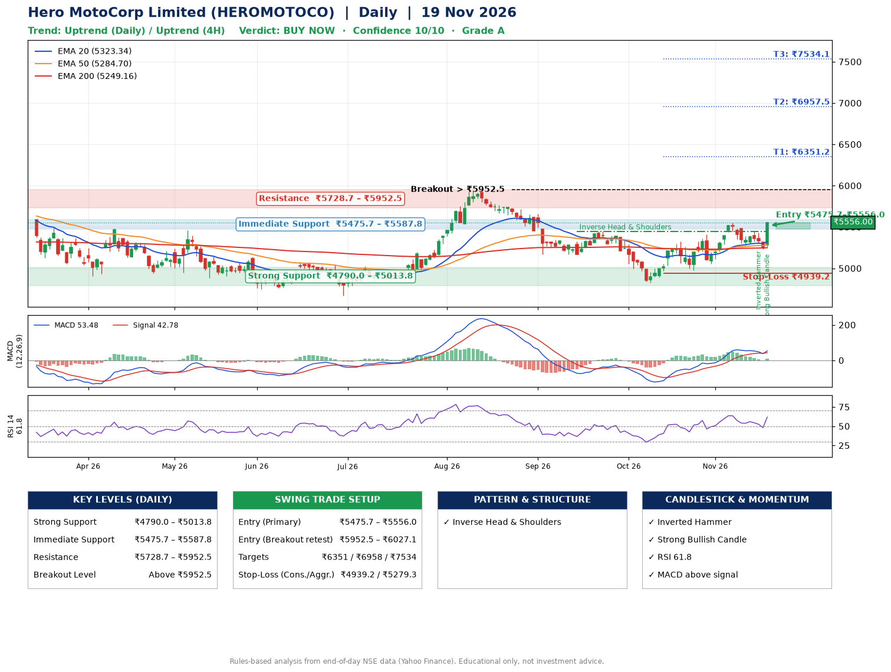

📌 **Hero MotoCorp Limited (HEROMOTOCO) – Multi-Timeframe Technical Analysis (Daily + 4H Combined)**
_Data up to 19 Nov 2026 · Close ₹5556.00_

**📍 Daily Timeframe Trend**
- Trend: **Uptrend** (higher highs and higher lows)
- Recent swing highs: ₹5937.0, ₹5448.5, ₹5550.0 · swing lows: ₹5166.0, ₹4825.0, ₹4976.5
- EMAs: EMA20 ₹5323.3, EMA50 ₹5284.7, EMA200 ₹5249.2; bullish stack (EMA20 > EMA50 > EMA200); price above EMA20, EMA50, EMA200
- MACD 53.48 above signal 42.78 (above zero), fresh bullish crossover; histogram rising
- RSI(14) 61.8; no divergence on the last two swings

**📍 4-Hour Timeframe Trend**
- Structure: **Uptrend** (price above rising EMAs)
- Pullback/support area: recent 4H swing lows ₹5054.0, ₹5288.5; EMA20 ₹5365.4
- EMA20/50: bullish stack (EMA20 > EMA50); price above EMA20, EMA50
- MACD 37.99 above signal 32.59 (above zero), fresh bullish crossover; histogram rising
- RSI(14) 65.1; Hidden bullish divergence

**📍 Pattern Detection (Both Timeframes)**
- Daily: **Inverse Head & Shoulders** – head ₹4825.0, neckline ₹5448.5
- 4H: **Ascending Triangle** – converging swing highs and lows over the last ~60 sessions

**📍 Candlestick Patterns (last 3 daily candles)**
- **Inverted Hammer** – 17 Nov: long upper wick shows selling near ₹5431.5
- **Strong Bullish Candle** – 19 Nov: wide-range green candle, buyers in control

**📍 Price Action Key Levels (Daily Structure)**

| Zone | Price Level (₹) | Context |
|------|-----------------|---------|
| Strong Support | ₹4790.0 – ₹5013.8 | Cluster of earlier swing lows (demand) |
| Immediate Support | ₹5475.7 – ₹5587.8 | Nearest swing-low / wick area |
| Resistance | ₹5728.7 – ₹5952.5 | Nearest swing-high supply |
| Breakout Level | Above ₹5952.5 | Swing continuation trigger (52-week high ₹6388.5) |

**📍 Swing Trade Setup**

🟢 **Entry Zone**
- Primary: ₹5475.7 – ₹5556.0 (daily support / EMA20 area; enter on a bullish 4H candle)
- Alternate: ₹5952.5 – ₹6027.1 (breakout retest)

🎯 **Profit Targets**
- T1: ₹6351.2
- T2: ₹6957.5
- T3: ₹7534.1

🛑 **Stop-Loss**
- Conservative: below daily swing low (₹4939.2)
- Aggressive: below 4H structure (₹5279.3)
- Risk per share ≈ ₹576.7; reward:risk to T1 ≈ 1.4
- Time to T1: about 34 trading days (it rose this much within 60 trading days 47% of the time in the last 2 years)
- Time to T2: about 43 trading days (it rose this much within 60 trading days 10% of the time in the last 2 years)

**📌 Strategy Notes**
- Higher timeframe: daily trend is uptrend; only take longs while price holds above ₹4790.0.
- Entry timing: wait for a bullish 4H candle (engulfing/hammer) inside ₹5475.7 – ₹5556.0 rather than buying mid-range.
- EMA stacking: bullish stack (EMA20 > EMA50 > EMA200); price above EMA20, EMA50, EMA200.
- Breakout rule: a daily close above ₹5952.5 with volume above its 20-day average (≈615,731) opens T2/T3.
- Momentum: RSI 62 – room to run; no divergence on the last two swings.
- Exit discipline: move the stop to entry once T1 is hit; book partial profits at each target.

**STEP 2 — Marked Up Chart**

**✅ Trade Validation Checklist**
- Trend + momentum aligned: Yes · Price at entry zone: Yes
- Stop defined (₹4939.2) · Reward:risk ≥ 1.5 to T1: No

## 📌 Final Verdict

Recommendation: **🟢 BUY NOW**

Confidence: **10/10**

Trade Quality: **A**

Reason:
• Daily uptrend (higher highs and higher lows)
• EMAs stacked bullishly

Next Action:
• Buy now within the entry zone, with the stop-loss in place

_Rules-based analysis from end-of-day data. Educational only, not investment advice. Never place orders without your own confirmation._