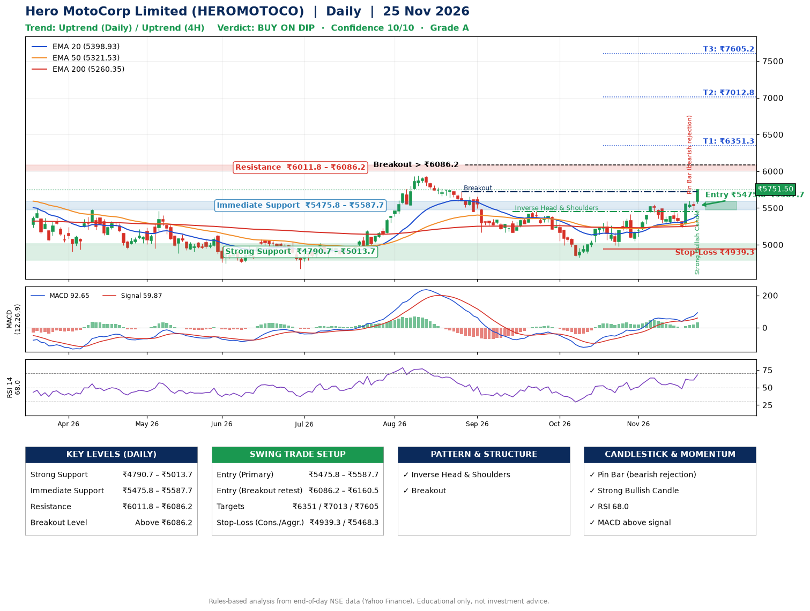

📌 **Hero MotoCorp Limited (HEROMOTOCO) – Multi-Timeframe Technical Analysis (Daily + 4H Combined)**
_Data up to 25 Nov 2026 · Close ₹5751.50_

**📍 Daily Timeframe Trend**
- Trend: **Uptrend** (higher highs and higher lows)
- Recent swing highs: ₹5937.0, ₹5448.5, ₹5550.0 · swing lows: ₹5166.0, ₹4825.0, ₹4976.5
- EMAs: EMA20 ₹5398.9, EMA50 ₹5321.5, EMA200 ₹5260.3; bullish stack (EMA20 > EMA50 > EMA200); price above EMA20, EMA50, EMA200
- MACD 92.65 above signal 59.87 (above zero), fresh bullish crossover; histogram rising
- RSI(14) 68.0; no divergence on the last two swings

**📍 4-Hour Timeframe Trend**
- Structure: **Uptrend** (higher highs and higher lows)
- Pullback/support area: recent 4H swing lows ₹5236.0, ₹5477.5; EMA20 ₹5470.9
- EMA20/50: bullish stack (EMA20 > EMA50); price above EMA20, EMA50
- MACD 86.15 above signal 58.12 (above zero); histogram rising
- RSI(14) 73.5; no divergence

**📍 Pattern Detection (Both Timeframes)**
- Daily: **Inverse Head & Shoulders** – head ₹4825.0, neckline ₹5448.5
- Daily: **Breakout** – closed above the 60-session high ₹5720.0 on strong volume
- 4H: **Ascending Triangle** – converging swing highs and lows over the last ~60 sessions

**📍 Candlestick Patterns (last 3 daily candles)**
- **Pin Bar (bearish rejection)** – 20 Nov: long upper wick shows selling near ₹5596.0
- **Strong Bullish Candle** – 25 Nov: wide-range green candle, buyers in control

**📍 Price Action Key Levels (Daily Structure)**

| Zone | Price Level (₹) | Context |
|------|-----------------|---------|
| Strong Support | ₹4790.7 – ₹5013.7 | Cluster of earlier swing lows (demand) |
| Immediate Support | ₹5475.8 – ₹5587.7 | Nearest swing-low / wick area |
| Resistance | ₹6011.8 – ₹6086.2 | Nearest swing-high supply |
| Breakout Level | Above ₹6086.2 | Swing continuation trigger (52-week high ₹6388.5) |

**📍 Swing Trade Setup**

🟢 **Entry Zone**
- Primary: ₹5475.8 – ₹5587.7 (daily support / EMA20 area; enter on a bullish 4H candle)
- Alternate: ₹6086.2 – ₹6160.5 (breakout retest)

🎯 **Profit Targets**
- T1: ₹6351.3
- T2: ₹7012.8
- T3: ₹7605.2

🛑 **Stop-Loss**
- Conservative: below daily swing low (₹4939.3)
- Aggressive: below 4H structure (₹5468.3)
- Risk per share ≈ ₹592.4; reward:risk to T1 ≈ 1.4
- Time to T1: about 35 trading days (it rose this much within 60 trading days 48% of the time in the last 2 years)
- Time to T2: about 43 trading days (it rose this much within 60 trading days 9% of the time in the last 2 years)

**📌 Strategy Notes**
- Higher timeframe: daily trend is uptrend; only take longs while price holds above ₹4790.7.
- Entry timing: wait for a bullish 4H candle (engulfing/hammer) inside ₹5475.8 – ₹5587.7 rather than buying mid-range.
- EMA stacking: bullish stack (EMA20 > EMA50 > EMA200); price above EMA20, EMA50, EMA200.
- Breakout rule: a daily close above ₹6086.2 with volume above its 20-day average (≈669,676) opens T2/T3.
- Momentum: RSI 68 – elevated, prefer dips; no divergence on the last two swings.
- Exit discipline: move the stop to entry once T1 is hit; book partial profits at each target.

**STEP 2 — Marked Up Chart**

**✅ Trade Validation Checklist**
- Trend + momentum aligned: Yes · Price at entry zone: No
- Stop defined (₹4939.3) · Reward:risk ≥ 1.5 to T1: No

## 📌 Final Verdict

Recommendation: **🟡 BUY ON DIP**

Confidence: **10/10**

Trade Quality: **A**

Reason:
• Daily uptrend (higher highs and higher lows)
• EMAs stacked bullishly

Next Action:
• Wait for a pullback to ₹5475.8–₹5587.7, or a breakout above ₹6086.2

_Rules-based analysis from end-of-day data. Educational only, not investment advice. Never place orders without your own confirmation._