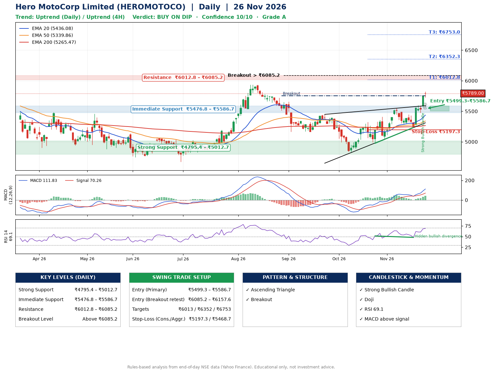

📌 **Hero MotoCorp Limited (HEROMOTOCO) – Multi-Timeframe Technical Analysis (Daily + 4H Combined)**
_Data up to 26 Nov 2026 · Close ₹5789.00_

**📍 Daily Timeframe Trend**
- Trend: **Uptrend** (higher highs and higher lows)
- Recent swing highs: ₹5937.0, ₹5448.5, ₹5550.0 · swing lows: ₹4825.0, ₹4976.5, ₹5233.5
- EMAs: EMA20 ₹5436.1, EMA50 ₹5339.9, EMA200 ₹5265.5; bullish stack (EMA20 > EMA50 > EMA200); price above EMA20, EMA50, EMA200
- MACD 111.83 above signal 70.26 (above zero), fresh bullish crossover; histogram rising
- RSI(14) 69.1; Hidden bullish divergence

**📍 4-Hour Timeframe Trend**
- Structure: **Uptrend** (higher highs and higher lows)
- Pullback/support area: recent 4H swing lows ₹5236.0, ₹5477.5; EMA20 ₹5527.0
- EMA20/50: bullish stack (EMA20 > EMA50); price above EMA20, EMA50
- MACD 109.80 above signal 75.02 (above zero); histogram rising
- RSI(14) 75.0; no divergence

**📍 Pattern Detection (Both Timeframes)**
- Daily: **Ascending Triangle** – converging swing highs and lows over the last ~60 sessions
- Daily: **Breakout** – closed above the 60-session high ₹5751.5 (volume not confirming yet)
- 4H: **Ascending Triangle** – converging swing highs and lows over the last ~60 sessions

**📍 Candlestick Patterns (last 3 daily candles)**
- **Strong Bullish Candle** – 25 Nov: wide-range green candle, buyers in control
- **Doji** – 26 Nov: indecision; wait for the next candle to confirm direction

**📍 Price Action Key Levels (Daily Structure)**

| Zone | Price Level (₹) | Context |
|------|-----------------|---------|
| Strong Support | ₹4795.4 – ₹5012.7 | Cluster of earlier swing lows (demand) |
| Immediate Support | ₹5476.8 – ₹5586.7 | Nearest swing-low / wick area |
| Resistance | ₹6012.8 – ₹6085.2 | Nearest swing-high supply |
| Breakout Level | Above ₹6085.2 | Swing continuation trigger (52-week high ₹6388.5) |

**📍 Swing Trade Setup**

🟢 **Entry Zone**
- Primary: ₹5499.3 – ₹5586.7 (daily support / EMA20 area; enter on a bullish 4H candle)
- Alternate: ₹6085.2 – ₹6157.6 (breakout retest)

🎯 **Profit Targets**
- T1: ₹6012.8
- T2: ₹6352.3
- T3: ₹6753.0

🛑 **Stop-Loss**
- Conservative: below daily swing low (₹5197.3)
- Aggressive: below 4H structure (₹5468.7)
- Risk per share ≈ ₹345.7; reward:risk to T1 ≈ 1.4
- Time to T1: about 22 trading days (it rose this much within 60 trading days 62% of the time in the last 2 years)
- Time to T2: about 34 trading days (it rose this much within 60 trading days 49% of the time in the last 2 years)

**📌 Strategy Notes**
- Higher timeframe: daily trend is uptrend; only take longs while price holds above ₹4795.4.
- Entry timing: wait for a bullish 4H candle (engulfing/hammer) inside ₹5499.3 – ₹5586.7 rather than buying mid-range.
- EMA stacking: bullish stack (EMA20 > EMA50 > EMA200); price above EMA20, EMA50, EMA200.
- Breakout rule: a daily close above ₹6085.2 with volume above its 20-day average (≈665,755) opens T2/T3.
- Momentum: RSI 69 – elevated, prefer dips; Hidden bullish divergence.
- Exit discipline: move the stop to entry once T1 is hit; book partial profits at each target.

**STEP 2 — Marked Up Chart**

**✅ Trade Validation Checklist**
- Trend + momentum aligned: Yes · Price at entry zone: No
- Stop defined (₹5197.3) · Reward:risk ≥ 1.5 to T1: No

## 📌 Final Verdict

Recommendation: **🟡 BUY ON DIP**

Confidence: **10/10**

Trade Quality: **A**

Reason:
• Daily uptrend (higher highs and higher lows)
• EMAs stacked bullishly

Next Action:
• Wait for a pullback to ₹5499.3–₹5586.7

_Rules-based analysis from end-of-day data. Educational only, not investment advice. Never place orders without your own confirmation._