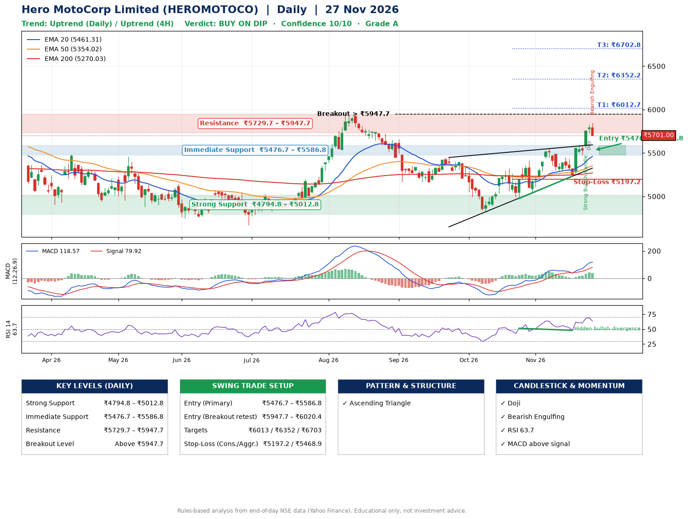

📌 **Hero MotoCorp Limited (HEROMOTOCO) – Multi-Timeframe Technical Analysis (Daily + 4H Combined)**
_Data up to 27 Nov 2026 · Close ₹5701.00_

**📍 Daily Timeframe Trend**
- Trend: **Uptrend** (higher highs and higher lows)
- Recent swing highs: ₹5937.0, ₹5448.5, ₹5550.0 · swing lows: ₹4825.0, ₹4976.5, ₹5233.5
- EMAs: EMA20 ₹5461.3, EMA50 ₹5354.0, EMA200 ₹5270.0; bullish stack (EMA20 > EMA50 > EMA200); price above EMA20, EMA50, EMA200
- MACD 118.57 above signal 79.92 (above zero); histogram falling
- RSI(14) 63.7; Hidden bullish divergence

**📍 4-Hour Timeframe Trend**
- Structure: **Uptrend** (higher highs and higher lows)
- Pullback/support area: recent 4H swing lows ₹5236.0, ₹5477.5; EMA20 ₹5563.1
- EMA20/50: bullish stack (EMA20 > EMA50); price above EMA20, EMA50
- MACD 111.86 above signal 88.65 (above zero); histogram falling
- RSI(14) 65.2; no divergence

**📍 Pattern Detection (Both Timeframes)**
- Daily: **Ascending Triangle** – converging swing highs and lows over the last ~60 sessions
- 4H: **Ascending Triangle** – converging swing highs and lows over the last ~60 sessions

**📍 Candlestick Patterns (last 3 daily candles)**
- **Strong Bullish Candle** – 25 Nov: wide-range green candle, buyers in control
- **Doji** – 26 Nov: indecision; wait for the next candle to confirm direction
- **Bearish Engulfing** – 27 Nov: sellers fully reversed the prior green candle

**📍 Price Action Key Levels (Daily Structure)**

| Zone | Price Level (₹) | Context |
|------|-----------------|---------|
| Strong Support | ₹4794.8 – ₹5012.8 | Cluster of earlier swing lows (demand) |
| Immediate Support | ₹5476.7 – ₹5586.8 | Nearest swing-low / wick area |
| Resistance | ₹5729.7 – ₹5947.7 | Nearest swing-high supply |
| Breakout Level | Above ₹5947.7 | Swing continuation trigger (52-week high ₹6388.5) |

**📍 Swing Trade Setup**

🟢 **Entry Zone**
- Primary: ₹5476.7 – ₹5586.8 (daily support / EMA20 area; enter on a bullish 4H candle)
- Alternate: ₹5947.7 – ₹6020.4 (breakout retest)

🎯 **Profit Targets**
- T1: ₹6012.7
- T2: ₹6352.2
- T3: ₹6702.8

🛑 **Stop-Loss**
- Conservative: below daily swing low (₹5197.2)
- Aggressive: below 4H structure (₹5468.9)
- Risk per share ≈ ₹334.6; reward:risk to T1 ≈ 1.4
- Time to T1: about 24 trading days (it rose this much within 60 trading days 61% of the time in the last 2 years)
- Time to T2: about 35 trading days (it rose this much within 60 trading days 48% of the time in the last 2 years)

**📌 Strategy Notes**
- Higher timeframe: daily trend is uptrend; only take longs while price holds above ₹4794.8.
- Entry timing: wait for a bullish 4H candle (engulfing/hammer) inside ₹5476.7 – ₹5586.8 rather than buying mid-range.
- EMA stacking: bullish stack (EMA20 > EMA50 > EMA200); price above EMA20, EMA50, EMA200.
- Breakout rule: a daily close above ₹5947.7 with volume above its 20-day average (≈691,223) opens T2/T3.
- Momentum: RSI 64 – room to run; Hidden bullish divergence.
- Exit discipline: move the stop to entry once T1 is hit; book partial profits at each target.

**STEP 2 — Marked Up Chart**

**✅ Trade Validation Checklist**
- Trend + momentum aligned: Yes · Price at entry zone: No
- Stop defined (₹5197.2) · Reward:risk ≥ 1.5 to T1: No

## 📌 Final Verdict

Recommendation: **🟡 BUY ON DIP**

Confidence: **10/10**

Trade Quality: **A**

Reason:
• Daily uptrend (higher highs and higher lows)
• EMAs stacked bullishly

Next Action:
• Wait for a pullback to ₹5476.7–₹5586.8, or a breakout above ₹5947.7

_Rules-based analysis from end-of-day data. Educational only, not investment advice. Never place orders without your own confirmation._