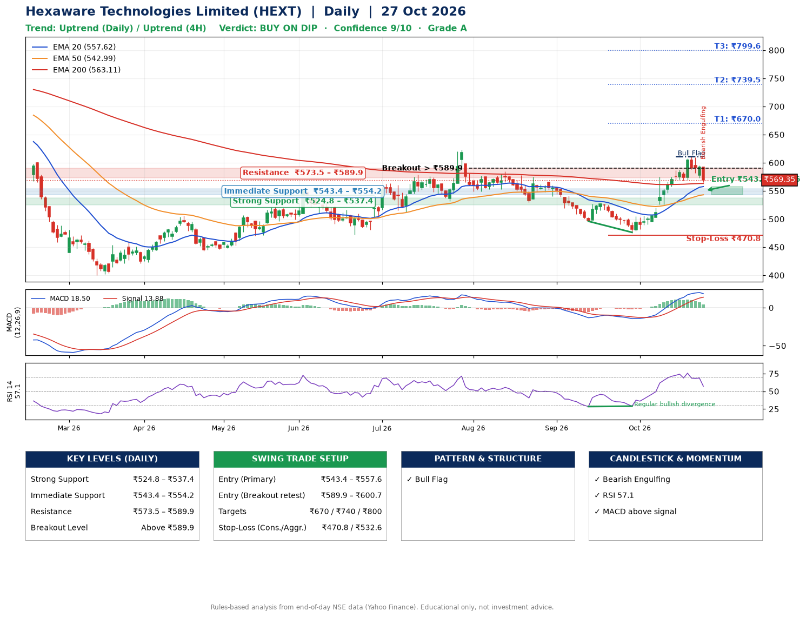

📌 **Hexaware Technologies Limited (HEXT) – Multi-Timeframe Technical Analysis (Daily + 4H Combined)**
_Data up to 27 Oct 2026 · Close ₹569.35_

**📍 Daily Timeframe Trend**
- Trend: **Uptrend** (price above rising EMAs)
- Recent swing highs: ₹622.8, ₹584.5, ₹528.0 · swing lows: ₹530.2, ₹496.0, ₹476.2
- EMAs: EMA20 ₹557.6, EMA50 ₹543.0, EMA200 ₹563.1; mixed / crossing; price above EMA20, EMA50, EMA200
- MACD 18.50 above signal 13.88 (above zero); histogram falling
- RSI(14) 57.1; Regular bullish divergence

**📍 4-Hour Timeframe Trend**
- Structure: **Uptrend** (higher highs and higher lows)
- Pullback/support area: recent 4H swing lows ₹476.4, ₹568.0; EMA20 ₹574.6
- EMA20/50: bullish stack (EMA20 > EMA50); price above EMA50
- MACD 13.00 below signal 17.25 (above zero), fresh bearish crossover; histogram falling
- RSI(14) 51.0; Regular bearish divergence

**📍 Pattern Detection (Both Timeframes)**
- Daily: **Bull Flag** – 15% pole then a tight 8% flag; trigger above ₹610.2
- 4H: **Bull Flag** – 20% pole then a tight 8% flag; trigger above ₹609.7

**📍 Candlestick Patterns (last 3 daily candles)**
- **Bearish Engulfing** – 27 Oct: sellers fully reversed the prior green candle

**📍 Price Action Key Levels (Daily Structure)**

| Zone | Price Level (₹) | Context |
|------|-----------------|---------|
| Strong Support | ₹524.8 – ₹537.4 | Cluster of earlier swing lows (demand) |
| Immediate Support | ₹543.4 – ₹554.2 | Nearest swing-low / wick area |
| Resistance | ₹573.5 – ₹589.9 | Nearest swing-high supply |
| Breakout Level | Above ₹589.9 | Swing continuation trigger (52-week high ₹807.8) |

**📍 Swing Trade Setup**

🟢 **Entry Zone**
- Primary: ₹543.4 – ₹557.6 (daily support / EMA20 area; enter on a bullish 4H candle)
- Alternate: ₹589.9 – ₹600.7 (breakout retest)

🎯 **Profit Targets**
- T1: ₹670.0
- T2: ₹739.5
- T3: ₹799.6

🛑 **Stop-Loss**
- Conservative: below daily swing low (₹470.8)
- Aggressive: below 4H structure (₹532.6)
- Risk per share ≈ ₹79.7; reward:risk to T1 ≈ 1.5

**📌 Strategy Notes**
- Higher timeframe: daily trend is uptrend; only take longs while price holds above ₹524.8.
- Entry timing: wait for a bullish 4H candle (engulfing/hammer) inside ₹543.4 – ₹557.6 rather than buying mid-range.
- EMA stacking: mixed / crossing; price above EMA20, EMA50, EMA200.
- Breakout rule: a daily close above ₹589.9 with volume above its 20-day average (≈2,078,648) opens T2/T3.
- Momentum: RSI 57 – room to run; Regular bullish divergence.
- Exit discipline: move the stop to entry once T1 is hit; book partial profits at each target.

**STEP 2 — Marked Up Chart**

**✅ Trade Validation Checklist**
- Trend + momentum aligned: Yes · Price at entry zone: No
- Stop defined (₹470.8) · Reward:risk ≥ 1.5 to T1: No

## 📌 Final Verdict

Recommendation: **🟡 BUY ON DIP**

Confidence: **9/10**

Trade Quality: **A**

Reason:
• Daily uptrend (price above rising EMAs)
• Bull Flag: 15% pole then a tight 8% flag; trigger above ₹610.2

Next Action:
• Wait for a pullback to ₹543.4–₹557.6, or a breakout above ₹589.9

_Rules-based analysis from end-of-day data. Educational only, not investment advice. Never place orders without your own confirmation._