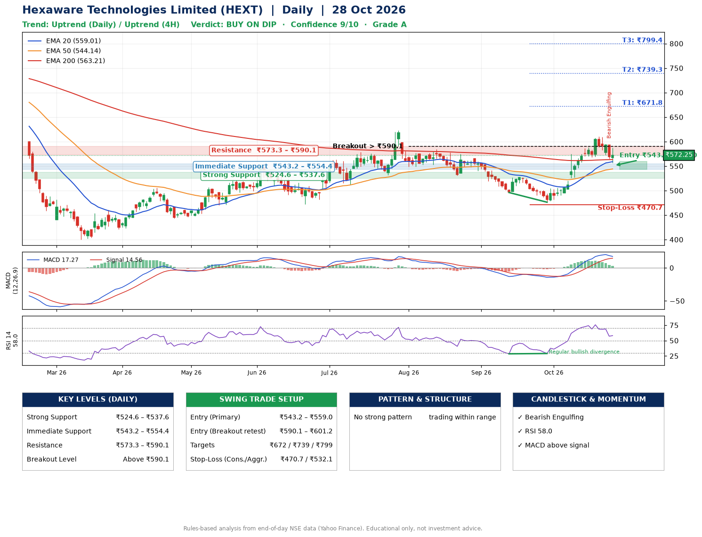

📌 **Hexaware Technologies Limited (HEXT) – Multi-Timeframe Technical Analysis (Daily + 4H Combined)**
_Data up to 28 Oct 2026 · Close ₹572.25_

**📍 Daily Timeframe Trend**
- Trend: **Uptrend** (price above rising EMAs)
- Recent swing highs: ₹622.8, ₹584.5, ₹528.0 · swing lows: ₹530.2, ₹496.0, ₹476.2
- EMAs: EMA20 ₹559.0, EMA50 ₹544.1, EMA200 ₹563.2; mixed / crossing; price above EMA20, EMA50, EMA200
- MACD 17.27 above signal 14.56 (above zero); histogram falling
- RSI(14) 58.0; Regular bullish divergence

**📍 4-Hour Timeframe Trend**
- Structure: **Uptrend** (higher highs and higher lows)
- Pullback/support area: recent 4H swing lows ₹476.4, ₹568.0; EMA20 ₹575.1
- EMA20/50: bullish stack (EMA20 > EMA50); price above EMA50
- MACD 10.46 below signal 15.07 (above zero); histogram falling
- RSI(14) 51.7; Regular bearish divergence

**📍 Pattern Detection (Both Timeframes)**
- No strong pattern detected. Trading within range.

**📍 Candlestick Patterns (last 3 daily candles)**
- **Bearish Engulfing** – 27 Oct: sellers fully reversed the prior green candle

**📍 Price Action Key Levels (Daily Structure)**

| Zone | Price Level (₹) | Context |
|------|-----------------|---------|
| Strong Support | ₹524.6 – ₹537.6 | Cluster of earlier swing lows (demand) |
| Immediate Support | ₹543.2 – ₹554.4 | Nearest swing-low / wick area |
| Resistance | ₹573.3 – ₹590.1 | Nearest swing-high supply |
| Breakout Level | Above ₹590.1 | Swing continuation trigger (52-week high ₹807.8) |

**📍 Swing Trade Setup**

🟢 **Entry Zone**
- Primary: ₹543.2 – ₹559.0 (daily support / EMA20 area; enter on a bullish 4H candle)
- Alternate: ₹590.1 – ₹601.2 (breakout retest)

🎯 **Profit Targets**
- T1: ₹671.8
- T2: ₹739.3
- T3: ₹799.4

🛑 **Stop-Loss**
- Conservative: below daily swing low (₹470.7)
- Aggressive: below 4H structure (₹532.1)
- Risk per share ≈ ₹80.4; reward:risk to T1 ≈ 1.5

**📌 Strategy Notes**
- Higher timeframe: daily trend is uptrend; only take longs while price holds above ₹524.6.
- Entry timing: wait for a bullish 4H candle (engulfing/hammer) inside ₹543.2 – ₹559.0 rather than buying mid-range.
- EMA stacking: mixed / crossing; price above EMA20, EMA50, EMA200.
- Breakout rule: a daily close above ₹590.1 with volume above its 20-day average (≈2,088,996) opens T2/T3.
- Momentum: RSI 58 – room to run; Regular bullish divergence.
- Exit discipline: move the stop to entry once T1 is hit; book partial profits at each target.

**STEP 2 — Marked Up Chart**

**✅ Trade Validation Checklist**
- Trend + momentum aligned: Yes · Price at entry zone: No
- Stop defined (₹470.7) · Reward:risk ≥ 1.5 to T1: Yes

## 📌 Final Verdict

Recommendation: **🟡 BUY ON DIP**

Confidence: **9/10**

Trade Quality: **A**

Reason:
• Daily uptrend (price above rising EMAs)

Next Action:
• Wait for a pullback to ₹543.2–₹559.0, or a breakout above ₹590.1

_Rules-based analysis from end-of-day data. Educational only, not investment advice. Never place orders without your own confirmation._