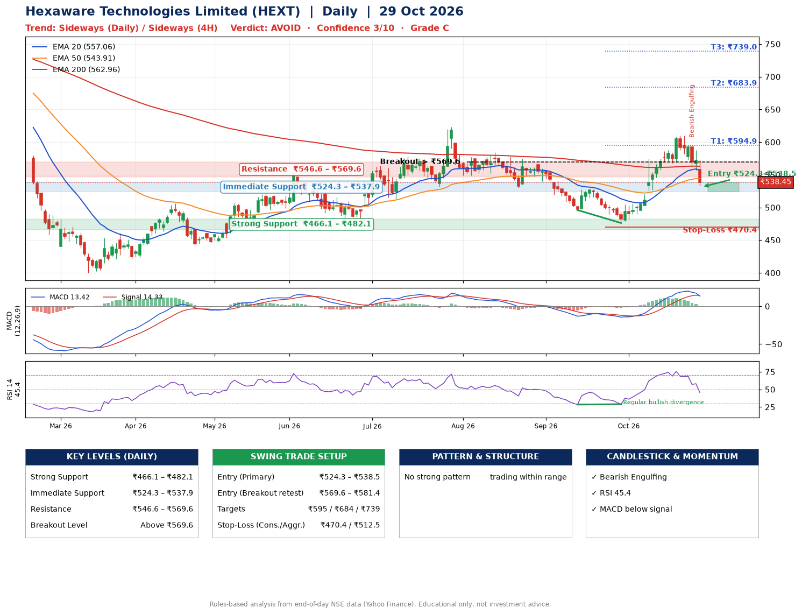

📌 **Hexaware Technologies Limited (HEXT) – Multi-Timeframe Technical Analysis (Daily + 4H Combined)**
_Data up to 29 Oct 2026 · Close ₹538.45_

**📍 Daily Timeframe Trend**
- Trend: **Sideways** (mixed swing structure)
- Recent swing highs: ₹584.5, ₹528.0, ₹610.2 · swing lows: ₹530.2, ₹496.0, ₹476.2
- EMAs: EMA20 ₹557.1, EMA50 ₹543.9, EMA200 ₹563.0; mixed / crossing; price below all EMAs
- MACD 13.42 below signal 14.33 (above zero), fresh bearish crossover; histogram falling
- RSI(14) 45.4; Regular bullish divergence

**📍 4-Hour Timeframe Trend**
- Structure: **Sideways** (mixed swing structure)
- Pullback/support area: recent 4H swing lows ₹476.4, ₹568.0; EMA20 ₹568.8
- EMA20/50: bullish stack (EMA20 > EMA50); price below all EMAs
- MACD 3.30 below signal 11.37 (above zero); histogram falling
- RSI(14) 38.0; Regular bearish divergence

**📍 Pattern Detection (Both Timeframes)**
- No strong pattern detected. Trading within range.

**📍 Candlestick Patterns (last 3 daily candles)**
- **Bearish Engulfing** – 27 Oct: sellers fully reversed the prior green candle

**📍 Price Action Key Levels (Daily Structure)**

| Zone | Price Level (₹) | Context |
|------|-----------------|---------|
| Strong Support | ₹466.1 – ₹482.1 | Cluster of earlier swing lows (demand) |
| Immediate Support | ₹524.3 – ₹537.9 | Nearest swing-low / wick area |
| Resistance | ₹546.6 – ₹569.6 | Nearest swing-high supply |
| Breakout Level | Above ₹569.6 | Swing continuation trigger (52-week high ₹807.8) |

**📍 Swing Trade Setup**

🟢 **Entry Zone**
- Primary: ₹524.3 – ₹538.5 (daily support / EMA20 area; enter on a bullish 4H candle)
- Alternate: ₹569.6 – ₹581.4 (breakout retest)

🎯 **Profit Targets**
- T1: ₹594.9
- T2: ₹683.9
- T3: ₹739.0

🛑 **Stop-Loss**
- Conservative: below daily swing low (₹470.4)
- Aggressive: below 4H structure (₹512.5)
- Risk per share ≈ ₹61.0; reward:risk to T1 ≈ 1.0

**📌 Strategy Notes**
- Higher timeframe: daily trend is sideways; only take longs while price holds above ₹466.1.
- Entry timing: wait for a bullish 4H candle (engulfing/hammer) inside ₹524.3 – ₹538.5 rather than buying mid-range.
- EMA stacking: mixed / crossing; price below all EMAs.
- Breakout rule: a daily close above ₹569.6 with volume above its 20-day average (≈2,125,142) opens T2/T3.
- Momentum: RSI 45 – room to run; Regular bullish divergence.
- Exit discipline: move the stop to entry once T1 is hit; book partial profits at each target.

**STEP 2 — Marked Up Chart**

**✅ Trade Validation Checklist**
- Trend + momentum aligned: No · Price at entry zone: Yes
- Stop defined (₹470.4) · Reward:risk ≥ 1.5 to T1: No

## 📌 Final Verdict

Recommendation: **🔴 AVOID**

Confidence: **3/10**

Trade Quality: **C**

Reason:
• Sharp pullback: 12% below the recent ₹610.2 high

Next Action:
• Avoid until the trend changes (reclaim EMA50 and a higher low)

_Rules-based analysis from end-of-day data. Educational only, not investment advice. Never place orders without your own confirmation._