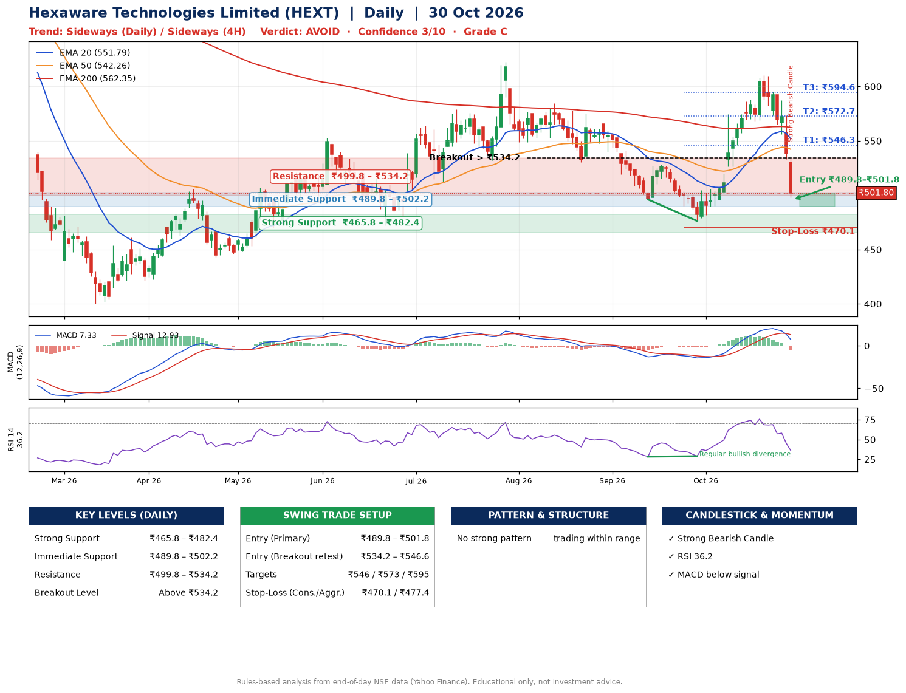

📌 **Hexaware Technologies Limited (HEXT) – Multi-Timeframe Technical Analysis (Daily + 4H Combined)**
_Data up to 30 Oct 2026 · Close ₹501.80_

**📍 Daily Timeframe Trend**
- Trend: **Sideways** (mixed swing structure)
- Recent swing highs: ₹584.5, ₹528.0, ₹610.2 · swing lows: ₹530.2, ₹496.0, ₹476.2
- EMAs: EMA20 ₹551.8, EMA50 ₹542.3, EMA200 ₹562.4; mixed / crossing; price below all EMAs
- MACD 7.33 below signal 12.93 (above zero), fresh bearish crossover; histogram falling
- RSI(14) 36.2; Regular bullish divergence

**📍 4-Hour Timeframe Trend**
- Structure: **Sideways** (mixed swing structure)
- Pullback/support area: recent 4H swing lows ₹476.4, ₹568.0; EMA20 ₹556.8
- EMA20/50: bullish stack (EMA20 > EMA50); price below all EMAs
- MACD -6.55 below signal 5.62 (below zero); histogram falling
- RSI(14) 28.6; Regular bearish divergence

**📍 Pattern Detection (Both Timeframes)**
- No strong pattern detected. Trading within range.

**📍 Candlestick Patterns (last 3 daily candles)**
- **Strong Bearish Candle** – 30 Oct: wide-range red candle, sellers in control

**📍 Price Action Key Levels (Daily Structure)**

| Zone | Price Level (₹) | Context |
|------|-----------------|---------|
| Strong Support | ₹465.8 – ₹482.4 | Cluster of earlier swing lows (demand) |
| Immediate Support | ₹489.8 – ₹502.2 | Nearest swing-low / wick area |
| Resistance | ₹499.8 – ₹534.2 | Nearest swing-high supply |
| Breakout Level | Above ₹534.2 | Swing continuation trigger (52-week high ₹807.8) |

**📍 Swing Trade Setup**

🟢 **Entry Zone**
- Primary: ₹489.8 – ₹501.8 (daily support / EMA20 area; enter on a bullish 4H candle)
- Alternate: ₹534.2 – ₹546.6 (breakout retest)

🎯 **Profit Targets**
- T1: ₹546.3
- T2: ₹572.7
- T3: ₹594.6

🛑 **Stop-Loss**
- Conservative: below daily swing low (₹470.1)
- Aggressive: below 4H structure (₹477.4)
- Risk per share ≈ ₹25.7; reward:risk to T1 ≈ 2.0

**📌 Strategy Notes**
- Higher timeframe: daily trend is sideways; only take longs while price holds above ₹465.8.
- Entry timing: wait for a bullish 4H candle (engulfing/hammer) inside ₹489.8 – ₹501.8 rather than buying mid-range.
- EMA stacking: mixed / crossing; price below all EMAs.
- Breakout rule: a daily close above ₹534.2 with volume above its 20-day average (≈2,182,080) opens T2/T3.
- Momentum: RSI 36 – room to run; Regular bullish divergence.
- Exit discipline: move the stop to entry once T1 is hit; book partial profits at each target.

**STEP 2 — Marked Up Chart**

**✅ Trade Validation Checklist**
- Trend + momentum aligned: No · Price at entry zone: Yes
- Stop defined (₹470.1) · Reward:risk ≥ 1.5 to T1: Yes

## 📌 Final Verdict

Recommendation: **🔴 AVOID**

Confidence: **3/10**

Trade Quality: **C**

Reason:
• Sharp pullback: 18% below the recent ₹610.2 high

Next Action:
• Avoid until the trend changes (reclaim EMA50 and a higher low)

_Rules-based analysis from end-of-day data. Educational only, not investment advice. Never place orders without your own confirmation._