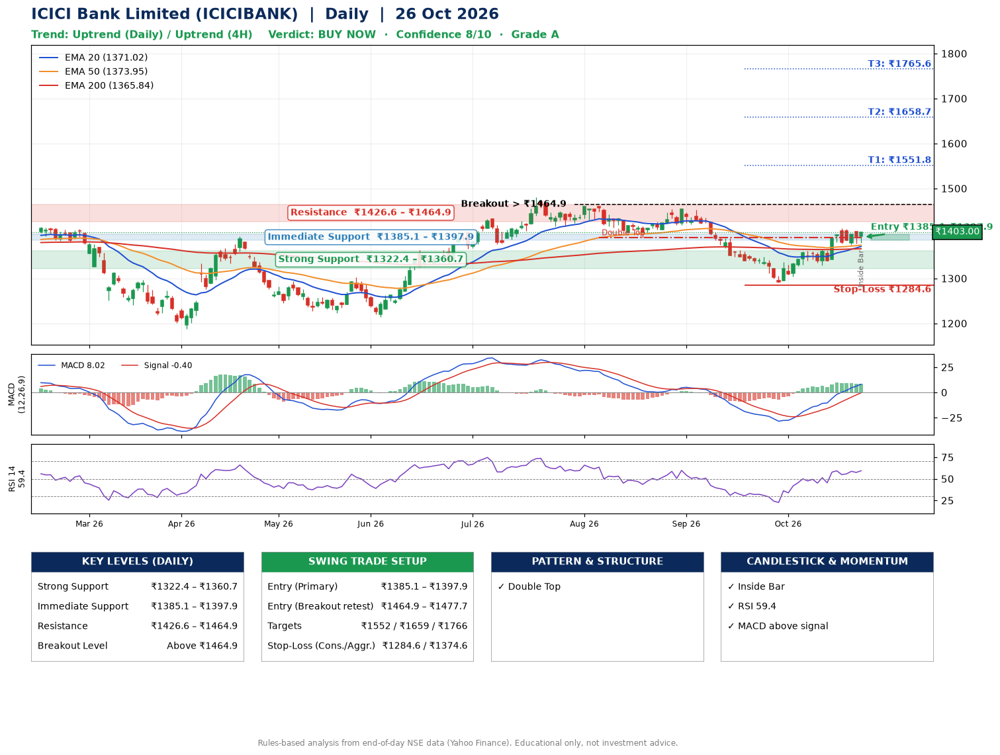

📌 **ICICI Bank Limited (ICICIBANK) – Multi-Timeframe Technical Analysis (Daily + 4H Combined)**
_Data up to 26 Oct 2026 · Close ₹1403.00_

**📍 Daily Timeframe Trend**
- Trend: **Uptrend** (price above rising EMAs)
- Recent swing highs: ₹1460.0, ₹1460.0, ₹1454.0 · swing lows: ₹1415.4, ₹1391.5, ₹1291.0
- EMAs: EMA20 ₹1371.0, EMA50 ₹1373.9, EMA200 ₹1365.8; mixed / crossing; price above EMA20, EMA50, EMA200
- MACD 8.02 above signal -0.40 (above zero); histogram falling
- RSI(14) 59.4; no divergence on the last two swings

**📍 4-Hour Timeframe Trend**
- Structure: **Uptrend** (price above rising EMAs)
- Pullback/support area: recent 4H swing lows ₹1329.5, ₹1376.3; EMA20 ₹1379.2
- EMA20/50: bullish stack (EMA20 > EMA50); price above EMA20, EMA50
- MACD 12.67 above signal 11.87 (above zero); histogram rising
- RSI(14) 61.7; no divergence

**📍 Pattern Detection (Both Timeframes)**
- Daily: **Double Top** – tops near ₹1460.0/₹1454.0, neckline ₹1391.5, forming

**📍 Candlestick Patterns (last 3 daily candles)**
- **Inside Bar** – 26 Oct: compression inside the prior range ₹1377.9–₹1404.5

**📍 Price Action Key Levels (Daily Structure)**

| Zone | Price Level (₹) | Context |
|------|-----------------|---------|
| Strong Support | ₹1322.4 – ₹1360.7 | Cluster of earlier swing lows (demand) |
| Immediate Support | ₹1385.1 – ₹1397.9 | Nearest swing-low / wick area |
| Resistance | ₹1426.6 – ₹1464.9 | Nearest swing-high supply |
| Breakout Level | Above ₹1464.9 | Swing continuation trigger (52-week high ₹1480.0) |

**📍 Swing Trade Setup**

🟢 **Entry Zone**
- Primary: ₹1385.1 – ₹1397.9 (daily support / EMA20 area; enter on a bullish 4H candle)
- Alternate: ₹1464.9 – ₹1477.7 (breakout retest)

🎯 **Profit Targets**
- T1: ₹1551.8
- T2: ₹1658.7
- T3: ₹1765.6

🛑 **Stop-Loss**
- Conservative: below daily swing low (₹1284.6)
- Aggressive: below 4H structure (₹1374.6)
- Risk per share ≈ ₹106.9; reward:risk to T1 ≈ 1.5

**📌 Strategy Notes**
- Higher timeframe: daily trend is uptrend; only take longs while price holds above ₹1322.4.
- Entry timing: wait for a bullish 4H candle (engulfing/hammer) inside ₹1385.1 – ₹1397.9 rather than buying mid-range.
- EMA stacking: mixed / crossing; price above EMA20, EMA50, EMA200.
- Breakout rule: a daily close above ₹1464.9 with volume above its 20-day average (≈12,481,466) opens T2/T3.
- Momentum: RSI 59 – room to run; no divergence on the last two swings.
- Exit discipline: move the stop to entry once T1 is hit; book partial profits at each target.

**STEP 2 — Marked Up Chart**

**✅ Trade Validation Checklist**
- Trend + momentum aligned: Yes · Price at entry zone: No
- Stop defined (₹1284.6) · Reward:risk ≥ 1.5 to T1: No

## 📌 Final Verdict

Recommendation: **🟢 BUY NOW**

Confidence: **8/10**

Trade Quality: **A**

Reason:
• Daily uptrend (price above rising EMAs)
• Double Top: tops near ₹1460.0/₹1454.0, neckline ₹1391.5, forming

Next Action:
• Buy now within the entry zone, with the stop-loss in place

_Rules-based analysis from end-of-day data. Educational only, not investment advice. Never place orders without your own confirmation._