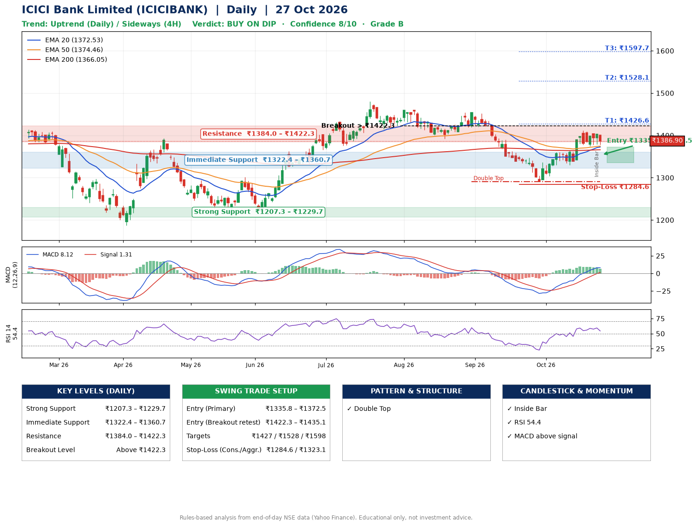

📌 **ICICI Bank Limited (ICICIBANK) – Multi-Timeframe Technical Analysis (Daily + 4H Combined)**
_Data up to 27 Oct 2026 · Close ₹1386.90_

**📍 Daily Timeframe Trend**
- Trend: **Uptrend** (price above rising EMAs)
- Recent swing highs: ₹1460.0, ₹1454.0, ₹1411.8 · swing lows: ₹1415.4, ₹1391.5, ₹1291.0
- EMAs: EMA20 ₹1372.5, EMA50 ₹1374.5, EMA200 ₹1366.1; mixed / crossing; price above EMA20, EMA50, EMA200
- MACD 8.12 above signal 1.31 (above zero); histogram falling
- RSI(14) 54.4; no divergence on the last two swings

**📍 4-Hour Timeframe Trend**
- Structure: **Sideways** (mixed swing structure)
- Pullback/support area: recent 4H swing lows ₹1329.5, ₹1376.3; EMA20 ₹1380.2
- EMA20/50: bullish stack (EMA20 > EMA50); price above EMA20, EMA50
- MACD 10.56 below signal 11.53 (above zero), fresh bearish crossover; histogram falling
- RSI(14) 54.4; no divergence

**📍 Pattern Detection (Both Timeframes)**
- Daily: **Double Top** – tops near ₹1454.0/₹1411.8, neckline ₹1291.0, forming

**📍 Candlestick Patterns (last 3 daily candles)**
- **Inside Bar** – 26 Oct: compression inside the prior range ₹1377.9–₹1404.5

**📍 Price Action Key Levels (Daily Structure)**

| Zone | Price Level (₹) | Context |
|------|-----------------|---------|
| Strong Support | ₹1207.3 – ₹1229.7 | Cluster of earlier swing lows (demand) |
| Immediate Support | ₹1322.4 – ₹1360.7 | Nearest swing-low / wick area |
| Resistance | ₹1384.0 – ₹1422.3 | Nearest swing-high supply |
| Breakout Level | Above ₹1422.3 | Swing continuation trigger (52-week high ₹1480.0) |

**📍 Swing Trade Setup**

🟢 **Entry Zone**
- Primary: ₹1335.8 – ₹1372.5 (daily support / EMA20 area; enter on a bullish 4H candle)
- Alternate: ₹1422.3 – ₹1435.1 (breakout retest)

🎯 **Profit Targets**
- T1: ₹1426.6
- T2: ₹1528.1
- T3: ₹1597.7

🛑 **Stop-Loss**
- Conservative: below daily swing low (₹1284.6)
- Aggressive: below 4H structure (₹1323.1)
- Risk per share ≈ ₹69.6; reward:risk to T1 ≈ 1.0

**📌 Strategy Notes**
- Higher timeframe: daily trend is uptrend; only take longs while price holds above ₹1207.3.
- Entry timing: wait for a bullish 4H candle (engulfing/hammer) inside ₹1335.8 – ₹1372.5 rather than buying mid-range.
- EMA stacking: mixed / crossing; price above EMA20, EMA50, EMA200.
- Breakout rule: a daily close above ₹1422.3 with volume above its 20-day average (≈12,733,298) opens T2/T3.
- Momentum: RSI 54 – room to run; no divergence on the last two swings.
- Exit discipline: move the stop to entry once T1 is hit; book partial profits at each target.

**STEP 2 — Marked Up Chart**

**✅ Trade Validation Checklist**
- Trend + momentum aligned: Yes · Price at entry zone: No
- Stop defined (₹1284.6) · Reward:risk ≥ 1.5 to T1: No

## 📌 Final Verdict

Recommendation: **🟡 BUY ON DIP**

Confidence: **8/10**

Trade Quality: **B**

Reason:
• Daily uptrend (price above rising EMAs)
• Double Top: tops near ₹1454.0/₹1411.8, neckline ₹1291.0, forming

Next Action:
• Wait for a pullback to ₹1335.8–₹1372.5, or a breakout above ₹1422.3

_Rules-based analysis from end-of-day data. Educational only, not investment advice. Never place orders without your own confirmation._