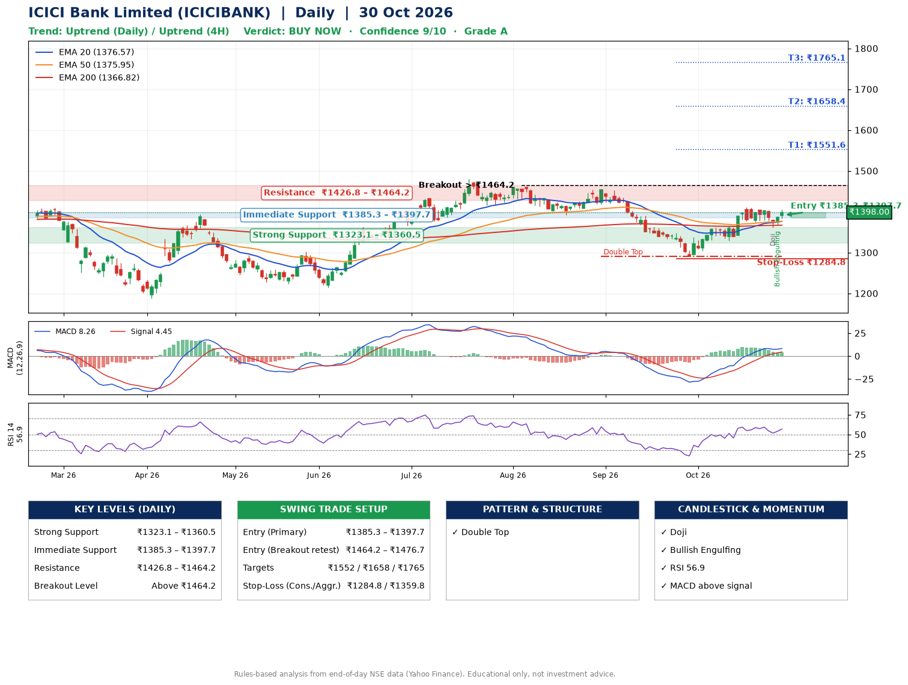

📌 **ICICI Bank Limited (ICICIBANK) – Multi-Timeframe Technical Analysis (Daily + 4H Combined)**
_Data up to 30 Oct 2026 · Close ₹1398.00_

**📍 Daily Timeframe Trend**
- Trend: **Uptrend** (price above rising EMAs)
- Recent swing highs: ₹1460.0, ₹1454.0, ₹1411.8 · swing lows: ₹1415.4, ₹1391.5, ₹1291.0
- EMAs: EMA20 ₹1376.6, EMA50 ₹1376.0, EMA200 ₹1366.8; bullish stack (EMA20 > EMA50 > EMA200); price above EMA20, EMA50, EMA200
- MACD 8.26 above signal 4.45 (above zero); histogram falling
- RSI(14) 56.9; no divergence on the last two swings

**📍 4-Hour Timeframe Trend**
- Structure: **Uptrend** (price above rising EMAs)
- Pullback/support area: recent 4H swing lows ₹1376.3, ₹1361.4; EMA20 ₹1383.9
- EMA20/50: bullish stack (EMA20 > EMA50); price above EMA20, EMA50
- MACD 7.88 below signal 8.61 (above zero); histogram rising
- RSI(14) 58.1; no divergence

**📍 Pattern Detection (Both Timeframes)**
- Daily: **Double Top** – tops near ₹1454.0/₹1411.8, neckline ₹1291.0, forming

**📍 Candlestick Patterns (last 3 daily candles)**
- **Doji** – 28 Oct: indecision; wait for the next candle to confirm direction
- **Bullish Engulfing** – 29 Oct: buyers fully reversed the prior red candle

**📍 Price Action Key Levels (Daily Structure)**

| Zone | Price Level (₹) | Context |
|------|-----------------|---------|
| Strong Support | ₹1323.1 – ₹1360.5 | Cluster of earlier swing lows (demand) |
| Immediate Support | ₹1385.3 – ₹1397.7 | Nearest swing-low / wick area |
| Resistance | ₹1426.8 – ₹1464.2 | Nearest swing-high supply |
| Breakout Level | Above ₹1464.2 | Swing continuation trigger (52-week high ₹1480.0) |

**📍 Swing Trade Setup**

🟢 **Entry Zone**
- Primary: ₹1385.3 – ₹1397.7 (daily support / EMA20 area; enter on a bullish 4H candle)
- Alternate: ₹1464.2 – ₹1476.7 (breakout retest)

🎯 **Profit Targets**
- T1: ₹1551.6
- T2: ₹1658.4
- T3: ₹1765.1

🛑 **Stop-Loss**
- Conservative: below daily swing low (₹1284.8)
- Aggressive: below 4H structure (₹1359.8)
- Risk per share ≈ ₹106.7; reward:risk to T1 ≈ 1.5

**📌 Strategy Notes**
- Higher timeframe: daily trend is uptrend; only take longs while price holds above ₹1323.1.
- Entry timing: wait for a bullish 4H candle (engulfing/hammer) inside ₹1385.3 – ₹1397.7 rather than buying mid-range.
- EMA stacking: bullish stack (EMA20 > EMA50 > EMA200); price above EMA20, EMA50, EMA200.
- Breakout rule: a daily close above ₹1464.2 with volume above its 20-day average (≈12,566,670) opens T2/T3.
- Momentum: RSI 57 – room to run; no divergence on the last two swings.
- Exit discipline: move the stop to entry once T1 is hit; book partial profits at each target.

**STEP 2 — Marked Up Chart**

**✅ Trade Validation Checklist**
- Trend + momentum aligned: Yes · Price at entry zone: No
- Stop defined (₹1284.8) · Reward:risk ≥ 1.5 to T1: No

## 📌 Final Verdict

Recommendation: **🟢 BUY NOW**

Confidence: **9/10**

Trade Quality: **A**

Reason:
• Daily uptrend (price above rising EMAs)
• EMAs stacked bullishly

Next Action:
• Buy now within the entry zone, with the stop-loss in place

_Rules-based analysis from end-of-day data. Educational only, not investment advice. Never place orders without your own confirmation._