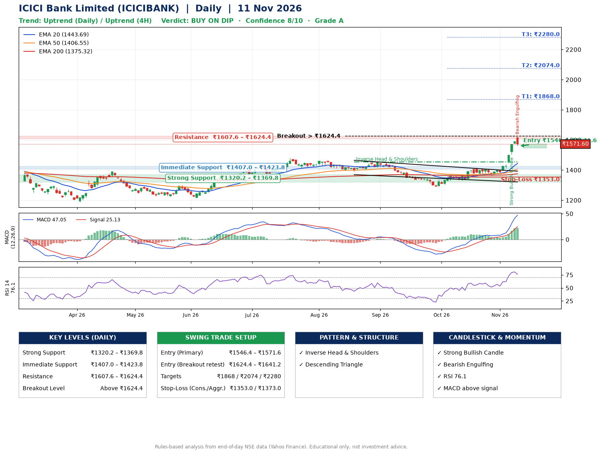

📌 **ICICI Bank Limited (ICICIBANK) – Multi-Timeframe Technical Analysis (Daily + 4H Combined)**
_Data up to 11 Nov 2026 · Close ₹1571.60_

**📍 Daily Timeframe Trend**
- Trend: **Uptrend** (price above rising EMAs)
- Recent swing highs: ₹1460.0, ₹1454.0, ₹1411.8 · swing lows: ₹1391.5, ₹1291.0, ₹1361.4
- EMAs: EMA20 ₹1443.7, EMA50 ₹1406.6, EMA200 ₹1375.3; bullish stack (EMA20 > EMA50 > EMA200); price above EMA20, EMA50, EMA200
- MACD 47.05 above signal 25.13 (above zero); histogram rising
- RSI(14) 76.1; no divergence on the last two swings

**📍 4-Hour Timeframe Trend**
- Structure: **Uptrend** (higher highs and higher lows)
- Pullback/support area: recent 4H swing lows ₹1361.4, ₹1375.2; EMA20 ₹1485.0
- EMA20/50: bullish stack (EMA20 > EMA50); price above EMA20, EMA50
- MACD 52.56 above signal 38.20 (above zero); histogram falling
- RSI(14) 78.3; no divergence

**📍 Pattern Detection (Both Timeframes)**
- Daily: **Inverse Head & Shoulders** – head ₹1291.0, neckline ₹1454.0
- Daily: **Descending Triangle** – converging swing highs and lows over the last ~60 sessions

**📍 Candlestick Patterns (last 3 daily candles)**
- **Strong Bullish Candle** – 06 Nov: wide-range green candle, buyers in control
- **Bearish Engulfing** – 11 Nov: sellers fully reversed the prior green candle

**📍 Price Action Key Levels (Daily Structure)**

| Zone | Price Level (₹) | Context |
|------|-----------------|---------|
| Strong Support | ₹1320.2 – ₹1369.8 | Cluster of earlier swing lows (demand) |
| Immediate Support | ₹1407.0 – ₹1423.8 | Nearest swing-low / wick area |
| Resistance | ₹1607.6 – ₹1624.4 | Nearest swing-high supply |
| Breakout Level | Above ₹1624.4 | Swing continuation trigger (52-week high ₹1616.0) |

**📍 Swing Trade Setup**

🟢 **Entry Zone**
- Primary: ₹1546.4 – ₹1571.6 (daily support / EMA20 area; enter on a bullish 4H candle)
- Alternate: ₹1624.4 – ₹1641.2 (breakout retest)

🎯 **Profit Targets**
- T1: ₹1868.0
- T2: ₹2074.0
- T3: ₹2280.0

🛑 **Stop-Loss**
- Conservative: below daily swing low (₹1353.0)
- Aggressive: below 4H structure (₹1373.0)
- Risk per share ≈ ₹206.0; reward:risk to T1 ≈ 1.5

**📌 Strategy Notes**
- Higher timeframe: daily trend is uptrend; only take longs while price holds above ₹1320.2.
- Entry timing: wait for a bullish 4H candle (engulfing/hammer) inside ₹1546.4 – ₹1571.6 rather than buying mid-range.
- EMA stacking: bullish stack (EMA20 > EMA50 > EMA200); price above EMA20, EMA50, EMA200.
- Breakout rule: a daily close above ₹1624.4 with volume above its 20-day average (≈17,258,239) opens T2/T3.
- Momentum: RSI 76 – elevated, prefer dips; no divergence on the last two swings.
- Exit discipline: move the stop to entry once T1 is hit; book partial profits at each target.

**STEP 2 — Marked Up Chart**

**✅ Trade Validation Checklist**
- Trend + momentum aligned: Yes · Price at entry zone: Yes
- Stop defined (₹1353.0) · Reward:risk ≥ 1.5 to T1: Yes

## 📌 Final Verdict

Recommendation: **🟡 BUY ON DIP**

Confidence: **8/10**

Trade Quality: **A**

Reason:
• Daily uptrend (price above rising EMAs)
• EMAs stacked bullishly

Next Action:
• Wait for a pullback to ₹1546.4–₹1571.6, or a breakout above ₹1624.4

_Rules-based analysis from end-of-day data. Educational only, not investment advice. Never place orders without your own confirmation._