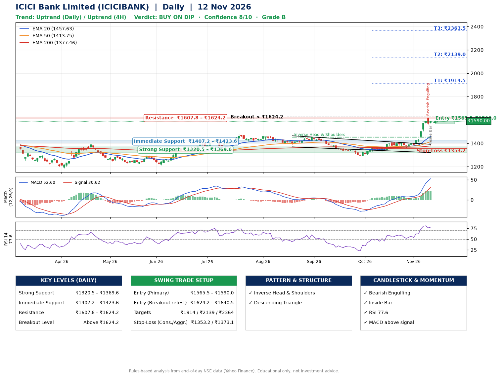

📌 **ICICI Bank Limited (ICICIBANK) – Multi-Timeframe Technical Analysis (Daily + 4H Combined)**
_Data up to 12 Nov 2026 · Close ₹1590.00_

**📍 Daily Timeframe Trend**
- Trend: **Uptrend** (price above rising EMAs)
- Recent swing highs: ₹1460.0, ₹1454.0, ₹1411.8 · swing lows: ₹1391.5, ₹1291.0, ₹1361.4
- EMAs: EMA20 ₹1457.6, EMA50 ₹1413.7, EMA200 ₹1377.5; bullish stack (EMA20 > EMA50 > EMA200); price above EMA20, EMA50, EMA200
- MACD 52.60 above signal 30.62 (above zero); histogram rising
- RSI(14) 77.6; no divergence on the last two swings

**📍 4-Hour Timeframe Trend**
- Structure: **Uptrend** (higher highs and higher lows)
- Pullback/support area: recent 4H swing lows ₹1361.4, ₹1375.2; EMA20 ₹1503.9
- EMA20/50: bullish stack (EMA20 > EMA50); price above EMA20, EMA50
- MACD 54.91 above signal 44.09 (above zero); histogram falling
- RSI(14) 80.2; no divergence

**📍 Pattern Detection (Both Timeframes)**
- Daily: **Inverse Head & Shoulders** – head ₹1291.0, neckline ₹1454.0
- Daily: **Descending Triangle** – converging swing highs and lows over the last ~60 sessions

**📍 Candlestick Patterns (last 3 daily candles)**
- **Bearish Engulfing** – 11 Nov: sellers fully reversed the prior green candle
- **Inside Bar** – 12 Nov: compression inside the prior range ₹1563.1–₹1616.0

**📍 Price Action Key Levels (Daily Structure)**

| Zone | Price Level (₹) | Context |
|------|-----------------|---------|
| Strong Support | ₹1320.5 – ₹1369.6 | Cluster of earlier swing lows (demand) |
| Immediate Support | ₹1407.2 – ₹1423.6 | Nearest swing-low / wick area |
| Resistance | ₹1607.8 – ₹1624.2 | Nearest swing-high supply |
| Breakout Level | Above ₹1624.2 | Swing continuation trigger (52-week high ₹1616.0) |

**📍 Swing Trade Setup**

🟢 **Entry Zone**
- Primary: ₹1565.5 – ₹1590.0 (daily support / EMA20 area; enter on a bullish 4H candle)
- Alternate: ₹1624.2 – ₹1640.5 (breakout retest)

🎯 **Profit Targets**
- T1: ₹1914.5
- T2: ₹2139.0
- T3: ₹2363.5

🛑 **Stop-Loss**
- Conservative: below daily swing low (₹1353.2)
- Aggressive: below 4H structure (₹1373.1)
- Risk per share ≈ ₹224.5; reward:risk to T1 ≈ 1.5
- Time to T1: about 54 trading days (it rose this much within 60 trading days 1% of the time in the last 2 years)
- Time to T2: it never rose this much within 60 trading days in the price history

**📌 Strategy Notes**
- Higher timeframe: daily trend is uptrend; only take longs while price holds above ₹1320.5.
- Entry timing: wait for a bullish 4H candle (engulfing/hammer) inside ₹1565.5 – ₹1590.0 rather than buying mid-range.
- EMA stacking: bullish stack (EMA20 > EMA50 > EMA200); price above EMA20, EMA50, EMA200.
- Breakout rule: a daily close above ₹1624.2 with volume above its 20-day average (≈17,781,923) opens T2/T3.
- Momentum: RSI 78 – elevated, prefer dips; no divergence on the last two swings.
- Exit discipline: move the stop to entry once T1 is hit; book partial profits at each target.

**STEP 2 — Marked Up Chart**

**✅ Trade Validation Checklist**
- Trend + momentum aligned: Yes · Price at entry zone: Yes
- Stop defined (₹1353.2) · Reward:risk ≥ 1.5 to T1: No

## 📌 Final Verdict

Recommendation: **🟡 BUY ON DIP**

Confidence: **8/10**

Trade Quality: **B**

Reason:
• Daily uptrend (price above rising EMAs)
• EMAs stacked bullishly

Next Action:
• Wait for a pullback to ₹1565.5–₹1590.0, or a breakout above ₹1624.2

_Rules-based analysis from end-of-day data. Educational only, not investment advice. Never place orders without your own confirmation._