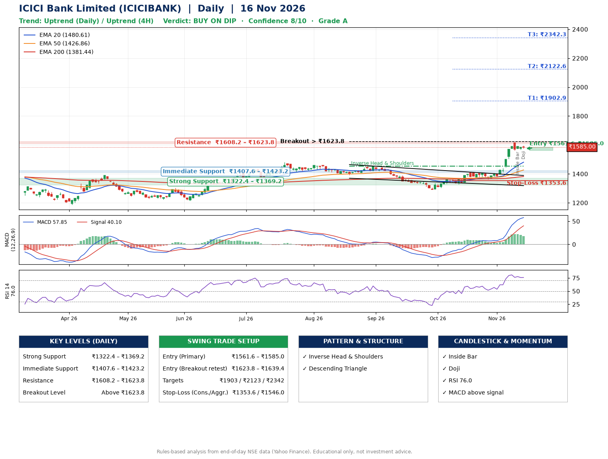

📌 **ICICI Bank Limited (ICICIBANK) – Multi-Timeframe Technical Analysis (Daily + 4H Combined)**
_Data up to 16 Nov 2026 · Close ₹1585.00_

**📍 Daily Timeframe Trend**
- Trend: **Uptrend** (price above rising EMAs)
- Recent swing highs: ₹1460.0, ₹1454.0, ₹1411.8 · swing lows: ₹1391.5, ₹1291.0, ₹1361.4
- EMAs: EMA20 ₹1480.6, EMA50 ₹1426.9, EMA200 ₹1381.4; bullish stack (EMA20 > EMA50 > EMA200); price above EMA20, EMA50, EMA200
- MACD 57.85 above signal 40.10 (above zero); histogram falling
- RSI(14) 76.0; no divergence on the last two swings

**📍 4-Hour Timeframe Trend**
- Structure: **Uptrend** (higher highs and higher lows)
- Pullback/support area: recent 4H swing lows ₹1564.0, ₹1566.2; EMA20 ₹1542.3
- EMA20/50: bullish stack (EMA20 > EMA50); price above EMA20, EMA50
- MACD 48.45 below signal 48.60 (above zero), fresh bearish crossover; histogram falling
- RSI(14) 74.0; Hidden bullish divergence

**📍 Pattern Detection (Both Timeframes)**
- Daily: **Inverse Head & Shoulders** – head ₹1291.0, neckline ₹1454.0
- Daily: **Descending Triangle** – converging swing highs and lows over the last ~60 sessions

**📍 Candlestick Patterns (last 3 daily candles)**
- **Inside Bar** – 12 Nov: compression inside the prior range ₹1563.1–₹1616.0
- **Doji** – 16 Nov: indecision; wait for the next candle to confirm direction

**📍 Price Action Key Levels (Daily Structure)**

| Zone | Price Level (₹) | Context |
|------|-----------------|---------|
| Strong Support | ₹1322.4 – ₹1369.2 | Cluster of earlier swing lows (demand) |
| Immediate Support | ₹1407.6 – ₹1423.2 | Nearest swing-low / wick area |
| Resistance | ₹1608.2 – ₹1623.8 | Nearest swing-high supply |
| Breakout Level | Above ₹1623.8 | Swing continuation trigger (52-week high ₹1616.0) |

**📍 Swing Trade Setup**

🟢 **Entry Zone**
- Primary: ₹1561.6 – ₹1585.0 (daily support / EMA20 area; enter on a bullish 4H candle)
- Alternate: ₹1623.8 – ₹1639.4 (breakout retest)

🎯 **Profit Targets**
- T1: ₹1902.9
- T2: ₹2122.6
- T3: ₹2342.3

🛑 **Stop-Loss**
- Conservative: below daily swing low (₹1353.6)
- Aggressive: below 4H structure (₹1546.0)
- Risk per share ≈ ₹219.7; reward:risk to T1 ≈ 1.5
- Time to T1: about 49 trading days (it rose this much within 60 trading days 1% of the time in the last 2 years)
- Time to T2: it never rose this much within 60 trading days in the price history

**📌 Strategy Notes**
- Higher timeframe: daily trend is uptrend; only take longs while price holds above ₹1322.4.
- Entry timing: wait for a bullish 4H candle (engulfing/hammer) inside ₹1561.6 – ₹1585.0 rather than buying mid-range.
- EMA stacking: bullish stack (EMA20 > EMA50 > EMA200); price above EMA20, EMA50, EMA200.
- Breakout rule: a daily close above ₹1623.8 with volume above its 20-day average (≈17,570,034) opens T2/T3.
- Momentum: RSI 76 – elevated, prefer dips; no divergence on the last two swings.
- Exit discipline: move the stop to entry once T1 is hit; book partial profits at each target.

**STEP 2 — Marked Up Chart**

**✅ Trade Validation Checklist**
- Trend + momentum aligned: Yes · Price at entry zone: Yes
- Stop defined (₹1353.6) · Reward:risk ≥ 1.5 to T1: Yes

## 📌 Final Verdict

Recommendation: **🟡 BUY ON DIP**

Confidence: **8/10**

Trade Quality: **A**

Reason:
• Daily uptrend (price above rising EMAs)
• EMAs stacked bullishly

Next Action:
• Wait for a pullback to ₹1561.6–₹1585.0, or a breakout above ₹1623.8

_Rules-based analysis from end-of-day data. Educational only, not investment advice. Never place orders without your own confirmation._