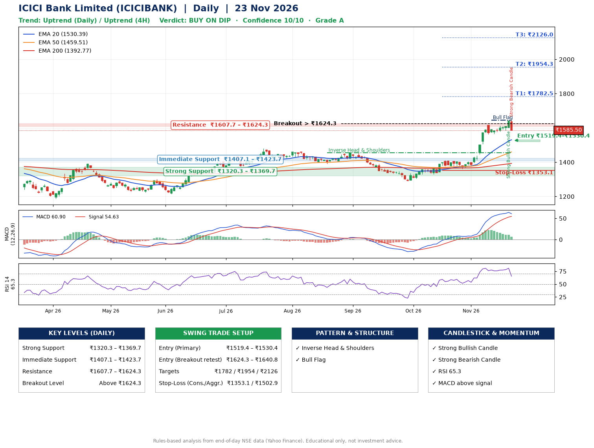

📌 **ICICI Bank Limited (ICICIBANK) – Multi-Timeframe Technical Analysis (Daily + 4H Combined)**
_Data up to 23 Nov 2026 · Close ₹1585.50_

**📍 Daily Timeframe Trend**
- Trend: **Uptrend** (higher highs and higher lows)
- Recent swing highs: ₹1454.0, ₹1411.8, ₹1616.0 · swing lows: ₹1391.5, ₹1291.0, ₹1361.4
- EMAs: EMA20 ₹1530.4, EMA50 ₹1459.5, EMA200 ₹1392.8; bullish stack (EMA20 > EMA50 > EMA200); price above EMA20, EMA50, EMA200
- MACD 60.90 above signal 54.63 (above zero); histogram falling
- RSI(14) 65.3; no divergence on the last two swings

**📍 4-Hour Timeframe Trend**
- Structure: **Uptrend** (higher highs and higher lows)
- Pullback/support area: recent 4H swing lows ₹1566.2, ₹1585.9; EMA20 ₹1578.3
- EMA20/50: bullish stack (EMA20 > EMA50); price above EMA20, EMA50
- MACD 36.11 below signal 42.42 (above zero); histogram falling
- RSI(14) 57.2; Hidden bullish divergence; Regular bearish divergence

**📍 Pattern Detection (Both Timeframes)**
- Daily: **Inverse Head & Shoulders** – head ₹1291.0, neckline ₹1454.0
- Daily: **Bull Flag** – 17% pole then a tight 5% flag; trigger above ₹1645.0
- 4H: **Bull Flag** – 15% pole then a tight 4% flag; trigger above ₹1645.0

**📍 Candlestick Patterns (last 3 daily candles)**
- **Strong Bullish Candle** – 20 Nov: wide-range green candle, buyers in control
- **Strong Bearish Candle** – 23 Nov: wide-range red candle, sellers in control

**📍 Price Action Key Levels (Daily Structure)**

| Zone | Price Level (₹) | Context |
|------|-----------------|---------|
| Strong Support | ₹1320.3 – ₹1369.7 | Cluster of earlier swing lows (demand) |
| Immediate Support | ₹1407.1 – ₹1423.7 | Nearest swing-low / wick area |
| Resistance | ₹1607.7 – ₹1624.3 | Nearest swing-high supply |
| Breakout Level | Above ₹1624.3 | Swing continuation trigger (52-week high ₹1645.0) |

**📍 Swing Trade Setup**

🟢 **Entry Zone**
- Primary: ₹1519.4 – ₹1530.4 (daily support / EMA20 area; enter on a bullish 4H candle)
- Alternate: ₹1624.3 – ₹1640.8 (breakout retest)

🎯 **Profit Targets**
- T1: ₹1782.5
- T2: ₹1954.3
- T3: ₹2126.0

🛑 **Stop-Loss**
- Conservative: below daily swing low (₹1353.1)
- Aggressive: below 4H structure (₹1502.9)
- Risk per share ≈ ₹171.8; reward:risk to T1 ≈ 1.5
- Time to T1: about 40 trading days (it rose this much within 60 trading days 9% of the time in the last 2 years)
- Time to T2: it never rose this much within 60 trading days in the price history

**📌 Strategy Notes**
- Higher timeframe: daily trend is uptrend; only take longs while price holds above ₹1320.3.
- Entry timing: wait for a bullish 4H candle (engulfing/hammer) inside ₹1519.4 – ₹1530.4 rather than buying mid-range.
- EMA stacking: bullish stack (EMA20 > EMA50 > EMA200); price above EMA20, EMA50, EMA200.
- Breakout rule: a daily close above ₹1624.3 with volume above its 20-day average (≈16,971,909) opens T2/T3.
- Momentum: RSI 65 – elevated, prefer dips; no divergence on the last two swings.
- Exit discipline: move the stop to entry once T1 is hit; book partial profits at each target.

**STEP 2 — Marked Up Chart**

**✅ Trade Validation Checklist**
- Trend + momentum aligned: Yes · Price at entry zone: No
- Stop defined (₹1353.1) · Reward:risk ≥ 1.5 to T1: No

## 📌 Final Verdict

Recommendation: **🟡 BUY ON DIP**

Confidence: **10/10**

Trade Quality: **A**

Reason:
• Daily uptrend (higher highs and higher lows)
• EMAs stacked bullishly

Next Action:
• Wait for a pullback to ₹1519.4–₹1530.4

_Rules-based analysis from end-of-day data. Educational only, not investment advice. Never place orders without your own confirmation._