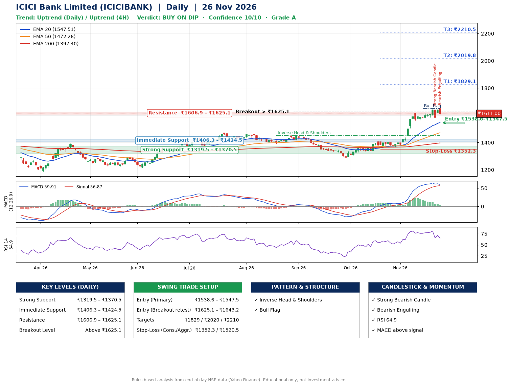

📌 **ICICI Bank Limited (ICICIBANK) – Multi-Timeframe Technical Analysis (Daily + 4H Combined)**
_Data up to 26 Nov 2026 · Close ₹1611.00_

**📍 Daily Timeframe Trend**
- Trend: **Uptrend** (higher highs and higher lows)
- Recent swing highs: ₹1454.0, ₹1411.8, ₹1616.0 · swing lows: ₹1391.5, ₹1291.0, ₹1361.4
- EMAs: EMA20 ₹1547.5, EMA50 ₹1472.3, EMA200 ₹1397.4; bullish stack (EMA20 > EMA50 > EMA200); price above EMA20, EMA50, EMA200
- MACD 59.91 above signal 56.87 (above zero); histogram falling
- RSI(14) 64.9; no divergence on the last two swings

**📍 4-Hour Timeframe Trend**
- Structure: **Uptrend** (price above rising EMAs)
- Pullback/support area: recent 4H swing lows ₹1585.9, ₹1585.5; EMA20 ₹1592.9
- EMA20/50: bullish stack (EMA20 > EMA50); price above EMA20, EMA50
- MACD 31.63 below signal 37.44 (above zero); histogram falling
- RSI(14) 58.7; Regular bearish divergence

**📍 Pattern Detection (Both Timeframes)**
- Daily: **Inverse Head & Shoulders** – head ₹1291.0, neckline ₹1454.0
- Daily: **Bull Flag** – 18% pole then a tight 5% flag; trigger above ₹1652.0
- 4H: **Double Top** – tops near ₹1613.7/₹1649.9, neckline ₹1579.1, forming
- 4H: **Bull Flag** – 16% pole then a tight 4% flag; trigger above ₹1649.9

**📍 Candlestick Patterns (last 3 daily candles)**
- **Strong Bearish Candle** – 23 Nov: wide-range red candle, sellers in control
- **Bearish Engulfing** – 26 Nov: sellers fully reversed the prior green candle

**📍 Price Action Key Levels (Daily Structure)**

| Zone | Price Level (₹) | Context |
|------|-----------------|---------|
| Strong Support | ₹1319.5 – ₹1370.5 | Cluster of earlier swing lows (demand) |
| Immediate Support | ₹1406.3 – ₹1424.5 | Nearest swing-low / wick area |
| Resistance | ₹1606.9 – ₹1625.1 | Nearest swing-high supply |
| Breakout Level | Above ₹1625.1 | Swing continuation trigger (52-week high ₹1652.0) |

**📍 Swing Trade Setup**

🟢 **Entry Zone**
- Primary: ₹1538.6 – ₹1547.5 (daily support / EMA20 area; enter on a bullish 4H candle)
- Alternate: ₹1625.1 – ₹1643.2 (breakout retest)

🎯 **Profit Targets**
- T1: ₹1829.1
- T2: ₹2019.8
- T3: ₹2210.5

🛑 **Stop-Loss**
- Conservative: below daily swing low (₹1352.3)
- Aggressive: below 4H structure (₹1520.5)
- Risk per share ≈ ₹190.7; reward:risk to T1 ≈ 1.5
- Time to T1: about 42 trading days (it rose this much within 60 trading days 6% of the time in the last 2 years)
- Time to T2: it never rose this much within 60 trading days in the price history

**📌 Strategy Notes**
- Higher timeframe: daily trend is uptrend; only take longs while price holds above ₹1319.5.
- Entry timing: wait for a bullish 4H candle (engulfing/hammer) inside ₹1538.6 – ₹1547.5 rather than buying mid-range.
- EMA stacking: bullish stack (EMA20 > EMA50 > EMA200); price above EMA20, EMA50, EMA200.
- Breakout rule: a daily close above ₹1625.1 with volume above its 20-day average (≈17,692,826) opens T2/T3.
- Momentum: RSI 65 – room to run; no divergence on the last two swings.
- Exit discipline: move the stop to entry once T1 is hit; book partial profits at each target.

**STEP 2 — Marked Up Chart**

**✅ Trade Validation Checklist**
- Trend + momentum aligned: Yes · Price at entry zone: No
- Stop defined (₹1352.3) · Reward:risk ≥ 1.5 to T1: No

## 📌 Final Verdict

Recommendation: **🟡 BUY ON DIP**

Confidence: **10/10**

Trade Quality: **A**

Reason:
• Daily uptrend (higher highs and higher lows)
• EMAs stacked bullishly

Next Action:
• Wait for a pullback to ₹1538.6–₹1547.5

_Rules-based analysis from end-of-day data. Educational only, not investment advice. Never place orders without your own confirmation._