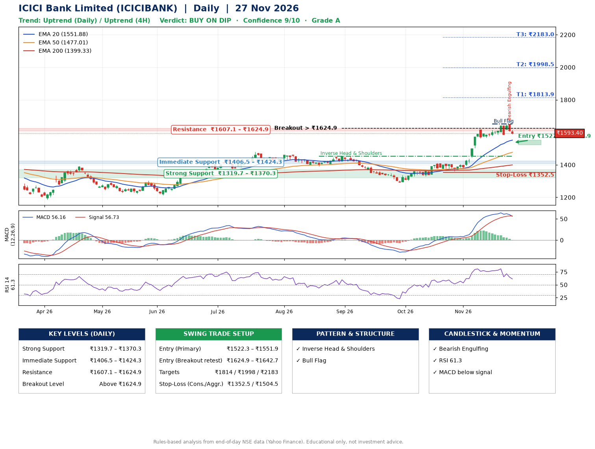

📌 **ICICI Bank Limited (ICICIBANK) – Multi-Timeframe Technical Analysis (Daily + 4H Combined)**
_Data up to 27 Nov 2026 · Close ₹1593.40_

**📍 Daily Timeframe Trend**
- Trend: **Uptrend** (higher highs and higher lows)
- Recent swing highs: ₹1454.0, ₹1411.8, ₹1616.0 · swing lows: ₹1391.5, ₹1291.0, ₹1361.4
- EMAs: EMA20 ₹1551.9, EMA50 ₹1477.0, EMA200 ₹1399.3; bullish stack (EMA20 > EMA50 > EMA200); price above EMA20, EMA50, EMA200
- MACD 56.16 below signal 56.73 (above zero), fresh bearish crossover; histogram falling
- RSI(14) 61.3; no divergence on the last two swings

**📍 4-Hour Timeframe Trend**
- Structure: **Uptrend** (price above rising EMAs)
- Pullback/support area: recent 4H swing lows ₹1585.9, ₹1585.5; EMA20 ₹1592.9
- EMA20/50: bullish stack (EMA20 > EMA50); price above EMA20, EMA50
- MACD 24.70 below signal 33.35 (above zero); histogram falling
- RSI(14) 54.0; Regular bearish divergence

**📍 Pattern Detection (Both Timeframes)**
- Daily: **Inverse Head & Shoulders** – head ₹1291.0, neckline ₹1454.0
- Daily: **Bull Flag** – 15% pole then a tight 5% flag; trigger above ₹1652.0
- 4H: **Double Top** – tops near ₹1613.7/₹1649.9, neckline ₹1579.1, forming
- 4H: **Bull Flag** – 15% pole then a tight 4% flag; trigger above ₹1649.9

**📍 Candlestick Patterns (last 3 daily candles)**
- **Bearish Engulfing** – 26 Nov: sellers fully reversed the prior green candle

**📍 Price Action Key Levels (Daily Structure)**

| Zone | Price Level (₹) | Context |
|------|-----------------|---------|
| Strong Support | ₹1319.7 – ₹1370.3 | Cluster of earlier swing lows (demand) |
| Immediate Support | ₹1406.5 – ₹1424.3 | Nearest swing-low / wick area |
| Resistance | ₹1607.1 – ₹1624.9 | Nearest swing-high supply |
| Breakout Level | Above ₹1624.9 | Swing continuation trigger (52-week high ₹1652.0) |

**📍 Swing Trade Setup**

🟢 **Entry Zone**
- Primary: ₹1522.3 – ₹1551.9 (daily support / EMA20 area; enter on a bullish 4H candle)
- Alternate: ₹1624.9 – ₹1642.7 (breakout retest)

🎯 **Profit Targets**
- T1: ₹1813.9
- T2: ₹1998.5
- T3: ₹2183.0

🛑 **Stop-Loss**
- Conservative: below daily swing low (₹1352.5)
- Aggressive: below 4H structure (₹1504.5)
- Risk per share ≈ ₹184.6; reward:risk to T1 ≈ 1.5
- Time to T1: about 41 trading days (it rose this much within 60 trading days 7% of the time in the last 2 years)
- Time to T2: it never rose this much within 60 trading days in the price history

**📌 Strategy Notes**
- Higher timeframe: daily trend is uptrend; only take longs while price holds above ₹1319.7.
- Entry timing: wait for a bullish 4H candle (engulfing/hammer) inside ₹1522.3 – ₹1551.9 rather than buying mid-range.
- EMA stacking: bullish stack (EMA20 > EMA50 > EMA200); price above EMA20, EMA50, EMA200.
- Breakout rule: a daily close above ₹1624.9 with volume above its 20-day average (≈17,591,557) opens T2/T3.
- Momentum: RSI 61 – room to run; no divergence on the last two swings.
- Exit discipline: move the stop to entry once T1 is hit; book partial profits at each target.

**STEP 2 — Marked Up Chart**

**✅ Trade Validation Checklist**
- Trend + momentum aligned: No · Price at entry zone: No
- Stop defined (₹1352.5) · Reward:risk ≥ 1.5 to T1: No

## 📌 Final Verdict

Recommendation: **🟡 BUY ON DIP**

Confidence: **9/10**

Trade Quality: **A**

Reason:
• Daily uptrend (higher highs and higher lows)
• EMAs stacked bullishly

Next Action:
• Wait for a pullback to ₹1522.3–₹1551.9, or a breakout above ₹1624.9

_Rules-based analysis from end-of-day data. Educational only, not investment advice. Never place orders without your own confirmation._