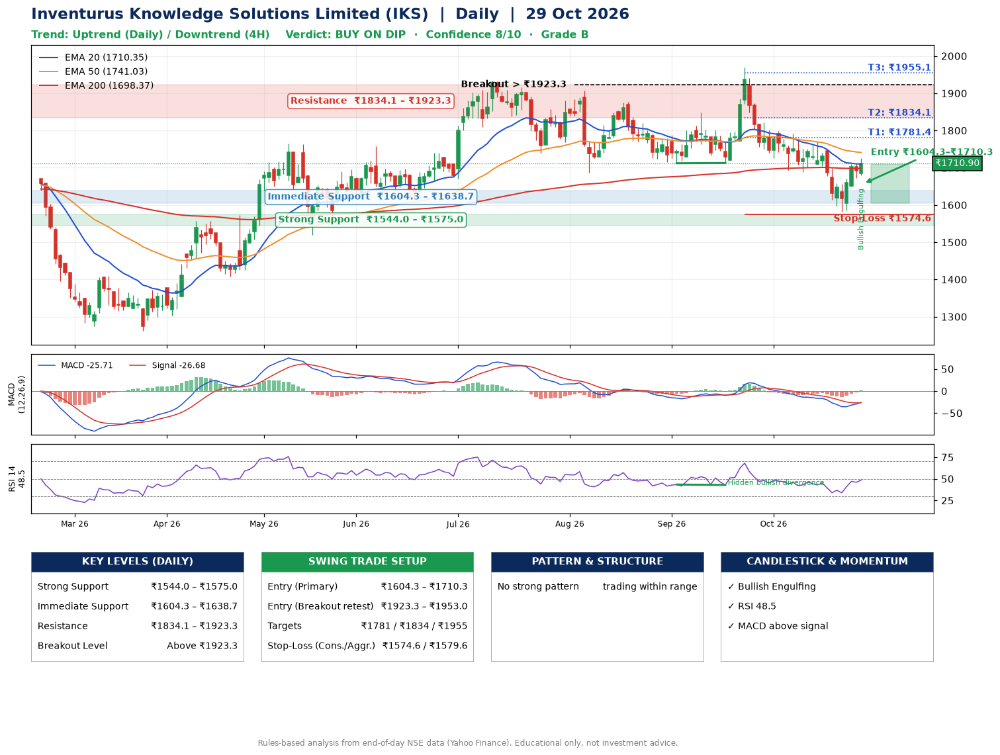

📌 **Inventurus Knowledge Solutions Limited (IKS) – Multi-Timeframe Technical Analysis (Daily + 4H Combined)**
_Data up to 29 Oct 2026 · Close ₹1710.90_

**📍 Daily Timeframe Trend**
- Trend: **Uptrend** (higher highs and higher lows)
- Recent swing highs: ₹1876.2, ₹1849.0, ₹1970.0 · swing lows: ₹1686.4, ₹1712.1, ₹1712.7
- EMAs: EMA20 ₹1710.3, EMA50 ₹1741.0, EMA200 ₹1698.4; mixed / crossing; price above EMA20, EMA200
- MACD -25.71 above signal -26.68 (below zero), fresh bullish crossover; histogram rising
- RSI(14) 48.5; Hidden bullish divergence

**📍 4-Hour Timeframe Trend**
- Structure: **Downtrend** (lower highs and lower lows)
- Pullback/support area: recent 4H swing lows ₹1689.0, ₹1583.2; EMA20 ₹1691.1
- EMA20/50: bearish stack (EMA20 < EMA50); price above EMA20
- MACD -9.63 above signal -19.47 (below zero); histogram rising
- RSI(14) 52.9; no divergence

**📍 Pattern Detection (Both Timeframes)**
- 4H: **Double Top** – tops near ₹1790.1/₹1769.9, neckline ₹1689.0, forming

**📍 Candlestick Patterns (last 3 daily candles)**
- **Bullish Engulfing** – 29 Oct: buyers fully reversed the prior red candle

**📍 Price Action Key Levels (Daily Structure)**

| Zone | Price Level (₹) | Context |
|------|-----------------|---------|
| Strong Support | ₹1544.0 – ₹1575.0 | Cluster of earlier swing lows (demand) |
| Immediate Support | ₹1604.3 – ₹1638.7 | Nearest swing-low / wick area |
| Resistance | ₹1834.1 – ₹1923.3 | Nearest swing-high supply |
| Breakout Level | Above ₹1923.3 | Swing continuation trigger (52-week high ₹1970.0) |

**📍 Swing Trade Setup**

🟢 **Entry Zone**
- Primary: ₹1604.3 – ₹1710.3 (daily support / EMA20 area; enter on a bullish 4H candle)
- Alternate: ₹1923.3 – ₹1953.0 (breakout retest)

🎯 **Profit Targets**
- T1: ₹1781.4
- T2: ₹1834.1
- T3: ₹1955.1

🛑 **Stop-Loss**
- Conservative: below daily swing low (₹1574.6)
- Aggressive: below 4H structure (₹1579.6)
- Risk per share ≈ ₹82.7; reward:risk to T1 ≈ 1.5

**📌 Strategy Notes**
- Higher timeframe: daily trend is uptrend; only take longs while price holds above ₹1544.0.
- Entry timing: wait for a bullish 4H candle (engulfing/hammer) inside ₹1604.3 – ₹1710.3 rather than buying mid-range.
- EMA stacking: mixed / crossing; price above EMA20, EMA200.
- Breakout rule: a daily close above ₹1923.3 with volume above its 20-day average (≈131,489) opens T2/T3.
- Momentum: RSI 48 – room to run; Hidden bullish divergence.
- Exit discipline: move the stop to entry once T1 is hit; book partial profits at each target.

**STEP 2 — Marked Up Chart**

**✅ Trade Validation Checklist**
- Trend + momentum aligned: Yes · Price at entry zone: No
- Stop defined (₹1574.6) · Reward:risk ≥ 1.5 to T1: Yes

## 📌 Final Verdict

Recommendation: **🟡 BUY ON DIP**

Confidence: **8/10**

Trade Quality: **B**

Reason:
• Daily uptrend (higher highs and higher lows)

Next Action:
• Wait for a pullback to ₹1604.3–₹1710.3, or a breakout above ₹1923.3

_Rules-based analysis from end-of-day data. Educational only, not investment advice. Never place orders without your own confirmation._