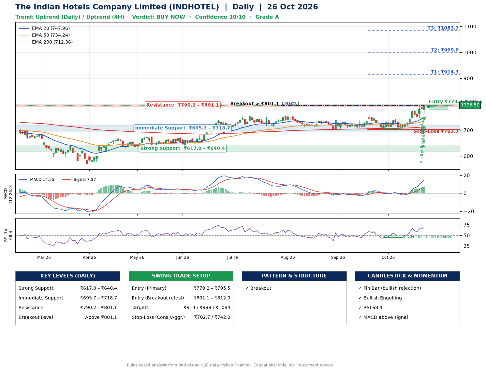

📌 **The Indian Hotels Company Limited (INDHOTEL) – Multi-Timeframe Technical Analysis (Daily + 4H Combined)**
_Data up to 26 Oct 2026 · Close ₹795.50_

**📍 Daily Timeframe Trend**
- Trend: **Uptrend** (price above rising EMAs)
- Recent swing highs: ₹737.9, ₹755.0, ₹743.0 · swing lows: ₹706.8, ₹704.6, ₹708.1
- EMAs: EMA20 ₹748.0, EMA50 ₹734.2, EMA200 ₹712.4; bullish stack (EMA20 > EMA50 > EMA200); price above EMA20, EMA50, EMA200
- MACD 14.55 above signal 7.37 (above zero); histogram rising
- RSI(14) 68.4; Hidden bullish divergence

**📍 4-Hour Timeframe Trend**
- Structure: **Uptrend** (higher highs and higher lows)
- Pullback/support area: recent 4H swing lows ₹708.8, ₹743.6; EMA20 ₹761.1
- EMA20/50: bullish stack (EMA20 > EMA50); price above EMA20, EMA50
- MACD 16.22 above signal 12.30 (above zero); histogram rising
- RSI(14) 68.6; Regular bearish divergence

**📍 Pattern Detection (Both Timeframes)**
- Daily: **Breakout** – closed above the 60-session high ₹794.7 (volume not confirming yet)

**📍 Candlestick Patterns (last 3 daily candles)**
- **Pin Bar (bullish rejection)** – 23 Oct: long lower wick shows dip-buying near ₹764.7
- **Bullish Engulfing** – 26 Oct: buyers fully reversed the prior red candle

**📍 Price Action Key Levels (Daily Structure)**

| Zone | Price Level (₹) | Context |
|------|-----------------|---------|
| Strong Support | ₹617.0 – ₹640.4 | Cluster of earlier swing lows (demand) |
| Immediate Support | ₹695.7 – ₹718.7 | Nearest swing-low / wick area |
| Resistance | ₹790.2 – ₹801.1 | Nearest swing-high supply |
| Breakout Level | Above ₹801.1 | Swing continuation trigger (52-week high ₹795.7) |

**📍 Swing Trade Setup**

🟢 **Entry Zone**
- Primary: ₹779.2 – ₹795.5 (daily support / EMA20 area; enter on a bullish 4H candle)
- Alternate: ₹801.1 – ₹812.0 (breakout retest)

🎯 **Profit Targets**
- T1: ₹914.3
- T2: ₹999.0
- T3: ₹1083.7

🛑 **Stop-Loss**
- Conservative: below daily swing low (₹702.7)
- Aggressive: below 4H structure (₹742.0)
- Risk per share ≈ ₹84.7; reward:risk to T1 ≈ 1.5

**📌 Strategy Notes**
- Higher timeframe: daily trend is uptrend; only take longs while price holds above ₹617.0.
- Entry timing: wait for a bullish 4H candle (engulfing/hammer) inside ₹779.2 – ₹795.5 rather than buying mid-range.
- EMA stacking: bullish stack (EMA20 > EMA50 > EMA200); price above EMA20, EMA50, EMA200.
- Breakout rule: a daily close above ₹801.1 with volume above its 20-day average (≈5,924,367) opens T2/T3.
- Momentum: RSI 68 – elevated, prefer dips; Hidden bullish divergence.
- Exit discipline: move the stop to entry once T1 is hit; book partial profits at each target.

**STEP 2 — Marked Up Chart**

**✅ Trade Validation Checklist**
- Trend + momentum aligned: Yes · Price at entry zone: Yes
- Stop defined (₹702.7) · Reward:risk ≥ 1.5 to T1: No

## 📌 Final Verdict

Recommendation: **🟢 BUY NOW**

Confidence: **10/10**

Trade Quality: **A**

Reason:
• Daily uptrend (price above rising EMAs)
• EMAs stacked bullishly

Next Action:
• Buy now within the entry zone, with the stop-loss in place

_Rules-based analysis from end-of-day data. Educational only, not investment advice. Never place orders without your own confirmation._