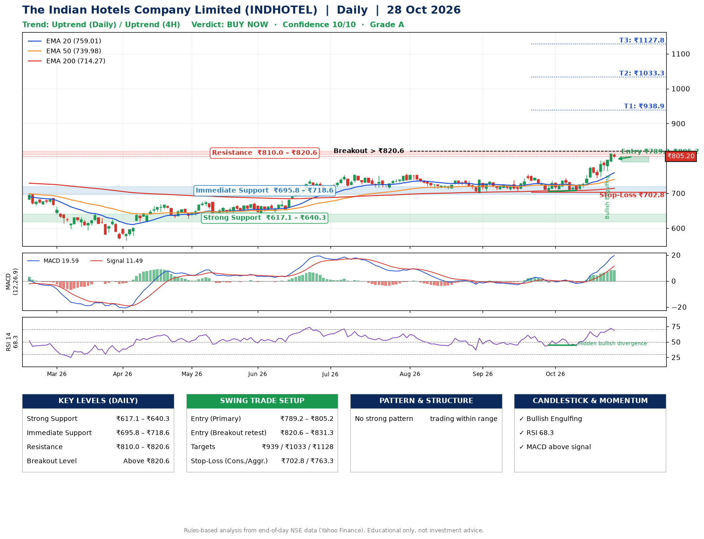

📌 **The Indian Hotels Company Limited (INDHOTEL) – Multi-Timeframe Technical Analysis (Daily + 4H Combined)**
_Data up to 28 Oct 2026 · Close ₹805.20_

**📍 Daily Timeframe Trend**
- Trend: **Uptrend** (price above rising EMAs)
- Recent swing highs: ₹737.9, ₹755.0, ₹743.0 · swing lows: ₹706.8, ₹704.6, ₹708.1
- EMAs: EMA20 ₹759.0, EMA50 ₹740.0, EMA200 ₹714.3; bullish stack (EMA20 > EMA50 > EMA200); price above EMA20, EMA50, EMA200
- MACD 19.59 above signal 11.49 (above zero); histogram falling
- RSI(14) 68.3; Hidden bullish divergence

**📍 4-Hour Timeframe Trend**
- Structure: **Uptrend** (higher highs and higher lows)
- Pullback/support area: recent 4H swing lows ₹743.6, ₹764.8; EMA20 ₹776.8
- EMA20/50: bullish stack (EMA20 > EMA50); price above EMA20, EMA50
- MACD 20.16 above signal 16.56 (above zero); histogram falling
- RSI(14) 67.9; Regular bearish divergence

**📍 Pattern Detection (Both Timeframes)**
- No strong pattern detected. Trading within range.

**📍 Candlestick Patterns (last 3 daily candles)**
- **Bullish Engulfing** – 26 Oct: buyers fully reversed the prior red candle

**📍 Price Action Key Levels (Daily Structure)**

| Zone | Price Level (₹) | Context |
|------|-----------------|---------|
| Strong Support | ₹617.1 – ₹640.3 | Cluster of earlier swing lows (demand) |
| Immediate Support | ₹695.8 – ₹718.6 | Nearest swing-low / wick area |
| Resistance | ₹810.0 – ₹820.6 | Nearest swing-high supply |
| Breakout Level | Above ₹820.6 | Swing continuation trigger (52-week high ₹815.3) |

**📍 Swing Trade Setup**

🟢 **Entry Zone**
- Primary: ₹789.2 – ₹805.2 (daily support / EMA20 area; enter on a bullish 4H candle)
- Alternate: ₹820.6 – ₹831.3 (breakout retest)

🎯 **Profit Targets**
- T1: ₹938.9
- T2: ₹1033.3
- T3: ₹1127.8

🛑 **Stop-Loss**
- Conservative: below daily swing low (₹702.8)
- Aggressive: below 4H structure (₹763.3)
- Risk per share ≈ ₹94.4; reward:risk to T1 ≈ 1.5

**📌 Strategy Notes**
- Higher timeframe: daily trend is uptrend; only take longs while price holds above ₹617.1.
- Entry timing: wait for a bullish 4H candle (engulfing/hammer) inside ₹789.2 – ₹805.2 rather than buying mid-range.
- EMA stacking: bullish stack (EMA20 > EMA50 > EMA200); price above EMA20, EMA50, EMA200.
- Breakout rule: a daily close above ₹820.6 with volume above its 20-day average (≈6,370,305) opens T2/T3.
- Momentum: RSI 68 – elevated, prefer dips; Hidden bullish divergence.
- Exit discipline: move the stop to entry once T1 is hit; book partial profits at each target.

**STEP 2 — Marked Up Chart**

**✅ Trade Validation Checklist**
- Trend + momentum aligned: Yes · Price at entry zone: Yes
- Stop defined (₹702.8) · Reward:risk ≥ 1.5 to T1: Yes

## 📌 Final Verdict

Recommendation: **🟢 BUY NOW**

Confidence: **10/10**

Trade Quality: **A**

Reason:
• Daily uptrend (price above rising EMAs)
• EMAs stacked bullishly

Next Action:
• Buy now within the entry zone, with the stop-loss in place

_Rules-based analysis from end-of-day data. Educational only, not investment advice. Never place orders without your own confirmation._