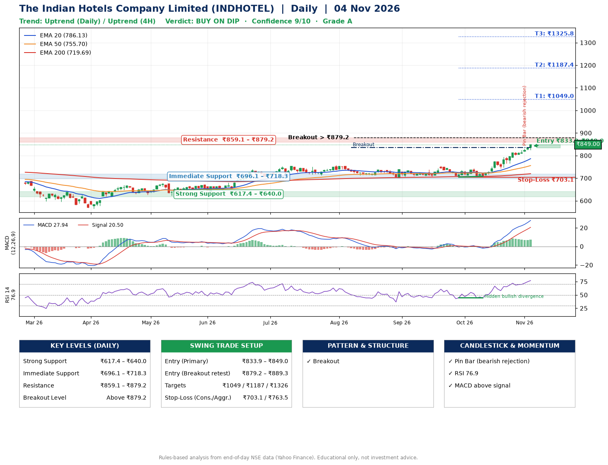

📌 **The Indian Hotels Company Limited (INDHOTEL) – Multi-Timeframe Technical Analysis (Daily + 4H Combined)**
_Data up to 04 Nov 2026 · Close ₹849.00_

**📍 Daily Timeframe Trend**
- Trend: **Uptrend** (price above rising EMAs)
- Recent swing highs: ₹737.9, ₹755.0, ₹743.0 · swing lows: ₹706.8, ₹704.6, ₹708.1
- EMAs: EMA20 ₹786.1, EMA50 ₹755.7, EMA200 ₹719.7; bullish stack (EMA20 > EMA50 > EMA200); price above EMA20, EMA50, EMA200
- MACD 27.94 above signal 20.50 (above zero); histogram rising
- RSI(14) 76.9; Hidden bullish divergence

**📍 4-Hour Timeframe Trend**
- Structure: **Uptrend** (higher highs and higher lows)
- Pullback/support area: recent 4H swing lows ₹743.6, ₹764.8; EMA20 ₹809.8
- EMA20/50: bullish stack (EMA20 > EMA50); price above EMA20, EMA50
- MACD 22.45 above signal 20.61 (above zero); histogram rising
- RSI(14) 75.9; Regular bearish divergence

**📍 Pattern Detection (Both Timeframes)**
- Daily: **Breakout** – closed above the 60-session high ₹836.0 (volume not confirming yet)

**📍 Candlestick Patterns (last 3 daily candles)**
- **Pin Bar (bearish rejection)** – 02 Nov: long upper wick shows selling near ₹830.8

**📍 Price Action Key Levels (Daily Structure)**

| Zone | Price Level (₹) | Context |
|------|-----------------|---------|
| Strong Support | ₹617.4 – ₹640.0 | Cluster of earlier swing lows (demand) |
| Immediate Support | ₹696.1 – ₹718.3 | Nearest swing-low / wick area |
| Resistance | ₹859.1 – ₹879.2 | Nearest swing-high supply |
| Breakout Level | Above ₹879.2 | Swing continuation trigger (52-week high ₹849.0) |

**📍 Swing Trade Setup**

🟢 **Entry Zone**
- Primary: ₹833.9 – ₹849.0 (daily support / EMA20 area; enter on a bullish 4H candle)
- Alternate: ₹879.2 – ₹889.3 (breakout retest)

🎯 **Profit Targets**
- T1: ₹1049.0
- T2: ₹1187.4
- T3: ₹1325.8

🛑 **Stop-Loss**
- Conservative: below daily swing low (₹703.1)
- Aggressive: below 4H structure (₹763.5)
- Risk per share ≈ ₹138.4; reward:risk to T1 ≈ 1.5

**📌 Strategy Notes**
- Higher timeframe: daily trend is uptrend; only take longs while price holds above ₹617.4.
- Entry timing: wait for a bullish 4H candle (engulfing/hammer) inside ₹833.9 – ₹849.0 rather than buying mid-range.
- EMA stacking: bullish stack (EMA20 > EMA50 > EMA200); price above EMA20, EMA50, EMA200.
- Breakout rule: a daily close above ₹879.2 with volume above its 20-day average (≈5,647,620) opens T2/T3.
- Momentum: RSI 77 – elevated, prefer dips; Hidden bullish divergence.
- Exit discipline: move the stop to entry once T1 is hit; book partial profits at each target.

**STEP 2 — Marked Up Chart**

**✅ Trade Validation Checklist**
- Trend + momentum aligned: Yes · Price at entry zone: Yes
- Stop defined (₹703.1) · Reward:risk ≥ 1.5 to T1: No

## 📌 Final Verdict

Recommendation: **🟡 BUY ON DIP**

Confidence: **9/10**

Trade Quality: **A**

Reason:
• Daily uptrend (price above rising EMAs)
• EMAs stacked bullishly

Next Action:
• Wait for a pullback to ₹833.9–₹849.0, or a breakout above ₹879.2

_Rules-based analysis from end-of-day data. Educational only, not investment advice. Never place orders without your own confirmation._