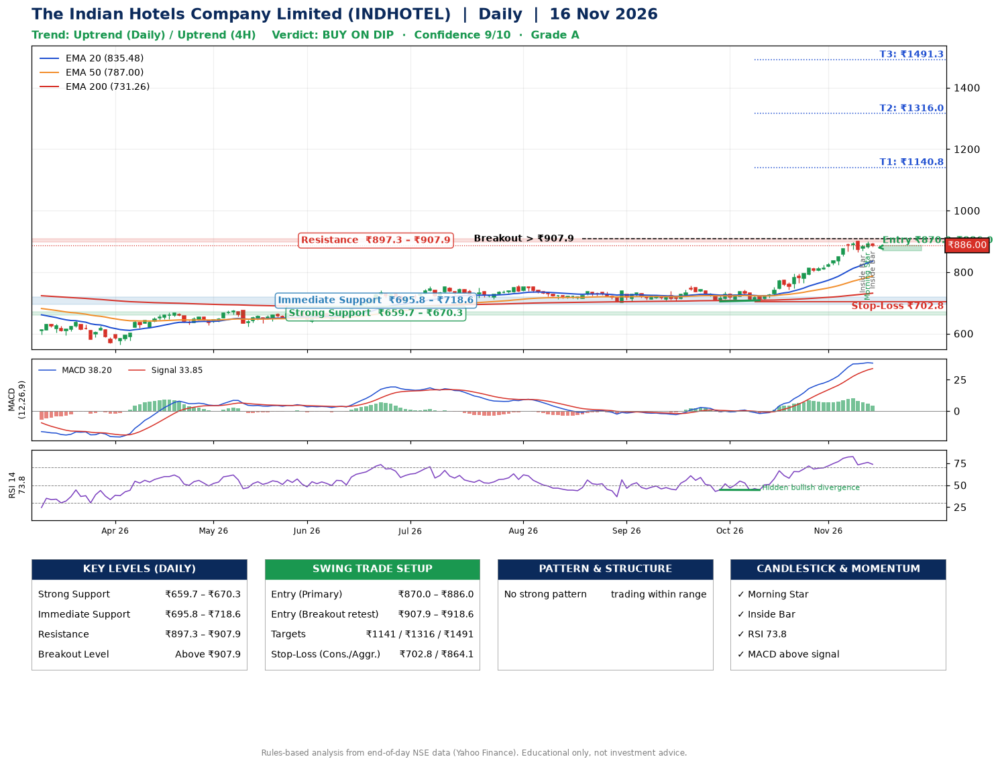

📌 **The Indian Hotels Company Limited (INDHOTEL) – Multi-Timeframe Technical Analysis (Daily + 4H Combined)**
_Data up to 16 Nov 2026 · Close ₹886.00_

**📍 Daily Timeframe Trend**
- Trend: **Uptrend** (price above rising EMAs)
- Recent swing highs: ₹737.9, ₹755.0, ₹743.0 · swing lows: ₹706.8, ₹704.6, ₹708.1
- EMAs: EMA20 ₹835.5, EMA50 ₹787.0, EMA200 ₹731.3; bullish stack (EMA20 > EMA50 > EMA200); price above EMA20, EMA50, EMA200
- MACD 38.20 above signal 33.85 (above zero); histogram falling
- RSI(14) 73.8; Hidden bullish divergence

**📍 4-Hour Timeframe Trend**
- Structure: **Uptrend** (price above rising EMAs)
- Pullback/support area: recent 4H swing lows ₹764.8, ₹865.4; EMA20 ₹865.7
- EMA20/50: bullish stack (EMA20 > EMA50); price above EMA20, EMA50
- MACD 23.15 below signal 25.49 (above zero); histogram falling
- RSI(14) 68.7; Hidden bullish divergence; Hidden bearish divergence

**📍 Pattern Detection (Both Timeframes)**
- 4H: **Bull Flag** – 15% pole then a tight 4% flag; trigger above ₹901.2

**📍 Candlestick Patterns (last 3 daily candles)**
- **Inside Bar** – 12 Nov: compression inside the prior range ₹865.4–₹902.6
- **Morning Star** – 13 Nov: three-candle bullish reversal
- **Inside Bar** – 16 Nov: compression inside the prior range ₹877.3–₹899.0

**📍 Price Action Key Levels (Daily Structure)**

| Zone | Price Level (₹) | Context |
|------|-----------------|---------|
| Strong Support | ₹659.7 – ₹670.3 | Cluster of earlier swing lows (demand) |
| Immediate Support | ₹695.8 – ₹718.6 | Nearest swing-low / wick area |
| Resistance | ₹897.3 – ₹907.9 | Nearest swing-high supply |
| Breakout Level | Above ₹907.9 | Swing continuation trigger (52-week high ₹902.6) |

**📍 Swing Trade Setup**

🟢 **Entry Zone**
- Primary: ₹870.0 – ₹886.0 (daily support / EMA20 area; enter on a bullish 4H candle)
- Alternate: ₹907.9 – ₹918.6 (breakout retest)

🎯 **Profit Targets**
- T1: ₹1140.8
- T2: ₹1316.0
- T3: ₹1491.3

🛑 **Stop-Loss**
- Conservative: below daily swing low (₹702.8)
- Aggressive: below 4H structure (₹864.1)
- Risk per share ≈ ₹175.2; reward:risk to T1 ≈ 1.5
- Time to T1: it never rose this much within 60 trading days in the price history
- Time to T2: it never rose this much within 60 trading days in the price history

**📌 Strategy Notes**
- Higher timeframe: daily trend is uptrend; only take longs while price holds above ₹659.7.
- Entry timing: wait for a bullish 4H candle (engulfing/hammer) inside ₹870.0 – ₹886.0 rather than buying mid-range.
- EMA stacking: bullish stack (EMA20 > EMA50 > EMA200); price above EMA20, EMA50, EMA200.
- Breakout rule: a daily close above ₹907.9 with volume above its 20-day average (≈6,737,528) opens T2/T3.
- Momentum: RSI 74 – elevated, prefer dips; Hidden bullish divergence.
- Exit discipline: move the stop to entry once T1 is hit; book partial profits at each target.

**STEP 2 — Marked Up Chart**

**✅ Trade Validation Checklist**
- Trend + momentum aligned: Yes · Price at entry zone: Yes
- Stop defined (₹702.8) · Reward:risk ≥ 1.5 to T1: No

## 📌 Final Verdict

Recommendation: **🟡 BUY ON DIP**

Confidence: **9/10**

Trade Quality: **A**

Reason:
• Daily uptrend (price above rising EMAs)
• EMAs stacked bullishly

Next Action:
• Wait for a pullback to ₹870.0–₹886.0, or a breakout above ₹907.9

_Rules-based analysis from end-of-day data. Educational only, not investment advice. Never place orders without your own confirmation._