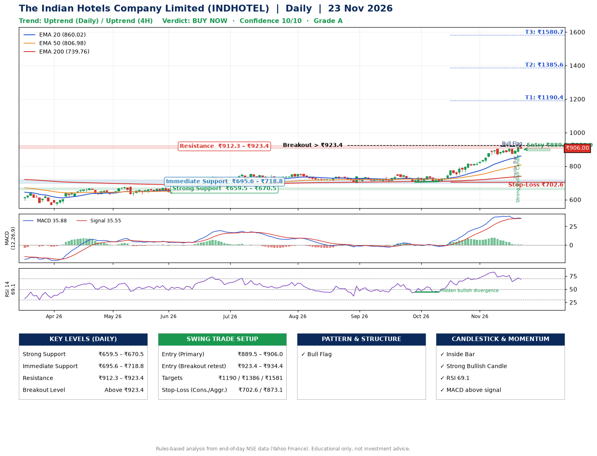

📌 **The Indian Hotels Company Limited (INDHOTEL) – Multi-Timeframe Technical Analysis (Daily + 4H Combined)**
_Data up to 23 Nov 2026 · Close ₹906.00_

**📍 Daily Timeframe Trend**
- Trend: **Uptrend** (price above rising EMAs)
- Recent swing highs: ₹737.9, ₹755.0, ₹743.0 · swing lows: ₹706.8, ₹704.6, ₹708.1
- EMAs: EMA20 ₹860.0, EMA50 ₹807.0, EMA200 ₹739.8; bullish stack (EMA20 > EMA50 > EMA200); price above EMA20, EMA50, EMA200
- MACD 35.88 above signal 35.55 (above zero); histogram falling
- RSI(14) 69.1; Hidden bullish divergence

**📍 4-Hour Timeframe Trend**
- Structure: **Uptrend** (higher highs and higher lows)
- Pullback/support area: recent 4H swing lows ₹865.4, ₹874.5; EMA20 ₹887.0
- EMA20/50: bullish stack (EMA20 > EMA50); price above EMA20, EMA50
- MACD 17.77 below signal 19.12 (above zero); histogram falling
- RSI(14) 64.9; Hidden bullish divergence

**📍 Pattern Detection (Both Timeframes)**
- Daily: **Bull Flag** – 16% pole then a tight 5% flag; trigger above ₹917.8
- 4H: **Double Bottom** – bottoms near ₹865.4/₹874.5, neckline ₹909.6, forming

**📍 Candlestick Patterns (last 3 daily candles)**
- **Inside Bar** – 19 Nov: compression inside the prior range ₹874.0–₹901.5
- **Strong Bullish Candle** – 20 Nov: wide-range green candle, buyers in control

**📍 Price Action Key Levels (Daily Structure)**

| Zone | Price Level (₹) | Context |
|------|-----------------|---------|
| Strong Support | ₹659.5 – ₹670.5 | Cluster of earlier swing lows (demand) |
| Immediate Support | ₹695.6 – ₹718.8 | Nearest swing-low / wick area |
| Resistance | ₹912.3 – ₹923.4 | Nearest swing-high supply |
| Breakout Level | Above ₹923.4 | Swing continuation trigger (52-week high ₹917.8) |

**📍 Swing Trade Setup**

🟢 **Entry Zone**
- Primary: ₹889.5 – ₹906.0 (daily support / EMA20 area; enter on a bullish 4H candle)
- Alternate: ₹923.4 – ₹934.4 (breakout retest)

🎯 **Profit Targets**
- T1: ₹1190.4
- T2: ₹1385.6
- T3: ₹1580.7

🛑 **Stop-Loss**
- Conservative: below daily swing low (₹702.6)
- Aggressive: below 4H structure (₹873.1)
- Risk per share ≈ ₹195.1; reward:risk to T1 ≈ 1.5
- Time to T1: it never rose this much within 60 trading days in the price history
- Time to T2: it never rose this much within 60 trading days in the price history

**📌 Strategy Notes**
- Higher timeframe: daily trend is uptrend; only take longs while price holds above ₹659.5.
- Entry timing: wait for a bullish 4H candle (engulfing/hammer) inside ₹889.5 – ₹906.0 rather than buying mid-range.
- EMA stacking: bullish stack (EMA20 > EMA50 > EMA200); price above EMA20, EMA50, EMA200.
- Breakout rule: a daily close above ₹923.4 with volume above its 20-day average (≈5,167,803) opens T2/T3.
- Momentum: RSI 69 – elevated, prefer dips; Hidden bullish divergence.
- Exit discipline: move the stop to entry once T1 is hit; book partial profits at each target.

**STEP 2 — Marked Up Chart**

**✅ Trade Validation Checklist**
- Trend + momentum aligned: Yes · Price at entry zone: Yes
- Stop defined (₹702.6) · Reward:risk ≥ 1.5 to T1: No

## 📌 Final Verdict

Recommendation: **🟢 BUY NOW**

Confidence: **10/10**

Trade Quality: **A**

Reason:
• Daily uptrend (price above rising EMAs)
• EMAs stacked bullishly

Next Action:
• Buy now within the entry zone, with the stop-loss in place

_Rules-based analysis from end-of-day data. Educational only, not investment advice. Never place orders without your own confirmation._