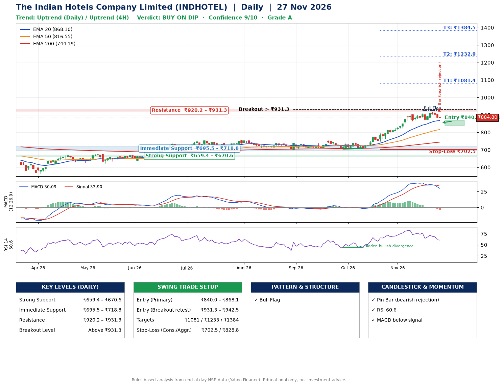

📌 **The Indian Hotels Company Limited (INDHOTEL) – Multi-Timeframe Technical Analysis (Daily + 4H Combined)**
_Data up to 27 Nov 2026 · Close ₹884.80_

**📍 Daily Timeframe Trend**
- Trend: **Uptrend** (price above rising EMAs)
- Recent swing highs: ₹737.9, ₹755.0, ₹743.0 · swing lows: ₹706.8, ₹704.6, ₹708.1
- EMAs: EMA20 ₹868.1, EMA50 ₹816.5, EMA200 ₹744.2; bullish stack (EMA20 > EMA50 > EMA200); price above EMA20, EMA50, EMA200
- MACD 30.09 below signal 33.90 (above zero), fresh bearish crossover; histogram falling
- RSI(14) 60.6; Hidden bullish divergence

**📍 4-Hour Timeframe Trend**
- Structure: **Uptrend** (higher highs and higher lows)
- Pullback/support area: recent 4H swing lows ₹865.4, ₹874.5; EMA20 ₹888.7
- EMA20/50: bullish stack (EMA20 > EMA50); price above EMA50
- MACD 9.14 below signal 14.01 (above zero); histogram falling
- RSI(14) 51.5; Hidden bullish divergence; Regular bearish divergence

**📍 Pattern Detection (Both Timeframes)**
- Daily: **Bull Flag** – 18% pole then a tight 6% flag; trigger above ₹925.8
- 4H: **Double Top** – tops near ₹909.6/₹925.2, neckline ₹874.5, forming
- 4H: **Double Bottom** – bottoms near ₹865.4/₹874.5, neckline ₹909.6, forming

**📍 Candlestick Patterns (last 3 daily candles)**
- **Pin Bar (bearish rejection)** – 27 Nov: long upper wick shows selling near ₹902.3

**📍 Price Action Key Levels (Daily Structure)**

| Zone | Price Level (₹) | Context |
|------|-----------------|---------|
| Strong Support | ₹659.4 – ₹670.6 | Cluster of earlier swing lows (demand) |
| Immediate Support | ₹695.5 – ₹718.8 | Nearest swing-low / wick area |
| Resistance | ₹920.2 – ₹931.3 | Nearest swing-high supply |
| Breakout Level | Above ₹931.3 | Swing continuation trigger (52-week high ₹925.8) |

**📍 Swing Trade Setup**

🟢 **Entry Zone**
- Primary: ₹840.0 – ₹868.1 (daily support / EMA20 area; enter on a bullish 4H candle)
- Alternate: ₹931.3 – ₹942.5 (breakout retest)

🎯 **Profit Targets**
- T1: ₹1081.4
- T2: ₹1232.9
- T3: ₹1384.5

🛑 **Stop-Loss**
- Conservative: below daily swing low (₹702.5)
- Aggressive: below 4H structure (₹828.8)
- Risk per share ≈ ₹151.6; reward:risk to T1 ≈ 1.5
- Time to T1: about 55 trading days (it rose this much within 60 trading days 1% of the time in the last 2 years)
- Time to T2: it never rose this much within 60 trading days in the price history

**📌 Strategy Notes**
- Higher timeframe: daily trend is uptrend; only take longs while price holds above ₹659.4.
- Entry timing: wait for a bullish 4H candle (engulfing/hammer) inside ₹840.0 – ₹868.1 rather than buying mid-range.
- EMA stacking: bullish stack (EMA20 > EMA50 > EMA200); price above EMA20, EMA50, EMA200.
- Breakout rule: a daily close above ₹931.3 with volume above its 20-day average (≈4,686,477) opens T2/T3.
- Momentum: RSI 61 – room to run; Hidden bullish divergence.
- Exit discipline: move the stop to entry once T1 is hit; book partial profits at each target.

**STEP 2 — Marked Up Chart**

**✅ Trade Validation Checklist**
- Trend + momentum aligned: No · Price at entry zone: No
- Stop defined (₹702.5) · Reward:risk ≥ 1.5 to T1: Yes

## 📌 Final Verdict

Recommendation: **🟡 BUY ON DIP**

Confidence: **9/10**

Trade Quality: **A**

Reason:
• Daily uptrend (price above rising EMAs)
• EMAs stacked bullishly

Next Action:
• Wait for a pullback to ₹840.0–₹868.1, or a breakout above ₹931.3

_Rules-based analysis from end-of-day data. Educational only, not investment advice. Never place orders without your own confirmation._