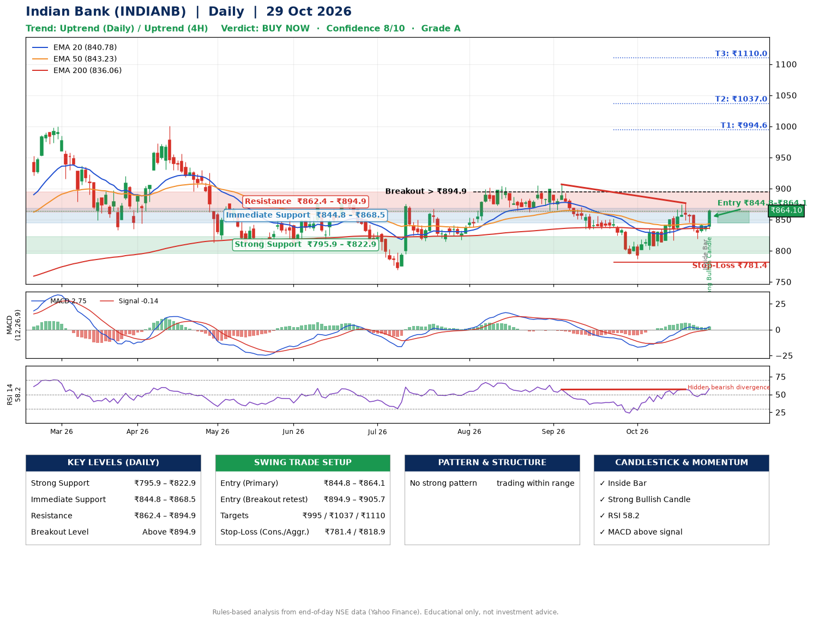

📌 **Indian Bank (INDIANB) – Multi-Timeframe Technical Analysis (Daily + 4H Combined)**
_Data up to 29 Oct 2026 · Close ₹864.10_

**📍 Daily Timeframe Trend**
- Trend: **Uptrend** (price above rising EMAs)
- Recent swing highs: ₹905.0, ₹906.7, ₹876.5 · swing lows: ₹862.0, ₹833.8, ₹786.8
- EMAs: EMA20 ₹840.8, EMA50 ₹843.2, EMA200 ₹836.1; mixed / crossing; price above EMA20, EMA50, EMA200
- MACD 2.75 above signal -0.14 (above zero); histogram rising
- RSI(14) 58.2; Hidden bearish divergence

**📍 4-Hour Timeframe Trend**
- Structure: **Uptrend** (price above rising EMAs)
- Pullback/support area: recent 4H swing lows ₹817.9, ₹820.2; EMA20 ₹843.7
- EMA20/50: bullish stack (EMA20 > EMA50); price above EMA20, EMA50
- MACD 4.16 above signal 3.37 (above zero), fresh bullish crossover; histogram rising
- RSI(14) 62.0; Hidden bullish divergence

**📍 Pattern Detection (Both Timeframes)**
- 4H: **Double Bottom** – bottoms near ₹817.9/₹820.2, neckline ₹876.3, forming
- 4H: **Head & Shoulders** – head ₹876.3, neckline ₹807.8

**📍 Candlestick Patterns (last 3 daily candles)**
- **Inside Bar** – 28 Oct: compression inside the prior range ₹830.0–₹843.0
- **Strong Bullish Candle** – 29 Oct: wide-range green candle, buyers in control

**📍 Price Action Key Levels (Daily Structure)**

| Zone | Price Level (₹) | Context |
|------|-----------------|---------|
| Strong Support | ₹795.9 – ₹822.9 | Cluster of earlier swing lows (demand) |
| Immediate Support | ₹844.8 – ₹868.5 | Nearest swing-low / wick area |
| Resistance | ₹862.4 – ₹894.9 | Nearest swing-high supply |
| Breakout Level | Above ₹894.9 | Swing continuation trigger (52-week high ₹1000.9) |

**📍 Swing Trade Setup**

🟢 **Entry Zone**
- Primary: ₹844.8 – ₹864.1 (daily support / EMA20 area; enter on a bullish 4H candle)
- Alternate: ₹894.9 – ₹905.7 (breakout retest)

🎯 **Profit Targets**
- T1: ₹994.6
- T2: ₹1037.0
- T3: ₹1110.0

🛑 **Stop-Loss**
- Conservative: below daily swing low (₹781.4)
- Aggressive: below 4H structure (₹818.9)
- Risk per share ≈ ₹73.0; reward:risk to T1 ≈ 1.9

**📌 Strategy Notes**
- Higher timeframe: daily trend is uptrend; only take longs while price holds above ₹795.9.
- Entry timing: wait for a bullish 4H candle (engulfing/hammer) inside ₹844.8 – ₹864.1 rather than buying mid-range.
- EMA stacking: mixed / crossing; price above EMA20, EMA50, EMA200.
- Breakout rule: a daily close above ₹894.9 with volume above its 20-day average (≈1,444,522) opens T2/T3.
- Momentum: RSI 58 – room to run; Hidden bearish divergence.
- Exit discipline: move the stop to entry once T1 is hit; book partial profits at each target.

**STEP 2 — Marked Up Chart**

**✅ Trade Validation Checklist**
- Trend + momentum aligned: Yes · Price at entry zone: Yes
- Stop defined (₹781.4) · Reward:risk ≥ 1.5 to T1: Yes

## 📌 Final Verdict

Recommendation: **🟢 BUY NOW**

Confidence: **8/10**

Trade Quality: **A**

Reason:
• Daily uptrend (price above rising EMAs)

Next Action:
• Buy now within the entry zone, with the stop-loss in place

_Rules-based analysis from end-of-day data. Educational only, not investment advice. Never place orders without your own confirmation._