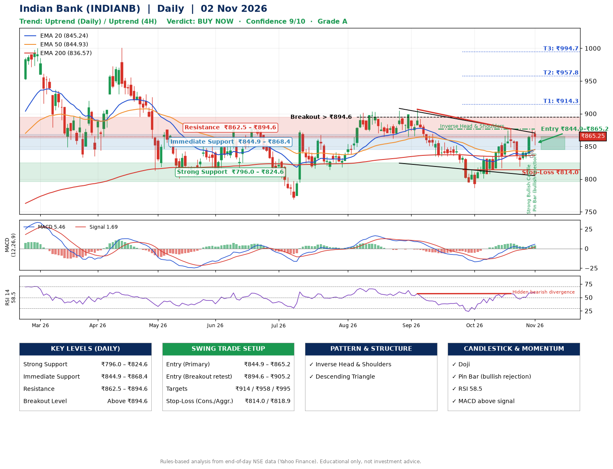

📌 **Indian Bank (INDIANB) – Multi-Timeframe Technical Analysis (Daily + 4H Combined)**
_Data up to 02 Nov 2026 · Close ₹865.25_

**📍 Daily Timeframe Trend**
- Trend: **Uptrend** (price above rising EMAs)
- Recent swing highs: ₹905.0, ₹906.7, ₹876.5 · swing lows: ₹833.8, ₹786.8, ₹819.3
- EMAs: EMA20 ₹845.2, EMA50 ₹844.9, EMA200 ₹836.6; bullish stack (EMA20 > EMA50 > EMA200); price above EMA20, EMA50, EMA200
- MACD 5.46 above signal 1.69 (above zero); histogram rising
- RSI(14) 58.5; Hidden bearish divergence

**📍 4-Hour Timeframe Trend**
- Structure: **Uptrend** (higher highs and higher lows)
- Pullback/support area: recent 4H swing lows ₹817.9, ₹820.2; EMA20 ₹850.4
- EMA20/50: bullish stack (EMA20 > EMA50); price above EMA20, EMA50
- MACD 6.91 above signal 5.21 (above zero), fresh bullish crossover; histogram rising
- RSI(14) 59.6; Hidden bullish divergence

**📍 Pattern Detection (Both Timeframes)**
- Daily: **Inverse Head & Shoulders** – head ₹786.8, neckline ₹876.5
- Daily: **Descending Triangle** – converging swing highs and lows over the last ~60 sessions
- 4H: **Double Bottom** – bottoms near ₹817.9/₹820.2, neckline ₹876.3, forming
- 4H: **Ascending Triangle** – converging swing highs and lows over the last ~60 sessions

**📍 Candlestick Patterns (last 3 daily candles)**
- **Strong Bullish Candle** – 29 Oct: wide-range green candle, buyers in control
- **Doji** – 30 Oct: indecision; wait for the next candle to confirm direction
- **Pin Bar (bullish rejection)** – 02 Nov: long lower wick shows dip-buying near ₹852.1

**📍 Price Action Key Levels (Daily Structure)**

| Zone | Price Level (₹) | Context |
|------|-----------------|---------|
| Strong Support | ₹796.0 – ₹824.6 | Cluster of earlier swing lows (demand) |
| Immediate Support | ₹844.9 – ₹868.4 | Nearest swing-low / wick area |
| Resistance | ₹862.5 – ₹894.6 | Nearest swing-high supply |
| Breakout Level | Above ₹894.6 | Swing continuation trigger (52-week high ₹1000.9) |

**📍 Swing Trade Setup**

🟢 **Entry Zone**
- Primary: ₹844.9 – ₹865.2 (daily support / EMA20 area; enter on a bullish 4H candle)
- Alternate: ₹894.6 – ₹905.2 (breakout retest)

🎯 **Profit Targets**
- T1: ₹914.3
- T2: ₹957.8
- T3: ₹994.7

🛑 **Stop-Loss**
- Conservative: below daily swing low (₹814.0)
- Aggressive: below 4H structure (₹818.9)
- Risk per share ≈ ₹41.1; reward:risk to T1 ≈ 1.4

**📌 Strategy Notes**
- Higher timeframe: daily trend is uptrend; only take longs while price holds above ₹796.0.
- Entry timing: wait for a bullish 4H candle (engulfing/hammer) inside ₹844.9 – ₹865.2 rather than buying mid-range.
- EMA stacking: bullish stack (EMA20 > EMA50 > EMA200); price above EMA20, EMA50, EMA200.
- Breakout rule: a daily close above ₹894.6 with volume above its 20-day average (≈1,476,151) opens T2/T3.
- Momentum: RSI 58 – room to run; Hidden bearish divergence.
- Exit discipline: move the stop to entry once T1 is hit; book partial profits at each target.

**STEP 2 — Marked Up Chart**

**✅ Trade Validation Checklist**
- Trend + momentum aligned: Yes · Price at entry zone: Yes
- Stop defined (₹814.0) · Reward:risk ≥ 1.5 to T1: No

## 📌 Final Verdict

Recommendation: **🟢 BUY NOW**

Confidence: **9/10**

Trade Quality: **A**

Reason:
• Daily uptrend (price above rising EMAs)
• EMAs stacked bullishly

Next Action:
• Buy now within the entry zone, with the stop-loss in place

_Rules-based analysis from end-of-day data. Educational only, not investment advice. Never place orders without your own confirmation._