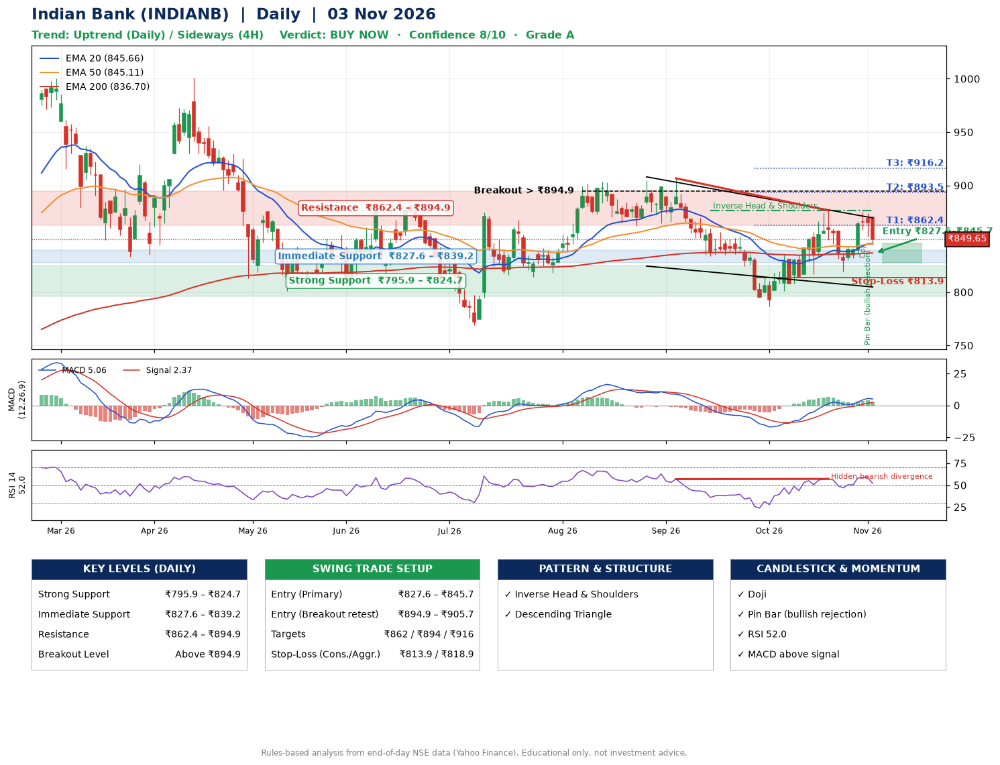

📌 **Indian Bank (INDIANB) – Multi-Timeframe Technical Analysis (Daily + 4H Combined)**
_Data up to 03 Nov 2026 · Close ₹849.65_

**📍 Daily Timeframe Trend**
- Trend: **Uptrend** (price above rising EMAs)
- Recent swing highs: ₹905.0, ₹906.7, ₹876.5 · swing lows: ₹833.8, ₹786.8, ₹819.3
- EMAs: EMA20 ₹845.7, EMA50 ₹845.1, EMA200 ₹836.7; bullish stack (EMA20 > EMA50 > EMA200); price above EMA20, EMA50, EMA200
- MACD 5.06 above signal 2.37 (above zero); histogram falling
- RSI(14) 52.0; Hidden bearish divergence

**📍 4-Hour Timeframe Trend**
- Structure: **Sideways** (mixed swing structure)
- Pullback/support area: recent 4H swing lows ₹817.9, ₹820.2; EMA20 ₹851.4
- EMA20/50: bullish stack (EMA20 > EMA50); price above EMA50
- MACD 5.97 above signal 5.64 (above zero); histogram falling
- RSI(14) 50.5; Hidden bullish divergence

**📍 Pattern Detection (Both Timeframes)**
- Daily: **Inverse Head & Shoulders** – head ₹786.8, neckline ₹876.5
- Daily: **Descending Triangle** – converging swing highs and lows over the last ~60 sessions
- 4H: **Double Bottom** – bottoms near ₹817.9/₹820.2, neckline ₹876.3, forming
- 4H: **Ascending Triangle** – converging swing highs and lows over the last ~60 sessions

**📍 Candlestick Patterns (last 3 daily candles)**
- **Doji** – 30 Oct: indecision; wait for the next candle to confirm direction
- **Pin Bar (bullish rejection)** – 02 Nov: long lower wick shows dip-buying near ₹852.1

**📍 Price Action Key Levels (Daily Structure)**

| Zone | Price Level (₹) | Context |
|------|-----------------|---------|
| Strong Support | ₹795.9 – ₹824.7 | Cluster of earlier swing lows (demand) |
| Immediate Support | ₹827.6 – ₹839.2 | Nearest swing-low / wick area |
| Resistance | ₹862.4 – ₹894.9 | Nearest swing-high supply |
| Breakout Level | Above ₹894.9 | Swing continuation trigger (52-week high ₹1000.9) |

**📍 Swing Trade Setup**

🟢 **Entry Zone**
- Primary: ₹827.6 – ₹845.7 (daily support / EMA20 area; enter on a bullish 4H candle)
- Alternate: ₹894.9 – ₹905.7 (breakout retest)

🎯 **Profit Targets**
- T1: ₹862.4
- T2: ₹893.5
- T3: ₹916.2

🛑 **Stop-Loss**
- Conservative: below daily swing low (₹813.9)
- Aggressive: below 4H structure (₹818.9)
- Risk per share ≈ ₹22.7; reward:risk to T1 ≈ 1.1

**📌 Strategy Notes**
- Higher timeframe: daily trend is uptrend; only take longs while price holds above ₹795.9.
- Entry timing: wait for a bullish 4H candle (engulfing/hammer) inside ₹827.6 – ₹845.7 rather than buying mid-range.
- EMA stacking: bullish stack (EMA20 > EMA50 > EMA200); price above EMA20, EMA50, EMA200.
- Breakout rule: a daily close above ₹894.9 with volume above its 20-day average (≈1,502,012) opens T2/T3.
- Momentum: RSI 52 – room to run; Hidden bearish divergence.
- Exit discipline: move the stop to entry once T1 is hit; book partial profits at each target.

**STEP 2 — Marked Up Chart**

**✅ Trade Validation Checklist**
- Trend + momentum aligned: Yes · Price at entry zone: No
- Stop defined (₹813.9) · Reward:risk ≥ 1.5 to T1: No

## 📌 Final Verdict

Recommendation: **🟢 BUY NOW**

Confidence: **8/10**

Trade Quality: **A**

Reason:
• Daily uptrend (price above rising EMAs)
• EMAs stacked bullishly

Next Action:
• Buy now within the entry zone, with the stop-loss in place

_Rules-based analysis from end-of-day data. Educational only, not investment advice. Never place orders without your own confirmation._