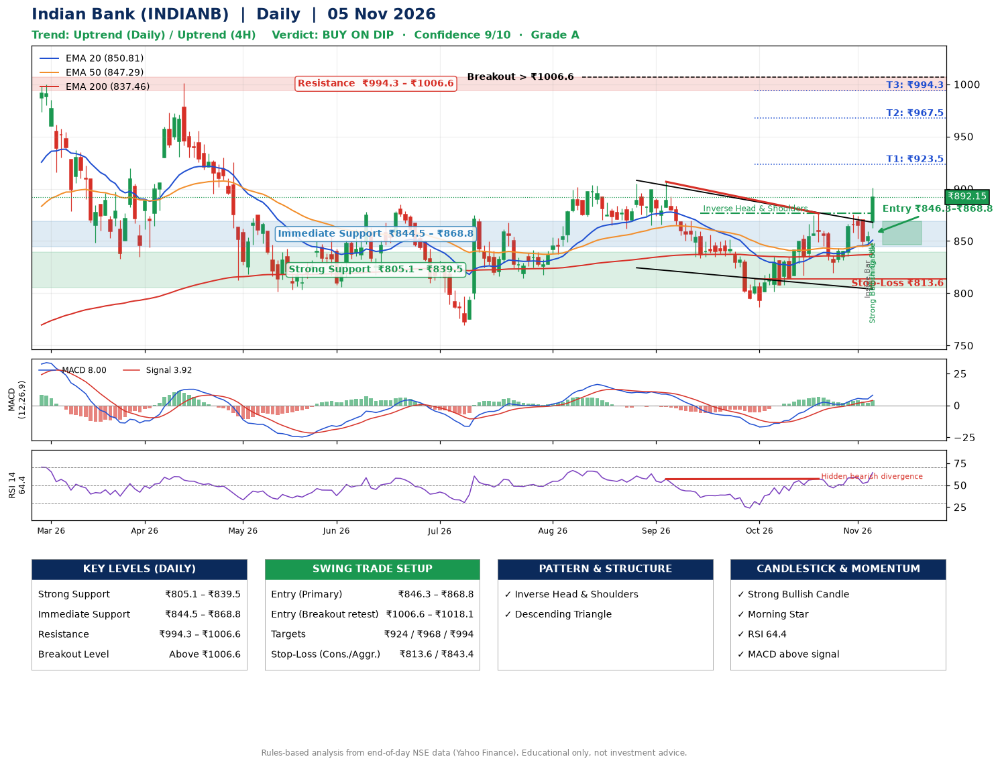

📌 **Indian Bank (INDIANB) – Multi-Timeframe Technical Analysis (Daily + 4H Combined)**
_Data up to 05 Nov 2026 · Close ₹892.15_

**📍 Daily Timeframe Trend**
- Trend: **Uptrend** (price above rising EMAs)
- Recent swing highs: ₹905.0, ₹906.7, ₹876.5 · swing lows: ₹833.8, ₹786.8, ₹819.3
- EMAs: EMA20 ₹850.8, EMA50 ₹847.3, EMA200 ₹837.5; bullish stack (EMA20 > EMA50 > EMA200); price above EMA20, EMA50, EMA200
- MACD 8.00 above signal 3.92 (above zero); histogram rising
- RSI(14) 64.4; Hidden bearish divergence

**📍 4-Hour Timeframe Trend**
- Structure: **Uptrend** (higher highs and higher lows)
- Pullback/support area: recent 4H swing lows ₹820.2, ₹845.0; EMA20 ₹858.7
- EMA20/50: bullish stack (EMA20 > EMA50); price above EMA20, EMA50
- MACD 9.33 above signal 6.44 (above zero), fresh bullish crossover; histogram rising
- RSI(14) 67.1; no divergence

**📍 Pattern Detection (Both Timeframes)**
- Daily: **Inverse Head & Shoulders** – head ₹786.8, neckline ₹876.5
- Daily: **Descending Triangle** – converging swing highs and lows over the last ~60 sessions
- 4H: **Ascending Triangle** – converging swing highs and lows over the last ~60 sessions

**📍 Candlestick Patterns (last 3 daily candles)**
- **Inside Bar** – 04 Nov: compression inside the prior range ₹844.6–₹870.0
- **Strong Bullish Candle** – 05 Nov: wide-range green candle, buyers in control
- **Morning Star** – 05 Nov: three-candle bullish reversal

**📍 Price Action Key Levels (Daily Structure)**

| Zone | Price Level (₹) | Context |
|------|-----------------|---------|
| Strong Support | ₹805.1 – ₹839.5 | Cluster of earlier swing lows (demand) |
| Immediate Support | ₹844.5 – ₹868.8 | Nearest swing-low / wick area |
| Resistance | ₹994.3 – ₹1006.6 | Nearest swing-high supply |
| Breakout Level | Above ₹1006.6 | Swing continuation trigger (52-week high ₹1000.9) |

**📍 Swing Trade Setup**

🟢 **Entry Zone**
- Primary: ₹846.3 – ₹868.8 (daily support / EMA20 area; enter on a bullish 4H candle)
- Alternate: ₹1006.6 – ₹1018.1 (breakout retest)

🎯 **Profit Targets**
- T1: ₹923.5
- T2: ₹967.5
- T3: ₹994.3

🛑 **Stop-Loss**
- Conservative: below daily swing low (₹813.6)
- Aggressive: below 4H structure (₹843.4)
- Risk per share ≈ ₹44.0; reward:risk to T1 ≈ 1.5

**📌 Strategy Notes**
- Higher timeframe: daily trend is uptrend; only take longs while price holds above ₹805.1.
- Entry timing: wait for a bullish 4H candle (engulfing/hammer) inside ₹846.3 – ₹868.8 rather than buying mid-range.
- EMA stacking: bullish stack (EMA20 > EMA50 > EMA200); price above EMA20, EMA50, EMA200.
- Breakout rule: a daily close above ₹1006.6 with volume above its 20-day average (≈1,741,621) opens T2/T3.
- Momentum: RSI 64 – room to run; Hidden bearish divergence.
- Exit discipline: move the stop to entry once T1 is hit; book partial profits at each target.

**STEP 2 — Marked Up Chart**

**✅ Trade Validation Checklist**
- Trend + momentum aligned: Yes · Price at entry zone: No
- Stop defined (₹813.6) · Reward:risk ≥ 1.5 to T1: No

## 📌 Final Verdict

Recommendation: **🟡 BUY ON DIP**

Confidence: **9/10**

Trade Quality: **A**

Reason:
• Daily uptrend (price above rising EMAs)
• EMAs stacked bullishly

Next Action:
• Wait for a pullback to ₹846.3–₹868.8, or a breakout above ₹1006.6

_Rules-based analysis from end-of-day data. Educational only, not investment advice. Never place orders without your own confirmation._