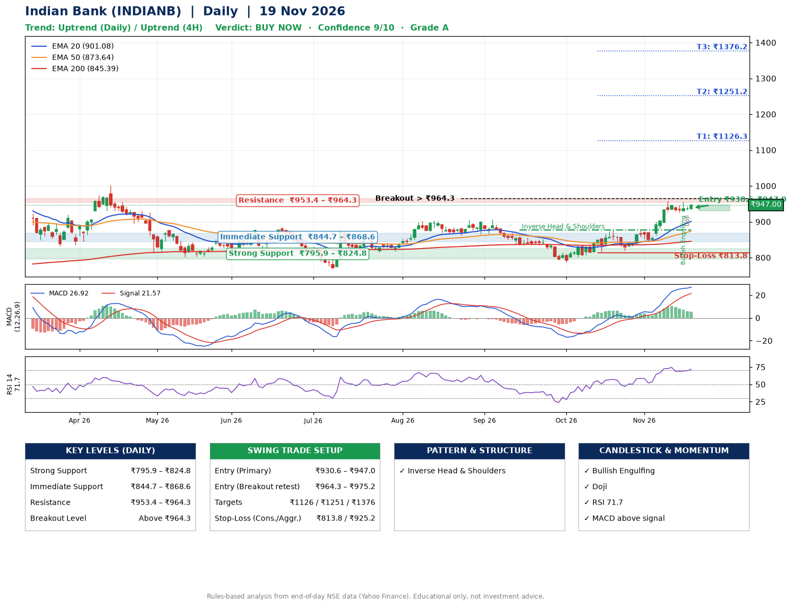

📌 **Indian Bank (INDIANB) – Multi-Timeframe Technical Analysis (Daily + 4H Combined)**
_Data up to 19 Nov 2026 · Close ₹947.00_

**📍 Daily Timeframe Trend**
- Trend: **Uptrend** (higher highs and higher lows)
- Recent swing highs: ₹906.7, ₹876.5, ₹958.8 · swing lows: ₹833.8, ₹786.8, ₹819.3
- EMAs: EMA20 ₹901.1, EMA50 ₹873.6, EMA200 ₹845.4; bullish stack (EMA20 > EMA50 > EMA200); price above EMA20, EMA50, EMA200
- MACD 26.92 above signal 21.57 (above zero); histogram falling
- RSI(14) 71.7; no divergence on the last two swings

**📍 4-Hour Timeframe Trend**
- Structure: **Uptrend** (price above rising EMAs)
- Pullback/support area: recent 4H swing lows ₹845.0, ₹926.5; EMA20 ₹922.8
- EMA20/50: bullish stack (EMA20 > EMA50); price above EMA20, EMA50
- MACD 18.83 below signal 20.24 (above zero), fresh bearish crossover; histogram rising
- RSI(14) 74.6; no divergence

**📍 Pattern Detection (Both Timeframes)**
- Daily: **Inverse Head & Shoulders** – head ₹786.8, neckline ₹876.5

**📍 Candlestick Patterns (last 3 daily candles)**
- **Bullish Engulfing** – 17 Nov: buyers fully reversed the prior red candle
- **Doji** – 18 Nov: indecision; wait for the next candle to confirm direction

**📍 Price Action Key Levels (Daily Structure)**

| Zone | Price Level (₹) | Context |
|------|-----------------|---------|
| Strong Support | ₹795.9 – ₹824.8 | Cluster of earlier swing lows (demand) |
| Immediate Support | ₹844.7 – ₹868.6 | Nearest swing-low / wick area |
| Resistance | ₹953.4 – ₹964.3 | Nearest swing-high supply |
| Breakout Level | Above ₹964.3 | Swing continuation trigger (52-week high ₹1000.9) |

**📍 Swing Trade Setup**

🟢 **Entry Zone**
- Primary: ₹930.6 – ₹947.0 (daily support / EMA20 area; enter on a bullish 4H candle)
- Alternate: ₹964.3 – ₹975.2 (breakout retest)

🎯 **Profit Targets**
- T1: ₹1126.3
- T2: ₹1251.2
- T3: ₹1376.2

🛑 **Stop-Loss**
- Conservative: below daily swing low (₹813.8)
- Aggressive: below 4H structure (₹925.2)
- Risk per share ≈ ₹125.0; reward:risk to T1 ≈ 1.5
- Time to T1: about 41 trading days (it rose this much within 60 trading days 26% of the time in the last 2 years)
- Time to T2: about 53 trading days (it rose this much within 60 trading days 6% of the time in the last 2 years)

**📌 Strategy Notes**
- Higher timeframe: daily trend is uptrend; only take longs while price holds above ₹795.9.
- Entry timing: wait for a bullish 4H candle (engulfing/hammer) inside ₹930.6 – ₹947.0 rather than buying mid-range.
- EMA stacking: bullish stack (EMA20 > EMA50 > EMA200); price above EMA20, EMA50, EMA200.
- Breakout rule: a daily close above ₹964.3 with volume above its 20-day average (≈1,686,597) opens T2/T3.
- Momentum: RSI 72 – elevated, prefer dips; no divergence on the last two swings.
- Exit discipline: move the stop to entry once T1 is hit; book partial profits at each target.

**STEP 2 — Marked Up Chart**

**✅ Trade Validation Checklist**
- Trend + momentum aligned: Yes · Price at entry zone: Yes
- Stop defined (₹813.8) · Reward:risk ≥ 1.5 to T1: Yes

## 📌 Final Verdict

Recommendation: **🟢 BUY NOW**

Confidence: **9/10**

Trade Quality: **A**

Reason:
• Daily uptrend (higher highs and higher lows)
• EMAs stacked bullishly

Next Action:
• Buy now within the entry zone, with the stop-loss in place

_Rules-based analysis from end-of-day data. Educational only, not investment advice. Never place orders without your own confirmation._