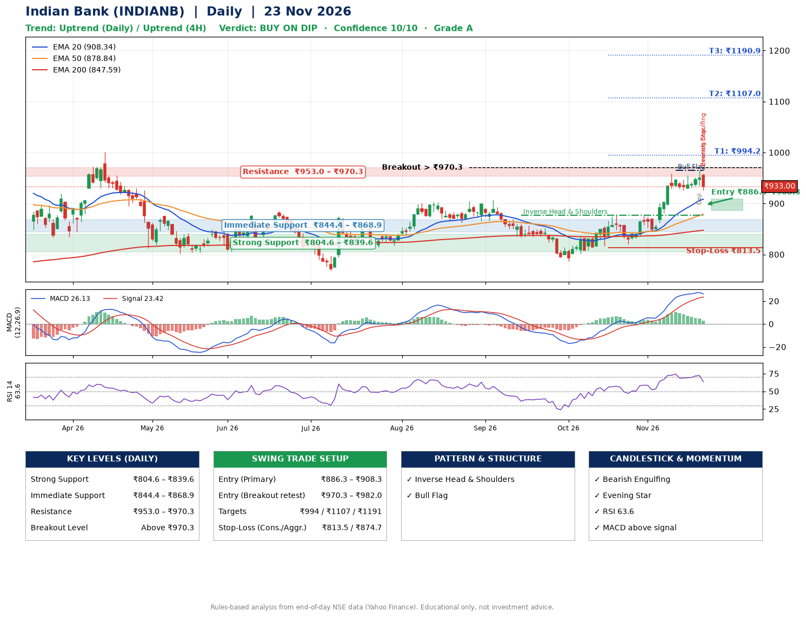

📌 **Indian Bank (INDIANB) – Multi-Timeframe Technical Analysis (Daily + 4H Combined)**
_Data up to 23 Nov 2026 · Close ₹933.00_

**📍 Daily Timeframe Trend**
- Trend: **Uptrend** (higher highs and higher lows)
- Recent swing highs: ₹906.7, ₹876.5, ₹958.8 · swing lows: ₹833.8, ₹786.8, ₹819.3
- EMAs: EMA20 ₹908.3, EMA50 ₹878.8, EMA200 ₹847.6; bullish stack (EMA20 > EMA50 > EMA200); price above EMA20, EMA50, EMA200
- MACD 26.13 above signal 23.42 (above zero); histogram falling
- RSI(14) 63.6; no divergence on the last two swings

**📍 4-Hour Timeframe Trend**
- Structure: **Uptrend** (price above rising EMAs)
- Pullback/support area: recent 4H swing lows ₹845.0, ₹926.5; EMA20 ₹929.6
- EMA20/50: bullish stack (EMA20 > EMA50); price above EMA20, EMA50
- MACD 15.64 below signal 18.60 (above zero); histogram falling
- RSI(14) 57.4; no divergence

**📍 Pattern Detection (Both Timeframes)**
- Daily: **Inverse Head & Shoulders** – head ₹786.8, neckline ₹876.5
- Daily: **Bull Flag** – 16% pole then a tight 4% flag; trigger above ₹964.5

**📍 Candlestick Patterns (last 3 daily candles)**
- **Doji** – 20 Nov: indecision; wait for the next candle to confirm direction
- **Bearish Engulfing** – 23 Nov: sellers fully reversed the prior green candle
- **Evening Star** – 23 Nov: three-candle bearish reversal

**📍 Price Action Key Levels (Daily Structure)**

| Zone | Price Level (₹) | Context |
|------|-----------------|---------|
| Strong Support | ₹804.6 – ₹839.6 | Cluster of earlier swing lows (demand) |
| Immediate Support | ₹844.4 – ₹868.9 | Nearest swing-low / wick area |
| Resistance | ₹953.0 – ₹970.3 | Nearest swing-high supply |
| Breakout Level | Above ₹970.3 | Swing continuation trigger (52-week high ₹1000.9) |

**📍 Swing Trade Setup**

🟢 **Entry Zone**
- Primary: ₹886.3 – ₹908.3 (daily support / EMA20 area; enter on a bullish 4H candle)
- Alternate: ₹970.3 – ₹982.0 (breakout retest)

🎯 **Profit Targets**
- T1: ₹994.2
- T2: ₹1107.0
- T3: ₹1190.9

🛑 **Stop-Loss**
- Conservative: below daily swing low (₹813.5)
- Aggressive: below 4H structure (₹874.7)
- Risk per share ≈ ₹83.9; reward:risk to T1 ≈ 1.2
- Time to T1: about 23 trading days (it rose this much within 60 trading days 57% of the time in the last 2 years)
- Time to T2: about 43 trading days (it rose this much within 60 trading days 20% of the time in the last 2 years)

**📌 Strategy Notes**
- Higher timeframe: daily trend is uptrend; only take longs while price holds above ₹804.6.
- Entry timing: wait for a bullish 4H candle (engulfing/hammer) inside ₹886.3 – ₹908.3 rather than buying mid-range.
- EMA stacking: bullish stack (EMA20 > EMA50 > EMA200); price above EMA20, EMA50, EMA200.
- Breakout rule: a daily close above ₹970.3 with volume above its 20-day average (≈1,842,106) opens T2/T3.
- Momentum: RSI 64 – room to run; no divergence on the last two swings.
- Exit discipline: move the stop to entry once T1 is hit; book partial profits at each target.

**STEP 2 — Marked Up Chart**

**✅ Trade Validation Checklist**
- Trend + momentum aligned: Yes · Price at entry zone: No
- Stop defined (₹813.5) · Reward:risk ≥ 1.5 to T1: No

## 📌 Final Verdict

Recommendation: **🟡 BUY ON DIP**

Confidence: **10/10**

Trade Quality: **A**

Reason:
• Daily uptrend (higher highs and higher lows)
• EMAs stacked bullishly

Next Action:
• Wait for a pullback to ₹886.3–₹908.3, or a breakout above ₹970.3

_Rules-based analysis from end-of-day data. Educational only, not investment advice. Never place orders without your own confirmation._