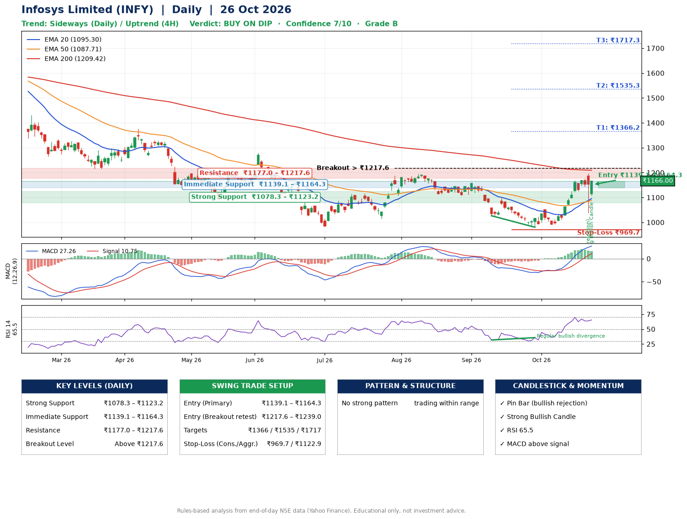

📌 **Infosys Limited (INFY) – Multi-Timeframe Technical Analysis (Daily + 4H Combined)**
_Data up to 26 Oct 2026 · Close ₹1166.00_

**📍 Daily Timeframe Trend**
- Trend: **Sideways** (mixed swing structure)
- Recent swing highs: ₹1195.0, ₹1156.0, ₹1052.3 · swing lows: ₹1107.2, ₹1026.5, ₹980.4
- EMAs: EMA20 ₹1095.3, EMA50 ₹1087.7, EMA200 ₹1209.4; mixed / crossing; price above EMA20, EMA50
- MACD 27.26 above signal 10.75 (above zero); histogram falling
- RSI(14) 65.5; Regular bullish divergence

**📍 4-Hour Timeframe Trend**
- Structure: **Uptrend** (higher highs and higher lows)
- Pullback/support area: recent 4H swing lows ₹990.2, ₹1125.3; EMA20 ₹1121.4
- EMA20/50: bullish stack (EMA20 > EMA50); price above EMA20, EMA50
- MACD 32.25 above signal 31.52 (above zero); histogram falling
- RSI(14) 67.1; no divergence

**📍 Pattern Detection (Both Timeframes)**
- No strong pattern detected. Trading within range.

**📍 Candlestick Patterns (last 3 daily candles)**
- **Pin Bar (bullish rejection)** – 23 Oct: long lower wick shows dip-buying near ₹1038.1
- **Strong Bullish Candle** – 26 Oct: wide-range green candle, buyers in control

**📍 Price Action Key Levels (Daily Structure)**

| Zone | Price Level (₹) | Context |
|------|-----------------|---------|
| Strong Support | ₹1078.3 – ₹1123.2 | Cluster of earlier swing lows (demand) |
| Immediate Support | ₹1139.1 – ₹1164.3 | Nearest swing-low / wick area |
| Resistance | ₹1177.0 – ₹1217.6 | Nearest swing-high supply |
| Breakout Level | Above ₹1217.6 | Swing continuation trigger (52-week high ₹1728.0) |

**📍 Swing Trade Setup**

🟢 **Entry Zone**
- Primary: ₹1139.1 – ₹1164.3 (daily support / EMA20 area; enter on a bullish 4H candle)
- Alternate: ₹1217.6 – ₹1239.0 (breakout retest)

🎯 **Profit Targets**
- T1: ₹1366.2
- T2: ₹1535.3
- T3: ₹1717.3

🛑 **Stop-Loss**
- Conservative: below daily swing low (₹969.7)
- Aggressive: below 4H structure (₹1122.9)
- Risk per share ≈ ₹182.0; reward:risk to T1 ≈ 1.2

**📌 Strategy Notes**
- Higher timeframe: daily trend is sideways; only take longs while price holds above ₹1078.3.
- Entry timing: wait for a bullish 4H candle (engulfing/hammer) inside ₹1139.1 – ₹1164.3 rather than buying mid-range.
- EMA stacking: mixed / crossing; price above EMA20, EMA50.
- Breakout rule: a daily close above ₹1217.6 with volume above its 20-day average (≈15,953,189) opens T2/T3.
- Momentum: RSI 65 – elevated, prefer dips; Regular bullish divergence.
- Exit discipline: move the stop to entry once T1 is hit; book partial profits at each target.

**STEP 2 — Marked Up Chart**

**✅ Trade Validation Checklist**
- Trend + momentum aligned: No · Price at entry zone: No
- Stop defined (₹969.7) · Reward:risk ≥ 1.5 to T1: No

## 📌 Final Verdict

Recommendation: **🟡 BUY ON DIP**

Confidence: **7/10**

Trade Quality: **B**

Reason:
• No strong edge from trend, momentum or patterns

Next Action:
• Wait for a pullback to ₹1139.1–₹1164.3, or a breakout above ₹1217.6

_Rules-based analysis from end-of-day data. Educational only, not investment advice. Never place orders without your own confirmation._