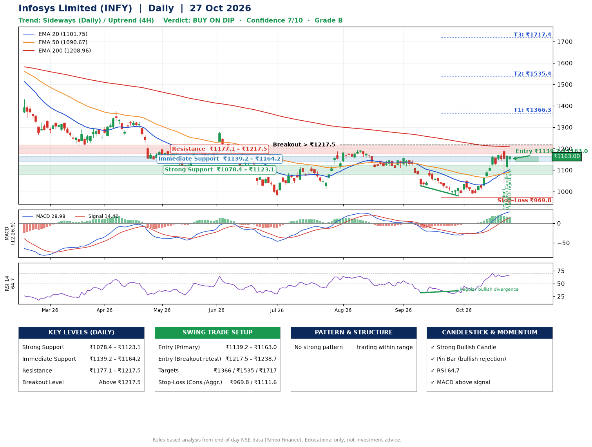

📌 **Infosys Limited (INFY) – Multi-Timeframe Technical Analysis (Daily + 4H Combined)**
_Data up to 27 Oct 2026 · Close ₹1163.00_

**📍 Daily Timeframe Trend**
- Trend: **Sideways** (mixed swing structure)
- Recent swing highs: ₹1195.0, ₹1156.0, ₹1052.3 · swing lows: ₹1107.2, ₹1026.5, ₹980.4
- EMAs: EMA20 ₹1101.7, EMA50 ₹1090.7, EMA200 ₹1209.0; mixed / crossing; price above EMA20, EMA50
- MACD 28.98 above signal 14.40 (above zero); histogram falling
- RSI(14) 64.7; Regular bullish divergence

**📍 4-Hour Timeframe Trend**
- Structure: **Uptrend** (price above rising EMAs)
- Pullback/support area: recent 4H swing lows ₹1125.3, ₹1114.1; EMA20 ₹1128.7
- EMA20/50: bullish stack (EMA20 > EMA50); price above EMA20, EMA50
- MACD 30.44 below signal 31.27 (above zero), fresh bearish crossover; histogram falling
- RSI(14) 65.3; no divergence

**📍 Pattern Detection (Both Timeframes)**
- 4H: **Bull Flag** – 15% pole then a tight 7% flag; trigger above ₹1196.9

**📍 Candlestick Patterns (last 3 daily candles)**
- **Pin Bar (bullish rejection)** – 23 Oct: long lower wick shows dip-buying near ₹1038.1
- **Strong Bullish Candle** – 26 Oct: wide-range green candle, buyers in control
- **Pin Bar (bullish rejection)** – 27 Oct: long lower wick shows dip-buying near ₹1129.3

**📍 Price Action Key Levels (Daily Structure)**

| Zone | Price Level (₹) | Context |
|------|-----------------|---------|
| Strong Support | ₹1078.4 – ₹1123.1 | Cluster of earlier swing lows (demand) |
| Immediate Support | ₹1139.2 – ₹1164.2 | Nearest swing-low / wick area |
| Resistance | ₹1177.1 – ₹1217.5 | Nearest swing-high supply |
| Breakout Level | Above ₹1217.5 | Swing continuation trigger (52-week high ₹1728.0) |

**📍 Swing Trade Setup**

🟢 **Entry Zone**
- Primary: ₹1139.2 – ₹1163.0 (daily support / EMA20 area; enter on a bullish 4H candle)
- Alternate: ₹1217.5 – ₹1238.7 (breakout retest)

🎯 **Profit Targets**
- T1: ₹1366.3
- T2: ₹1535.4
- T3: ₹1717.4

🛑 **Stop-Loss**
- Conservative: below daily swing low (₹969.8)
- Aggressive: below 4H structure (₹1111.6)
- Risk per share ≈ ₹181.3; reward:risk to T1 ≈ 1.2

**📌 Strategy Notes**
- Higher timeframe: daily trend is sideways; only take longs while price holds above ₹1078.4.
- Entry timing: wait for a bullish 4H candle (engulfing/hammer) inside ₹1139.2 – ₹1163.0 rather than buying mid-range.
- EMA stacking: mixed / crossing; price above EMA20, EMA50.
- Breakout rule: a daily close above ₹1217.5 with volume above its 20-day average (≈16,447,148) opens T2/T3.
- Momentum: RSI 65 – room to run; Regular bullish divergence.
- Exit discipline: move the stop to entry once T1 is hit; book partial profits at each target.

**STEP 2 — Marked Up Chart**

**✅ Trade Validation Checklist**
- Trend + momentum aligned: No · Price at entry zone: Yes
- Stop defined (₹969.8) · Reward:risk ≥ 1.5 to T1: No

## 📌 Final Verdict

Recommendation: **🟡 BUY ON DIP**

Confidence: **7/10**

Trade Quality: **B**

Reason:
• No strong edge from trend, momentum or patterns

Next Action:
• Wait for a pullback to ₹1139.2–₹1163.0, or a breakout above ₹1217.5

_Rules-based analysis from end-of-day data. Educational only, not investment advice. Never place orders without your own confirmation._