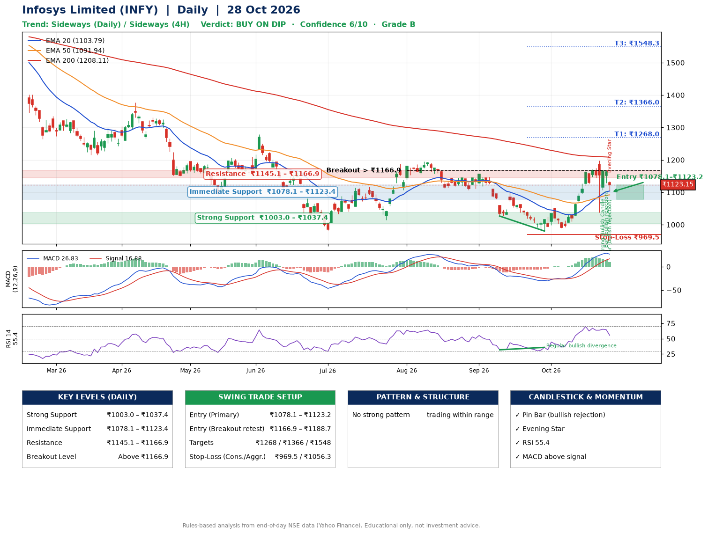

📌 **Infosys Limited (INFY) – Multi-Timeframe Technical Analysis (Daily + 4H Combined)**
_Data up to 28 Oct 2026 · Close ₹1123.15_

**📍 Daily Timeframe Trend**
- Trend: **Sideways** (mixed swing structure)
- Recent swing highs: ₹1195.0, ₹1156.0, ₹1052.3 · swing lows: ₹1107.2, ₹1026.5, ₹980.4
- EMAs: EMA20 ₹1103.8, EMA50 ₹1091.9, EMA200 ₹1208.1; mixed / crossing; price above EMA20, EMA50
- MACD 26.83 above signal 16.88 (above zero); histogram falling
- RSI(14) 55.4; Regular bullish divergence

**📍 4-Hour Timeframe Trend**
- Structure: **Sideways** (mixed swing structure)
- Pullback/support area: recent 4H swing lows ₹1125.3, ₹1114.1; EMA20 ₹1127.4
- EMA20/50: bullish stack (EMA20 > EMA50); price above EMA50
- MACD 22.50 below signal 28.67 (above zero), fresh bearish crossover; histogram falling
- RSI(14) 52.1; no divergence

**📍 Pattern Detection (Both Timeframes)**
- No strong pattern detected. Trading within range.

**📍 Candlestick Patterns (last 3 daily candles)**
- **Strong Bullish Candle** – 26 Oct: wide-range green candle, buyers in control
- **Pin Bar (bullish rejection)** – 27 Oct: long lower wick shows dip-buying near ₹1129.3
- **Pin Bar (bullish rejection)** – 28 Oct: long lower wick shows dip-buying near ₹1103.4
- **Evening Star** – 28 Oct: three-candle bearish reversal

**📍 Price Action Key Levels (Daily Structure)**

| Zone | Price Level (₹) | Context |
|------|-----------------|---------|
| Strong Support | ₹1003.0 – ₹1037.4 | Cluster of earlier swing lows (demand) |
| Immediate Support | ₹1078.1 – ₹1123.4 | Nearest swing-low / wick area |
| Resistance | ₹1145.1 – ₹1166.9 | Nearest swing-high supply |
| Breakout Level | Above ₹1166.9 | Swing continuation trigger (52-week high ₹1728.0) |

**📍 Swing Trade Setup**

🟢 **Entry Zone**
- Primary: ₹1078.1 – ₹1123.2 (daily support / EMA20 area; enter on a bullish 4H candle)
- Alternate: ₹1166.9 – ₹1188.7 (breakout retest)

🎯 **Profit Targets**
- T1: ₹1268.0
- T2: ₹1366.0
- T3: ₹1548.3

🛑 **Stop-Loss**
- Conservative: below daily swing low (₹969.5)
- Aggressive: below 4H structure (₹1056.3)
- Risk per share ≈ ₹131.1; reward:risk to T1 ≈ 1.3

**📌 Strategy Notes**
- Higher timeframe: daily trend is sideways; only take longs while price holds above ₹1003.0.
- Entry timing: wait for a bullish 4H candle (engulfing/hammer) inside ₹1078.1 – ₹1123.2 rather than buying mid-range.
- EMA stacking: mixed / crossing; price above EMA20, EMA50.
- Breakout rule: a daily close above ₹1166.9 with volume above its 20-day average (≈16,800,402) opens T2/T3.
- Momentum: RSI 55 – room to run; Regular bullish divergence.
- Exit discipline: move the stop to entry once T1 is hit; book partial profits at each target.

**STEP 2 — Marked Up Chart**

**✅ Trade Validation Checklist**
- Trend + momentum aligned: No · Price at entry zone: Yes
- Stop defined (₹969.5) · Reward:risk ≥ 1.5 to T1: No

## 📌 Final Verdict

Recommendation: **🟡 BUY ON DIP**

Confidence: **6/10**

Trade Quality: **B**

Reason:
• No strong edge from trend, momentum or patterns

Next Action:
• Wait for a pullback to ₹1078.1–₹1123.2, or a breakout above ₹1166.9

_Rules-based analysis from end-of-day data. Educational only, not investment advice. Never place orders without your own confirmation._