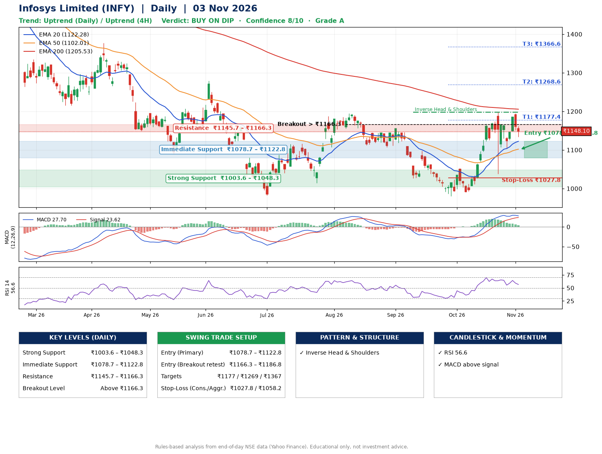

📌 **Infosys Limited (INFY) – Multi-Timeframe Technical Analysis (Daily + 4H Combined)**
_Data up to 03 Nov 2026 · Close ₹1148.10_

**📍 Daily Timeframe Trend**
- Trend: **Uptrend** (higher highs and higher lows)
- Recent swing highs: ₹1156.0, ₹1052.3, ₹1197.8 · swing lows: ₹1026.5, ₹980.4, ₹1038.1
- EMAs: EMA20 ₹1122.3, EMA50 ₹1102.0, EMA200 ₹1205.5; mixed / crossing; price above EMA20, EMA50
- MACD 27.70 above signal 23.62 (above zero); histogram falling
- RSI(14) 56.6; no divergence on the last two swings

**📍 4-Hour Timeframe Trend**
- Structure: **Uptrend** (price above rising EMAs)
- Pullback/support area: recent 4H swing lows ₹1114.1, ₹1103.7; EMA20 ₹1142.5
- EMA20/50: bullish stack (EMA20 > EMA50); price above EMA20, EMA50
- MACD 15.68 below signal 20.58 (above zero); histogram falling
- RSI(14) 53.7; no divergence

**📍 Pattern Detection (Both Timeframes)**
- Daily: **Inverse Head & Shoulders** – head ₹980.4, neckline ₹1197.8
- 4H: **Double Top** – tops near ₹1196.9/₹1190.7, neckline ₹1103.7, forming

**📍 Candlestick Patterns (last 3 daily candles)**
- No notable candlestick signal in the last 3 sessions.

**📍 Price Action Key Levels (Daily Structure)**

| Zone | Price Level (₹) | Context |
|------|-----------------|---------|
| Strong Support | ₹1003.6 – ₹1048.3 | Cluster of earlier swing lows (demand) |
| Immediate Support | ₹1078.7 – ₹1122.8 | Nearest swing-low / wick area |
| Resistance | ₹1145.7 – ₹1166.3 | Nearest swing-high supply |
| Breakout Level | Above ₹1166.3 | Swing continuation trigger (52-week high ₹1728.0) |

**📍 Swing Trade Setup**

🟢 **Entry Zone**
- Primary: ₹1078.7 – ₹1122.8 (daily support / EMA20 area; enter on a bullish 4H candle)
- Alternate: ₹1166.3 – ₹1186.8 (breakout retest)

🎯 **Profit Targets**
- T1: ₹1177.4
- T2: ₹1268.6
- T3: ₹1366.6

🛑 **Stop-Loss**
- Conservative: below daily swing low (₹1027.8)
- Aggressive: below 4H structure (₹1058.2)
- Risk per share ≈ ₹73.0; reward:risk to T1 ≈ 1.1

**📌 Strategy Notes**
- Higher timeframe: daily trend is uptrend; only take longs while price holds above ₹1003.6.
- Entry timing: wait for a bullish 4H candle (engulfing/hammer) inside ₹1078.7 – ₹1122.8 rather than buying mid-range.
- EMA stacking: mixed / crossing; price above EMA20, EMA50.
- Breakout rule: a daily close above ₹1166.3 with volume above its 20-day average (≈16,635,474) opens T2/T3.
- Momentum: RSI 57 – room to run; no divergence on the last two swings.
- Exit discipline: move the stop to entry once T1 is hit; book partial profits at each target.

**STEP 2 — Marked Up Chart**

**✅ Trade Validation Checklist**
- Trend + momentum aligned: Yes · Price at entry zone: No
- Stop defined (₹1027.8) · Reward:risk ≥ 1.5 to T1: No

## 📌 Final Verdict

Recommendation: **🟡 BUY ON DIP**

Confidence: **8/10**

Trade Quality: **A**

Reason:
• Daily uptrend (higher highs and higher lows)
• Inverse Head & Shoulders: head ₹980.4, neckline ₹1197.8

Next Action:
• Wait for a pullback to ₹1078.7–₹1122.8, or a breakout above ₹1166.3

_Rules-based analysis from end-of-day data. Educational only, not investment advice. Never place orders without your own confirmation._