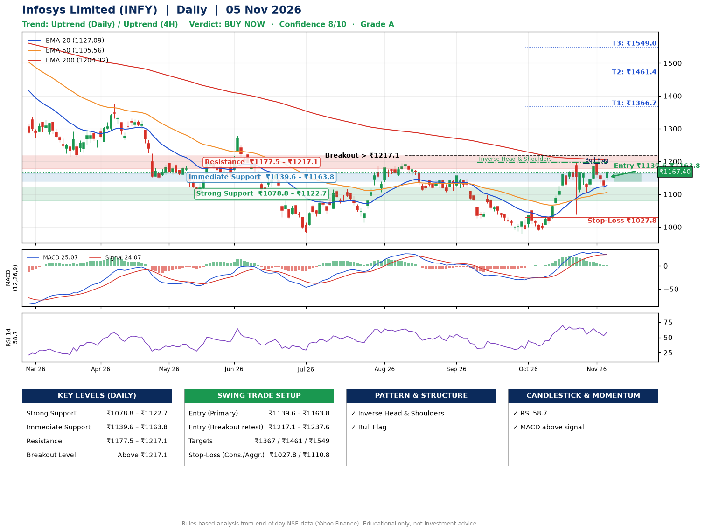

📌 **Infosys Limited (INFY) – Multi-Timeframe Technical Analysis (Daily + 4H Combined)**
_Data up to 05 Nov 2026 · Close ₹1167.40_

**📍 Daily Timeframe Trend**
- Trend: **Uptrend** (higher highs and higher lows)
- Recent swing highs: ₹1156.0, ₹1052.3, ₹1197.8 · swing lows: ₹1026.5, ₹980.4, ₹1038.1
- EMAs: EMA20 ₹1127.1, EMA50 ₹1105.6, EMA200 ₹1204.3; mixed / crossing; price above EMA20, EMA50
- MACD 25.07 above signal 24.07 (above zero); histogram rising
- RSI(14) 58.7; no divergence on the last two swings

**📍 4-Hour Timeframe Trend**
- Structure: **Uptrend** (price above rising EMAs)
- Pullback/support area: recent 4H swing lows ₹1103.7, ₹1113.1; EMA20 ₹1144.0
- EMA20/50: bullish stack (EMA20 > EMA50); price above EMA20, EMA50
- MACD 11.61 below signal 14.98 (above zero); histogram rising
- RSI(14) 57.3; Hidden bullish divergence

**📍 Pattern Detection (Both Timeframes)**
- Daily: **Inverse Head & Shoulders** – head ₹980.4, neckline ₹1197.8
- Daily: **Bull Flag** – 17% pole then a tight 8% flag; trigger above ₹1194.5
- 4H: **Double Top** – tops near ₹1196.9/₹1190.7, neckline ₹1103.7, forming
- 4H: **Double Bottom** – bottoms near ₹1103.7/₹1113.1, neckline ₹1190.7, forming

**📍 Candlestick Patterns (last 3 daily candles)**
- No notable candlestick signal in the last 3 sessions.

**📍 Price Action Key Levels (Daily Structure)**

| Zone | Price Level (₹) | Context |
|------|-----------------|---------|
| Strong Support | ₹1078.8 – ₹1122.7 | Cluster of earlier swing lows (demand) |
| Immediate Support | ₹1139.6 – ₹1163.8 | Nearest swing-low / wick area |
| Resistance | ₹1177.5 – ₹1217.1 | Nearest swing-high supply |
| Breakout Level | Above ₹1217.1 | Swing continuation trigger (52-week high ₹1728.0) |

**📍 Swing Trade Setup**

🟢 **Entry Zone**
- Primary: ₹1139.6 – ₹1163.8 (daily support / EMA20 area; enter on a bullish 4H candle)
- Alternate: ₹1217.1 – ₹1237.6 (breakout retest)

🎯 **Profit Targets**
- T1: ₹1366.7
- T2: ₹1461.4
- T3: ₹1549.0

🛑 **Stop-Loss**
- Conservative: below daily swing low (₹1027.8)
- Aggressive: below 4H structure (₹1110.8)
- Risk per share ≈ ₹123.9; reward:risk to T1 ≈ 1.7

**📌 Strategy Notes**
- Higher timeframe: daily trend is uptrend; only take longs while price holds above ₹1078.8.
- Entry timing: wait for a bullish 4H candle (engulfing/hammer) inside ₹1139.6 – ₹1163.8 rather than buying mid-range.
- EMA stacking: mixed / crossing; price above EMA20, EMA50.
- Breakout rule: a daily close above ₹1217.1 with volume above its 20-day average (≈16,823,525) opens T2/T3.
- Momentum: RSI 59 – room to run; no divergence on the last two swings.
- Exit discipline: move the stop to entry once T1 is hit; book partial profits at each target.

**STEP 2 — Marked Up Chart**

**✅ Trade Validation Checklist**
- Trend + momentum aligned: Yes · Price at entry zone: No
- Stop defined (₹1027.8) · Reward:risk ≥ 1.5 to T1: Yes

## 📌 Final Verdict

Recommendation: **🟢 BUY NOW**

Confidence: **8/10**

Trade Quality: **A**

Reason:
• Daily uptrend (higher highs and higher lows)
• Inverse Head & Shoulders: head ₹980.4, neckline ₹1197.8

Next Action:
• Buy now within the entry zone, with the stop-loss in place

_Rules-based analysis from end-of-day data. Educational only, not investment advice. Never place orders without your own confirmation._