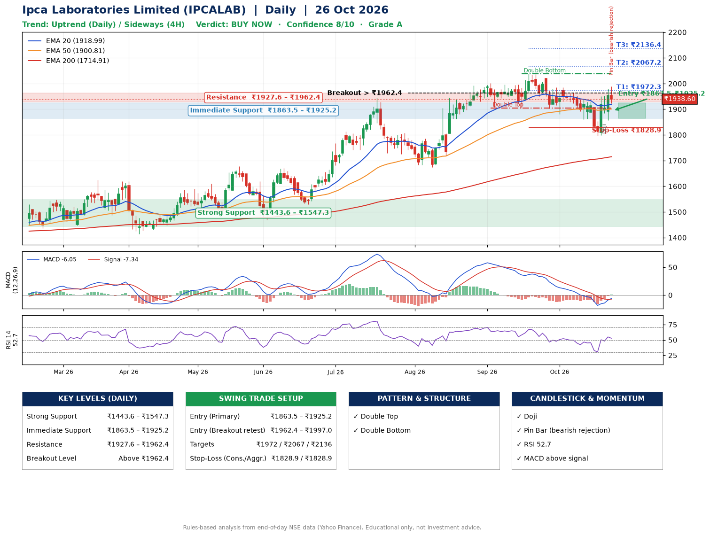

📌 **Ipca Laboratories Limited (IPCALAB) – Multi-Timeframe Technical Analysis (Daily + 4H Combined)**
_Data up to 26 Oct 2026 · Close ₹1938.60_

**📍 Daily Timeframe Trend**
- Trend: **Uptrend** (price above rising EMAs)
- Recent swing highs: ₹1945.1, ₹2001.5, ₹2038.0 · swing lows: ₹1907.9, ₹1905.0, ₹1880.8
- EMAs: EMA20 ₹1919.0, EMA50 ₹1900.8, EMA200 ₹1714.9; bullish stack (EMA20 > EMA50 > EMA200); price above EMA20, EMA50, EMA200
- MACD -6.05 above signal -7.34 (below zero), fresh bullish crossover; histogram rising
- RSI(14) 52.7; no divergence on the last two swings

**📍 4-Hour Timeframe Trend**
- Structure: **Sideways** (mixed swing structure)
- Pullback/support area: recent 4H swing lows ₹1862.0, ₹1800.0; EMA20 ₹1904.3
- EMA20/50: bearish stack (EMA20 < EMA50); price above EMA20, EMA50
- MACD -0.19 above signal -11.32 (below zero); histogram falling
- RSI(14) 54.5; no divergence

**📍 Pattern Detection (Both Timeframes)**
- Daily: **Double Top** – tops near ₹2001.5/₹2038.0, neckline ₹1905.0, forming
- Daily: **Double Bottom** – bottoms near ₹1905.0/₹1880.8, neckline ₹2038.0, forming

**📍 Candlestick Patterns (last 3 daily candles)**
- **Doji** – 22 Oct: indecision; wait for the next candle to confirm direction
- **Pin Bar (bearish rejection)** – 26 Oct: long upper wick shows selling near ₹1989.6

**📍 Price Action Key Levels (Daily Structure)**

| Zone | Price Level (₹) | Context |
|------|-----------------|---------|
| Strong Support | ₹1443.6 – ₹1547.3 | Cluster of earlier swing lows (demand) |
| Immediate Support | ₹1863.5 – ₹1925.2 | Nearest swing-low / wick area |
| Resistance | ₹1927.6 – ₹1962.4 | Nearest swing-high supply |
| Breakout Level | Above ₹1962.4 | Swing continuation trigger (52-week high ₹2038.0) |

**📍 Swing Trade Setup**

🟢 **Entry Zone**
- Primary: ₹1863.5 – ₹1925.2 (daily support / EMA20 area; enter on a bullish 4H candle)
- Alternate: ₹1962.4 – ₹1997.0 (breakout retest)

🎯 **Profit Targets**
- T1: ₹1972.3
- T2: ₹2067.2
- T3: ₹2136.4

🛑 **Stop-Loss**
- Conservative: below daily swing low (₹1828.9)
- Aggressive: below 4H structure (₹1828.9)
- Risk per share ≈ ₹69.1; reward:risk to T1 ≈ 1.1

**📌 Strategy Notes**
- Higher timeframe: daily trend is uptrend; only take longs while price holds above ₹1443.6.
- Entry timing: wait for a bullish 4H candle (engulfing/hammer) inside ₹1863.5 – ₹1925.2 rather than buying mid-range.
- EMA stacking: bullish stack (EMA20 > EMA50 > EMA200); price above EMA20, EMA50, EMA200.
- Breakout rule: a daily close above ₹1962.4 with volume above its 20-day average (≈255,562) opens T2/T3.
- Momentum: RSI 53 – room to run; no divergence on the last two swings.
- Exit discipline: move the stop to entry once T1 is hit; book partial profits at each target.

**STEP 2 — Marked Up Chart**

**✅ Trade Validation Checklist**
- Trend + momentum aligned: Yes · Price at entry zone: No
- Stop defined (₹1828.9) · Reward:risk ≥ 1.5 to T1: No

## 📌 Final Verdict

Recommendation: **🟢 BUY NOW**

Confidence: **8/10**

Trade Quality: **A**

Reason:
• Daily uptrend (price above rising EMAs)
• EMAs stacked bullishly

Next Action:
• Buy now within the entry zone, with the stop-loss in place

_Rules-based analysis from end-of-day data. Educational only, not investment advice. Never place orders without your own confirmation._