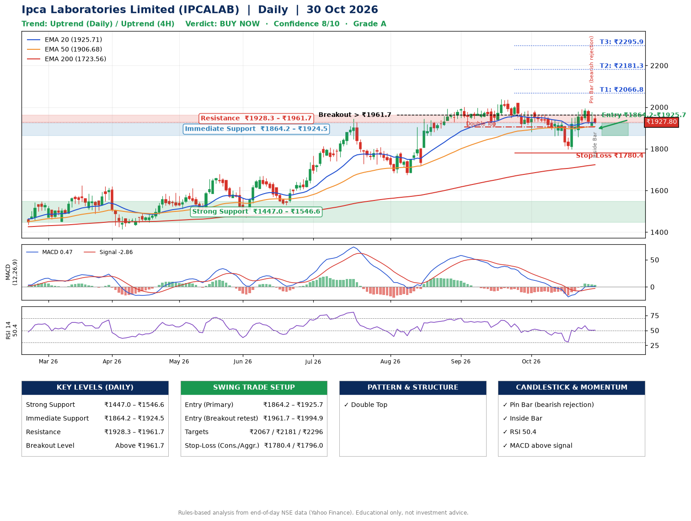

📌 **Ipca Laboratories Limited (IPCALAB) – Multi-Timeframe Technical Analysis (Daily + 4H Combined)**
_Data up to 30 Oct 2026 · Close ₹1927.80_

**📍 Daily Timeframe Trend**
- Trend: **Uptrend** (price above rising EMAs)
- Recent swing highs: ₹1945.1, ₹2001.5, ₹2038.0 · swing lows: ₹1905.0, ₹1880.8, ₹1797.0
- EMAs: EMA20 ₹1925.7, EMA50 ₹1906.7, EMA200 ₹1723.6; bullish stack (EMA20 > EMA50 > EMA200); price above EMA20, EMA50, EMA200
- MACD 0.47 above signal -2.86 (above zero), fresh bullish crossover; histogram falling
- RSI(14) 50.4; no divergence on the last two swings

**📍 4-Hour Timeframe Trend**
- Structure: **Uptrend** (price above rising EMAs)
- Pullback/support area: recent 4H swing lows ₹1862.0, ₹1800.0; EMA20 ₹1922.3
- EMA20/50: bullish stack (EMA20 > EMA50); price above EMA20, EMA50
- MACD 6.50 above signal 4.50 (above zero); histogram falling
- RSI(14) 51.0; no divergence

**📍 Pattern Detection (Both Timeframes)**
- Daily: **Double Top** – tops near ₹2001.5/₹2038.0, neckline ₹1905.0, forming

**📍 Candlestick Patterns (last 3 daily candles)**
- **Pin Bar (bearish rejection)** – 29 Oct: long upper wick shows selling near ₹1978.0
- **Inside Bar** – 30 Oct: compression inside the prior range ₹1910.5–₹1978.0

**📍 Price Action Key Levels (Daily Structure)**

| Zone | Price Level (₹) | Context |
|------|-----------------|---------|
| Strong Support | ₹1447.0 – ₹1546.6 | Cluster of earlier swing lows (demand) |
| Immediate Support | ₹1864.2 – ₹1924.5 | Nearest swing-low / wick area |
| Resistance | ₹1928.3 – ₹1961.7 | Nearest swing-high supply |
| Breakout Level | Above ₹1961.7 | Swing continuation trigger (52-week high ₹2038.0) |

**📍 Swing Trade Setup**

🟢 **Entry Zone**
- Primary: ₹1864.2 – ₹1925.7 (daily support / EMA20 area; enter on a bullish 4H candle)
- Alternate: ₹1961.7 – ₹1994.9 (breakout retest)

🎯 **Profit Targets**
- T1: ₹2066.8
- T2: ₹2181.3
- T3: ₹2295.9

🛑 **Stop-Loss**
- Conservative: below daily swing low (₹1780.4)
- Aggressive: below 4H structure (₹1796.0)
- Risk per share ≈ ₹114.6; reward:risk to T1 ≈ 1.5

**📌 Strategy Notes**
- Higher timeframe: daily trend is uptrend; only take longs while price holds above ₹1447.0.
- Entry timing: wait for a bullish 4H candle (engulfing/hammer) inside ₹1864.2 – ₹1925.7 rather than buying mid-range.
- EMA stacking: bullish stack (EMA20 > EMA50 > EMA200); price above EMA20, EMA50, EMA200.
- Breakout rule: a daily close above ₹1961.7 with volume above its 20-day average (≈246,402) opens T2/T3.
- Momentum: RSI 50 – room to run; no divergence on the last two swings.
- Exit discipline: move the stop to entry once T1 is hit; book partial profits at each target.

**STEP 2 — Marked Up Chart**

**✅ Trade Validation Checklist**
- Trend + momentum aligned: Yes · Price at entry zone: No
- Stop defined (₹1780.4) · Reward:risk ≥ 1.5 to T1: Yes

## 📌 Final Verdict

Recommendation: **🟢 BUY NOW**

Confidence: **8/10**

Trade Quality: **A**

Reason:
• Daily uptrend (price above rising EMAs)
• EMAs stacked bullishly

Next Action:
• Buy now within the entry zone, with the stop-loss in place

_Rules-based analysis from end-of-day data. Educational only, not investment advice. Never place orders without your own confirmation._