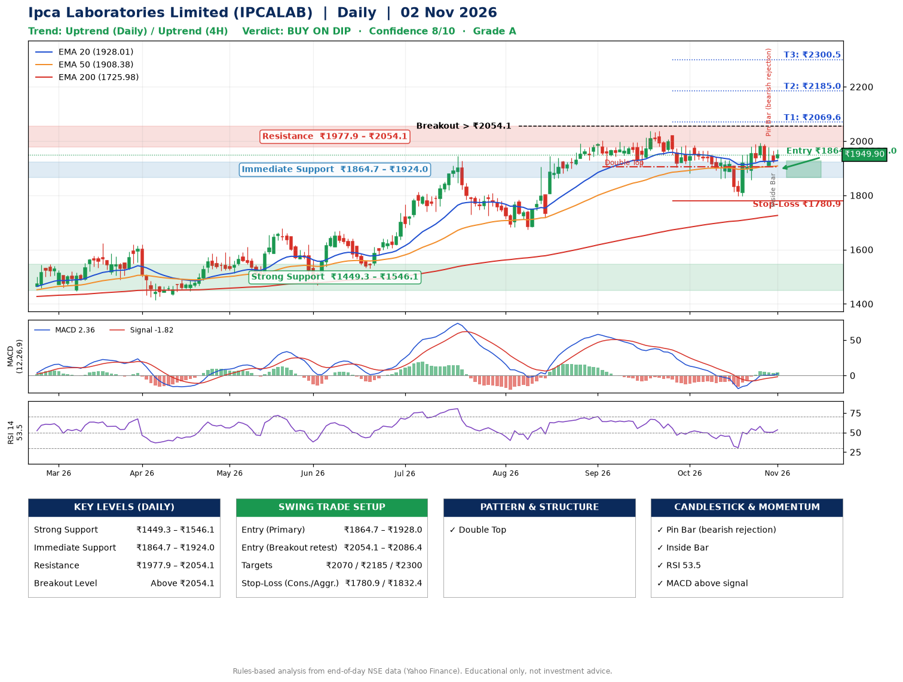

📌 **Ipca Laboratories Limited (IPCALAB) – Multi-Timeframe Technical Analysis (Daily + 4H Combined)**
_Data up to 02 Nov 2026 · Close ₹1949.90_

**📍 Daily Timeframe Trend**
- Trend: **Uptrend** (price above rising EMAs)
- Recent swing highs: ₹1945.1, ₹2001.5, ₹2038.0 · swing lows: ₹1905.0, ₹1880.8, ₹1797.0
- EMAs: EMA20 ₹1928.0, EMA50 ₹1908.4, EMA200 ₹1726.0; bullish stack (EMA20 > EMA50 > EMA200); price above EMA20, EMA50, EMA200
- MACD 2.36 above signal -1.82 (above zero); histogram rising
- RSI(14) 53.5; no divergence on the last two swings

**📍 4-Hour Timeframe Trend**
- Structure: **Uptrend** (price above rising EMAs)
- Pullback/support area: recent 4H swing lows ₹1800.0, ₹1919.0; EMA20 ₹1927.6
- EMA20/50: bullish stack (EMA20 > EMA50); price above EMA20, EMA50
- MACD 8.93 above signal 5.99 (above zero); histogram falling
- RSI(14) 54.9; no divergence

**📍 Pattern Detection (Both Timeframes)**
- Daily: **Double Top** – tops near ₹2001.5/₹2038.0, neckline ₹1905.0, forming
- 4H: **Inverse Head & Shoulders** – head ₹1800.0, neckline ₹1989.2
- 4H: **Ascending Triangle** – converging swing highs and lows over the last ~60 sessions

**📍 Candlestick Patterns (last 3 daily candles)**
- **Pin Bar (bearish rejection)** – 29 Oct: long upper wick shows selling near ₹1978.0
- **Inside Bar** – 30 Oct: compression inside the prior range ₹1910.5–₹1978.0

**📍 Price Action Key Levels (Daily Structure)**

| Zone | Price Level (₹) | Context |
|------|-----------------|---------|
| Strong Support | ₹1449.3 – ₹1546.1 | Cluster of earlier swing lows (demand) |
| Immediate Support | ₹1864.7 – ₹1924.0 | Nearest swing-low / wick area |
| Resistance | ₹1977.9 – ₹2054.1 | Nearest swing-high supply |
| Breakout Level | Above ₹2054.1 | Swing continuation trigger (52-week high ₹2038.0) |

**📍 Swing Trade Setup**

🟢 **Entry Zone**
- Primary: ₹1864.7 – ₹1928.0 (daily support / EMA20 area; enter on a bullish 4H candle)
- Alternate: ₹2054.1 – ₹2086.4 (breakout retest)

🎯 **Profit Targets**
- T1: ₹2069.6
- T2: ₹2185.0
- T3: ₹2300.5

🛑 **Stop-Loss**
- Conservative: below daily swing low (₹1780.9)
- Aggressive: below 4H structure (₹1832.4)
- Risk per share ≈ ₹115.5; reward:risk to T1 ≈ 1.5

**📌 Strategy Notes**
- Higher timeframe: daily trend is uptrend; only take longs while price holds above ₹1449.3.
- Entry timing: wait for a bullish 4H candle (engulfing/hammer) inside ₹1864.7 – ₹1928.0 rather than buying mid-range.
- EMA stacking: bullish stack (EMA20 > EMA50 > EMA200); price above EMA20, EMA50, EMA200.
- Breakout rule: a daily close above ₹2054.1 with volume above its 20-day average (≈240,897) opens T2/T3.
- Momentum: RSI 54 – room to run; no divergence on the last two swings.
- Exit discipline: move the stop to entry once T1 is hit; book partial profits at each target.

**STEP 2 — Marked Up Chart**

**✅ Trade Validation Checklist**
- Trend + momentum aligned: Yes · Price at entry zone: No
- Stop defined (₹1780.9) · Reward:risk ≥ 1.5 to T1: Yes

## 📌 Final Verdict

Recommendation: **🟡 BUY ON DIP**

Confidence: **8/10**

Trade Quality: **A**

Reason:
• Daily uptrend (price above rising EMAs)
• EMAs stacked bullishly

Next Action:
• Wait for a pullback to ₹1864.7–₹1928.0, or a breakout above ₹2054.1

_Rules-based analysis from end-of-day data. Educational only, not investment advice. Never place orders without your own confirmation._