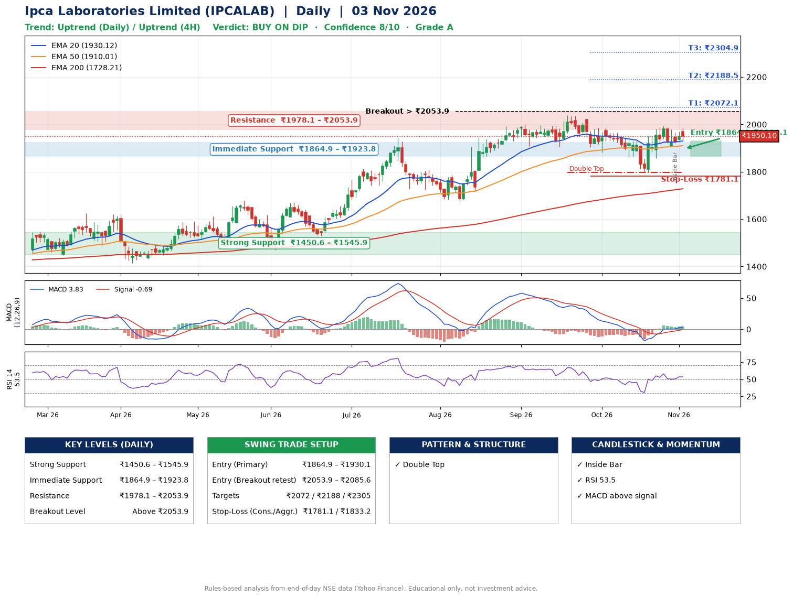

📌 **Ipca Laboratories Limited (IPCALAB) – Multi-Timeframe Technical Analysis (Daily + 4H Combined)**
_Data up to 03 Nov 2026 · Close ₹1950.10_

**📍 Daily Timeframe Trend**
- Trend: **Uptrend** (price above rising EMAs)
- Recent swing highs: ₹2001.5, ₹2038.0, ₹1994.0 · swing lows: ₹1905.0, ₹1880.8, ₹1797.0
- EMAs: EMA20 ₹1930.1, EMA50 ₹1910.0, EMA200 ₹1728.2; bullish stack (EMA20 > EMA50 > EMA200); price above EMA20, EMA50, EMA200
- MACD 3.83 above signal -0.69 (above zero); histogram rising
- RSI(14) 53.5; no divergence on the last two swings

**📍 4-Hour Timeframe Trend**
- Structure: **Uptrend** (price above rising EMAs)
- Pullback/support area: recent 4H swing lows ₹1800.0, ₹1919.0; EMA20 ₹1932.1
- EMA20/50: bullish stack (EMA20 > EMA50); price above EMA20, EMA50
- MACD 10.17 above signal 7.45 (above zero); histogram falling
- RSI(14) 55.1; no divergence

**📍 Pattern Detection (Both Timeframes)**
- Daily: **Double Top** – tops near ₹2038.0/₹1994.0, neckline ₹1797.0, forming
- 4H: **Inverse Head & Shoulders** – head ₹1800.0, neckline ₹1989.2
- 4H: **Ascending Triangle** – converging swing highs and lows over the last ~60 sessions

**📍 Candlestick Patterns (last 3 daily candles)**
- **Inside Bar** – 30 Oct: compression inside the prior range ₹1910.5–₹1978.0

**📍 Price Action Key Levels (Daily Structure)**

| Zone | Price Level (₹) | Context |
|------|-----------------|---------|
| Strong Support | ₹1450.6 – ₹1545.9 | Cluster of earlier swing lows (demand) |
| Immediate Support | ₹1864.9 – ₹1923.8 | Nearest swing-low / wick area |
| Resistance | ₹1978.1 – ₹2053.9 | Nearest swing-high supply |
| Breakout Level | Above ₹2053.9 | Swing continuation trigger (52-week high ₹2038.0) |

**📍 Swing Trade Setup**

🟢 **Entry Zone**
- Primary: ₹1864.9 – ₹1930.1 (daily support / EMA20 area; enter on a bullish 4H candle)
- Alternate: ₹2053.9 – ₹2085.6 (breakout retest)

🎯 **Profit Targets**
- T1: ₹2072.1
- T2: ₹2188.5
- T3: ₹2304.9

🛑 **Stop-Loss**
- Conservative: below daily swing low (₹1781.1)
- Aggressive: below 4H structure (₹1833.2)
- Risk per share ≈ ₹116.4; reward:risk to T1 ≈ 1.5

**📌 Strategy Notes**
- Higher timeframe: daily trend is uptrend; only take longs while price holds above ₹1450.6.
- Entry timing: wait for a bullish 4H candle (engulfing/hammer) inside ₹1864.9 – ₹1930.1 rather than buying mid-range.
- EMA stacking: bullish stack (EMA20 > EMA50 > EMA200); price above EMA20, EMA50, EMA200.
- Breakout rule: a daily close above ₹2053.9 with volume above its 20-day average (≈248,464) opens T2/T3.
- Momentum: RSI 54 – room to run; no divergence on the last two swings.
- Exit discipline: move the stop to entry once T1 is hit; book partial profits at each target.

**STEP 2 — Marked Up Chart**

**✅ Trade Validation Checklist**
- Trend + momentum aligned: Yes · Price at entry zone: No
- Stop defined (₹1781.1) · Reward:risk ≥ 1.5 to T1: No

## 📌 Final Verdict

Recommendation: **🟡 BUY ON DIP**

Confidence: **8/10**

Trade Quality: **A**

Reason:
• Daily uptrend (price above rising EMAs)
• EMAs stacked bullishly

Next Action:
• Wait for a pullback to ₹1864.9–₹1930.1, or a breakout above ₹2053.9

_Rules-based analysis from end-of-day data. Educational only, not investment advice. Never place orders without your own confirmation._