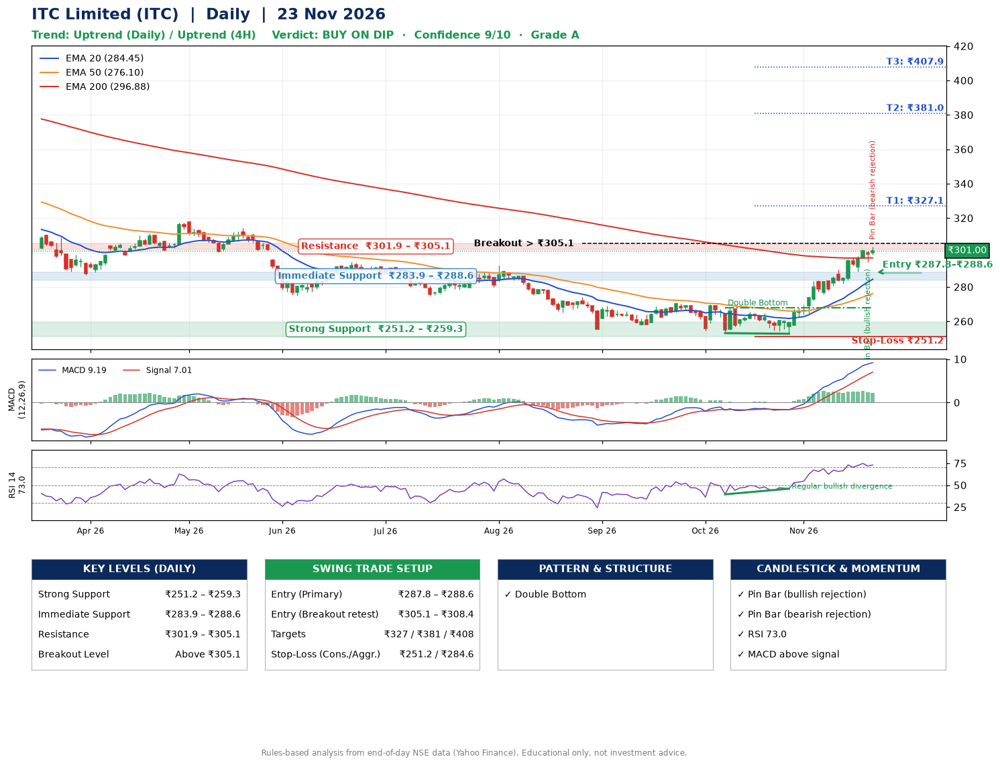

📌 **ITC Limited (ITC) – Multi-Timeframe Technical Analysis (Daily + 4H Combined)**
_Data up to 23 Nov 2026 · Close ₹301.00_

**📍 Daily Timeframe Trend**
- Trend: **Uptrend** (price above rising EMAs)
- Recent swing highs: ₹274.0, ₹271.0, ₹269.8 · swing lows: ₹257.7, ₹253.1, ₹252.8
- EMAs: EMA20 ₹284.5, EMA50 ₹276.1, EMA200 ₹296.9; mixed / crossing; price above EMA20, EMA50, EMA200
- MACD 9.19 above signal 7.01 (above zero); histogram falling
- RSI(14) 73.0; Regular bullish divergence

**📍 4-Hour Timeframe Trend**
- Structure: **Uptrend** (higher highs and higher lows)
- Pullback/support area: recent 4H swing lows ₹282.2, ₹289.0; EMA20 ₹292.0
- EMA20/50: bullish stack (EMA20 > EMA50); price above EMA20, EMA50
- MACD 7.10 above signal 6.93 (above zero); histogram falling
- RSI(14) 73.4; Hidden bullish divergence

**📍 Pattern Detection (Both Timeframes)**
- Daily: **Double Bottom** – bottoms near ₹253.1/₹252.8, neckline ₹268.0, confirmed (closed above neckline)

**📍 Candlestick Patterns (last 3 daily candles)**
- **Pin Bar (bullish rejection)** – 20 Nov: long lower wick shows dip-buying near ₹294.3
- **Pin Bar (bearish rejection)** – 23 Nov: long upper wick shows selling near ₹303.5

**📍 Price Action Key Levels (Daily Structure)**

| Zone | Price Level (₹) | Context |
|------|-----------------|---------|
| Strong Support | ₹251.2 – ₹259.3 | Cluster of earlier swing lows (demand) |
| Immediate Support | ₹283.9 – ₹288.6 | Nearest swing-low / wick area |
| Resistance | ₹301.9 – ₹305.1 | Nearest swing-high supply |
| Breakout Level | Above ₹305.1 | Swing continuation trigger (52-week high ₹409.5) |

**📍 Swing Trade Setup**

🟢 **Entry Zone**
- Primary: ₹287.8 – ₹288.6 (daily support / EMA20 area; enter on a bullish 4H candle)
- Alternate: ₹305.1 – ₹308.4 (breakout retest)

🎯 **Profit Targets**
- T1: ₹327.1
- T2: ₹381.0
- T3: ₹407.9

🛑 **Stop-Loss**
- Conservative: below daily swing low (₹251.2)
- Aggressive: below 4H structure (₹284.6)
- Risk per share ≈ ₹37.1; reward:risk to T1 ≈ 1.0
- Time to T1: it never rose this much within 60 trading days in the price history
- Time to T2: it never rose this much within 60 trading days in the price history

**📌 Strategy Notes**
- Higher timeframe: daily trend is uptrend; only take longs while price holds above ₹251.2.
- Entry timing: wait for a bullish 4H candle (engulfing/hammer) inside ₹287.8 – ₹288.6 rather than buying mid-range.
- EMA stacking: mixed / crossing; price above EMA20, EMA50, EMA200.
- Breakout rule: a daily close above ₹305.1 with volume above its 20-day average (≈22,897,978) opens T2/T3.
- Momentum: RSI 73 – elevated, prefer dips; Regular bullish divergence.
- Exit discipline: move the stop to entry once T1 is hit; book partial profits at each target.

**STEP 2 — Marked Up Chart**

**✅ Trade Validation Checklist**
- Trend + momentum aligned: Yes · Price at entry zone: No
- Stop defined (₹251.2) · Reward:risk ≥ 1.5 to T1: No

## 📌 Final Verdict

Recommendation: **🟡 BUY ON DIP**

Confidence: **9/10**

Trade Quality: **A**

Reason:
• Daily uptrend (price above rising EMAs)
• Double Bottom: bottoms near ₹253.1/₹252.8, neckline ₹268.0, confirmed (closed above neckline)

Next Action:
• Wait for a pullback to ₹287.8–₹288.6

_Rules-based analysis from end-of-day data. Educational only, not investment advice. Never place orders without your own confirmation._