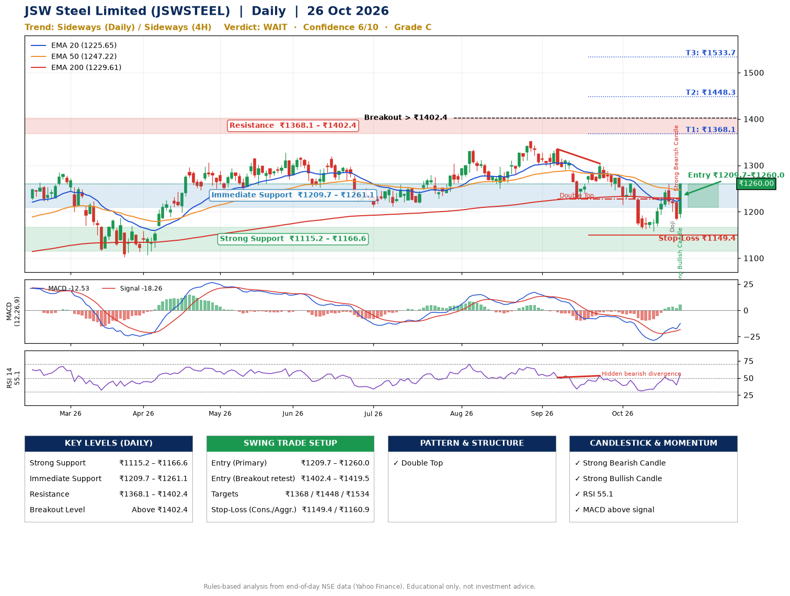

📌 **JSW Steel Limited (JSWSTEEL) – Multi-Timeframe Technical Analysis (Daily + 4H Combined)**
_Data up to 26 Oct 2026 · Close ₹1260.00_

**📍 Daily Timeframe Trend**
- Trend: **Sideways** (mixed swing structure)
- Recent swing highs: ₹1351.0, ₹1335.0, ₹1304.0 · swing lows: ₹1250.4, ₹1227.0, ₹1158.0
- EMAs: EMA20 ₹1225.6, EMA50 ₹1247.2, EMA200 ₹1229.6; mixed / crossing; price above EMA20, EMA50, EMA200
- MACD -12.53 above signal -18.26 (below zero), fresh bullish crossover; histogram rising
- RSI(14) 55.1; Hidden bearish divergence

**📍 4-Hour Timeframe Trend**
- Structure: **Sideways** (mixed swing structure)
- Pullback/support area: recent 4H swing lows ₹1214.8, ₹1163.3; EMA20 ₹1215.3
- EMA20/50: bearish stack (EMA20 < EMA50); price above EMA20, EMA50
- MACD 0.04 above signal -4.69 (above zero); histogram rising
- RSI(14) 61.2; Hidden bearish divergence

**📍 Pattern Detection (Both Timeframes)**
- Daily: **Double Top** – tops near ₹1335.0/₹1304.0, neckline ₹1227.0, forming
- 4H: **Double Top** – tops near ₹1261.2/₹1260.9, neckline ₹1163.3, forming

**📍 Candlestick Patterns (last 3 daily candles)**
- **Doji** – 22 Oct: indecision; wait for the next candle to confirm direction
- **Strong Bearish Candle** – 23 Oct: wide-range red candle, sellers in control
- **Strong Bullish Candle** – 26 Oct: wide-range green candle, buyers in control

**📍 Price Action Key Levels (Daily Structure)**

| Zone | Price Level (₹) | Context |
|------|-----------------|---------|
| Strong Support | ₹1115.2 – ₹1166.6 | Cluster of earlier swing lows (demand) |
| Immediate Support | ₹1209.7 – ₹1261.1 | Nearest swing-low / wick area |
| Resistance | ₹1368.1 – ₹1402.4 | Nearest swing-high supply |
| Breakout Level | Above ₹1402.4 | Swing continuation trigger (52-week high ₹1351.0) |

**📍 Swing Trade Setup**

🟢 **Entry Zone**
- Primary: ₹1209.7 – ₹1260.0 (daily support / EMA20 area; enter on a bullish 4H candle)
- Alternate: ₹1402.4 – ₹1419.5 (breakout retest)

🎯 **Profit Targets**
- T1: ₹1368.1
- T2: ₹1448.3
- T3: ₹1533.7

🛑 **Stop-Loss**
- Conservative: below daily swing low (₹1149.4)
- Aggressive: below 4H structure (₹1160.9)
- Risk per share ≈ ₹85.4; reward:risk to T1 ≈ 1.6

**📌 Strategy Notes**
- Higher timeframe: daily trend is sideways; only take longs while price holds above ₹1115.2.
- Entry timing: wait for a bullish 4H candle (engulfing/hammer) inside ₹1209.7 – ₹1260.0 rather than buying mid-range.
- EMA stacking: mixed / crossing; price above EMA20, EMA50, EMA200.
- Breakout rule: a daily close above ₹1402.4 with volume above its 20-day average (≈1,924,039) opens T2/T3.
- Momentum: RSI 55 – room to run; Hidden bearish divergence.
- Exit discipline: move the stop to entry once T1 is hit; book partial profits at each target.

**STEP 2 — Marked Up Chart**

**✅ Trade Validation Checklist**
- Trend + momentum aligned: No · Price at entry zone: Yes
- Stop defined (₹1149.4) · Reward:risk ≥ 1.5 to T1: Yes

## 📌 Final Verdict

Recommendation: **🟠 WAIT**

Confidence: **6/10**

Trade Quality: **C**

Reason:
• Double Top: tops near ₹1335.0/₹1304.0, neckline ₹1227.0, forming

Next Action:
• Wait for a breakout above ₹1402.4

_Rules-based analysis from end-of-day data. Educational only, not investment advice. Never place orders without your own confirmation._