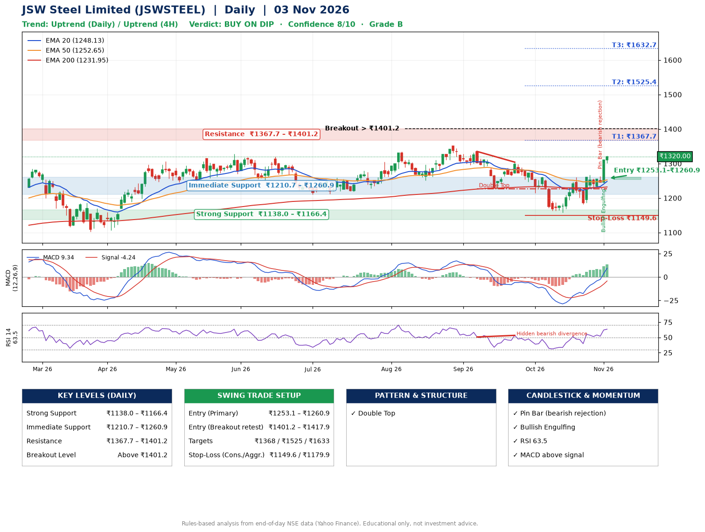

📌 **JSW Steel Limited (JSWSTEEL) – Multi-Timeframe Technical Analysis (Daily + 4H Combined)**
_Data up to 03 Nov 2026 · Close ₹1320.00_

**📍 Daily Timeframe Trend**
- Trend: **Uptrend** (price above rising EMAs)
- Recent swing highs: ₹1351.0, ₹1335.0, ₹1304.0 · swing lows: ₹1250.4, ₹1227.0, ₹1158.0
- EMAs: EMA20 ₹1248.1, EMA50 ₹1252.6, EMA200 ₹1232.0; mixed / crossing; price above EMA20, EMA50, EMA200
- MACD 9.34 above signal -4.24 (above zero); histogram rising
- RSI(14) 63.5; Hidden bearish divergence

**📍 4-Hour Timeframe Trend**
- Structure: **Uptrend** (higher highs and higher lows)
- Pullback/support area: recent 4H swing lows ₹1163.3, ₹1182.0; EMA20 ₹1259.3
- EMA20/50: bullish stack (EMA20 > EMA50); price above EMA20, EMA50
- MACD 22.57 above signal 13.35 (above zero); histogram rising
- RSI(14) 71.4; no divergence

**📍 Pattern Detection (Both Timeframes)**
- Daily: **Double Top** – tops near ₹1335.0/₹1304.0, neckline ₹1227.0, forming
- 4H: **Double Bottom** – bottoms near ₹1163.3/₹1182.0, neckline ₹1260.9, confirmed (closed above neckline)

**📍 Candlestick Patterns (last 3 daily candles)**
- **Pin Bar (bearish rejection)** – 30 Oct: long upper wick shows selling near ₹1263.6
- **Bullish Engulfing** – 02 Nov: buyers fully reversed the prior red candle

**📍 Price Action Key Levels (Daily Structure)**

| Zone | Price Level (₹) | Context |
|------|-----------------|---------|
| Strong Support | ₹1138.0 – ₹1166.4 | Cluster of earlier swing lows (demand) |
| Immediate Support | ₹1210.7 – ₹1260.9 | Nearest swing-low / wick area |
| Resistance | ₹1367.7 – ₹1401.2 | Nearest swing-high supply |
| Breakout Level | Above ₹1401.2 | Swing continuation trigger (52-week high ₹1351.0) |

**📍 Swing Trade Setup**

🟢 **Entry Zone**
- Primary: ₹1253.1 – ₹1260.9 (daily support / EMA20 area; enter on a bullish 4H candle)
- Alternate: ₹1401.2 – ₹1417.9 (breakout retest)

🎯 **Profit Targets**
- T1: ₹1367.7
- T2: ₹1525.4
- T3: ₹1632.7

🛑 **Stop-Loss**
- Conservative: below daily swing low (₹1149.6)
- Aggressive: below 4H structure (₹1179.9)
- Risk per share ≈ ₹107.3; reward:risk to T1 ≈ 1.0

**📌 Strategy Notes**
- Higher timeframe: daily trend is uptrend; only take longs while price holds above ₹1138.0.
- Entry timing: wait for a bullish 4H candle (engulfing/hammer) inside ₹1253.1 – ₹1260.9 rather than buying mid-range.
- EMA stacking: mixed / crossing; price above EMA20, EMA50, EMA200.
- Breakout rule: a daily close above ₹1401.2 with volume above its 20-day average (≈2,092,141) opens T2/T3.
- Momentum: RSI 63 – room to run; Hidden bearish divergence.
- Exit discipline: move the stop to entry once T1 is hit; book partial profits at each target.

**STEP 2 — Marked Up Chart**

**✅ Trade Validation Checklist**
- Trend + momentum aligned: Yes · Price at entry zone: No
- Stop defined (₹1149.6) · Reward:risk ≥ 1.5 to T1: No

## 📌 Final Verdict

Recommendation: **🟡 BUY ON DIP**

Confidence: **8/10**

Trade Quality: **B**

Reason:
• Daily uptrend (price above rising EMAs)
• Double Top: tops near ₹1335.0/₹1304.0, neckline ₹1227.0, forming

Next Action:
• Wait for a pullback to ₹1253.1–₹1260.9

_Rules-based analysis from end-of-day data. Educational only, not investment advice. Never place orders without your own confirmation._