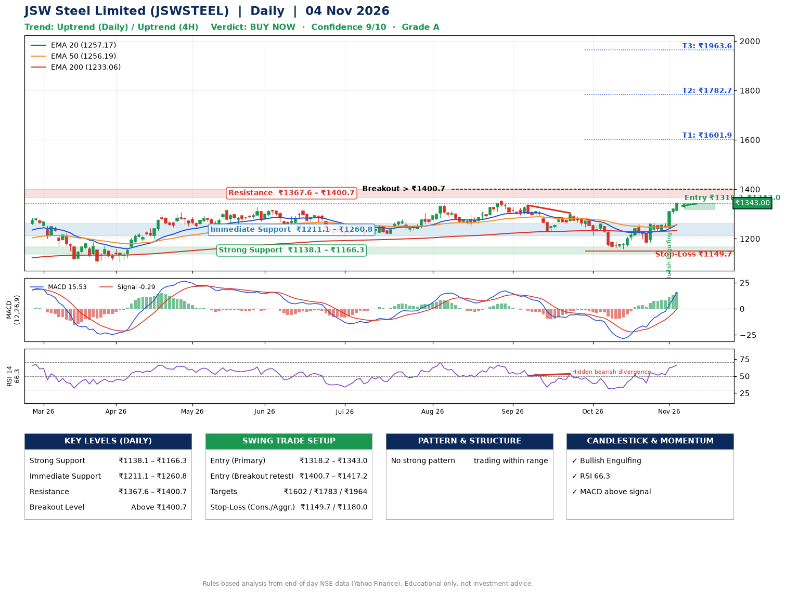

📌 **JSW Steel Limited (JSWSTEEL) – Multi-Timeframe Technical Analysis (Daily + 4H Combined)**
_Data up to 04 Nov 2026 · Close ₹1343.00_

**📍 Daily Timeframe Trend**
- Trend: **Uptrend** (price above rising EMAs)
- Recent swing highs: ₹1351.0, ₹1335.0, ₹1304.0 · swing lows: ₹1250.4, ₹1227.0, ₹1158.0
- EMAs: EMA20 ₹1257.2, EMA50 ₹1256.2, EMA200 ₹1233.1; bullish stack (EMA20 > EMA50 > EMA200); price above EMA20, EMA50, EMA200
- MACD 15.53 above signal -0.29 (above zero); histogram rising
- RSI(14) 66.3; Hidden bearish divergence

**📍 4-Hour Timeframe Trend**
- Structure: **Uptrend** (higher highs and higher lows)
- Pullback/support area: recent 4H swing lows ₹1163.3, ₹1182.0; EMA20 ₹1273.6
- EMA20/50: bullish stack (EMA20 > EMA50); price above EMA20, EMA50
- MACD 28.32 above signal 18.29 (above zero); histogram rising
- RSI(14) 75.1; no divergence

**📍 Pattern Detection (Both Timeframes)**
- 4H: **Double Bottom** – bottoms near ₹1163.3/₹1182.0, neckline ₹1260.9, confirmed (closed above neckline)

**📍 Candlestick Patterns (last 3 daily candles)**
- **Bullish Engulfing** – 02 Nov: buyers fully reversed the prior red candle

**📍 Price Action Key Levels (Daily Structure)**

| Zone | Price Level (₹) | Context |
|------|-----------------|---------|
| Strong Support | ₹1138.1 – ₹1166.3 | Cluster of earlier swing lows (demand) |
| Immediate Support | ₹1211.1 – ₹1260.8 | Nearest swing-low / wick area |
| Resistance | ₹1367.6 – ₹1400.7 | Nearest swing-high supply |
| Breakout Level | Above ₹1400.7 | Swing continuation trigger (52-week high ₹1351.0) |

**📍 Swing Trade Setup**

🟢 **Entry Zone**
- Primary: ₹1318.2 – ₹1343.0 (daily support / EMA20 area; enter on a bullish 4H candle)
- Alternate: ₹1400.7 – ₹1417.2 (breakout retest)

🎯 **Profit Targets**
- T1: ₹1601.9
- T2: ₹1782.7
- T3: ₹1963.6

🛑 **Stop-Loss**
- Conservative: below daily swing low (₹1149.7)
- Aggressive: below 4H structure (₹1180.0)
- Risk per share ≈ ₹180.9; reward:risk to T1 ≈ 1.5

**📌 Strategy Notes**
- Higher timeframe: daily trend is uptrend; only take longs while price holds above ₹1138.1.
- Entry timing: wait for a bullish 4H candle (engulfing/hammer) inside ₹1318.2 – ₹1343.0 rather than buying mid-range.
- EMA stacking: bullish stack (EMA20 > EMA50 > EMA200); price above EMA20, EMA50, EMA200.
- Breakout rule: a daily close above ₹1400.7 with volume above its 20-day average (≈2,099,391) opens T2/T3.
- Momentum: RSI 66 – elevated, prefer dips; Hidden bearish divergence.
- Exit discipline: move the stop to entry once T1 is hit; book partial profits at each target.

**STEP 2 — Marked Up Chart**

**✅ Trade Validation Checklist**
- Trend + momentum aligned: Yes · Price at entry zone: Yes
- Stop defined (₹1149.7) · Reward:risk ≥ 1.5 to T1: Yes

## 📌 Final Verdict

Recommendation: **🟢 BUY NOW**

Confidence: **9/10**

Trade Quality: **A**

Reason:
• Daily uptrend (price above rising EMAs)
• EMAs stacked bullishly

Next Action:
• Buy now within the entry zone, with the stop-loss in place

_Rules-based analysis from end-of-day data. Educational only, not investment advice. Never place orders without your own confirmation._