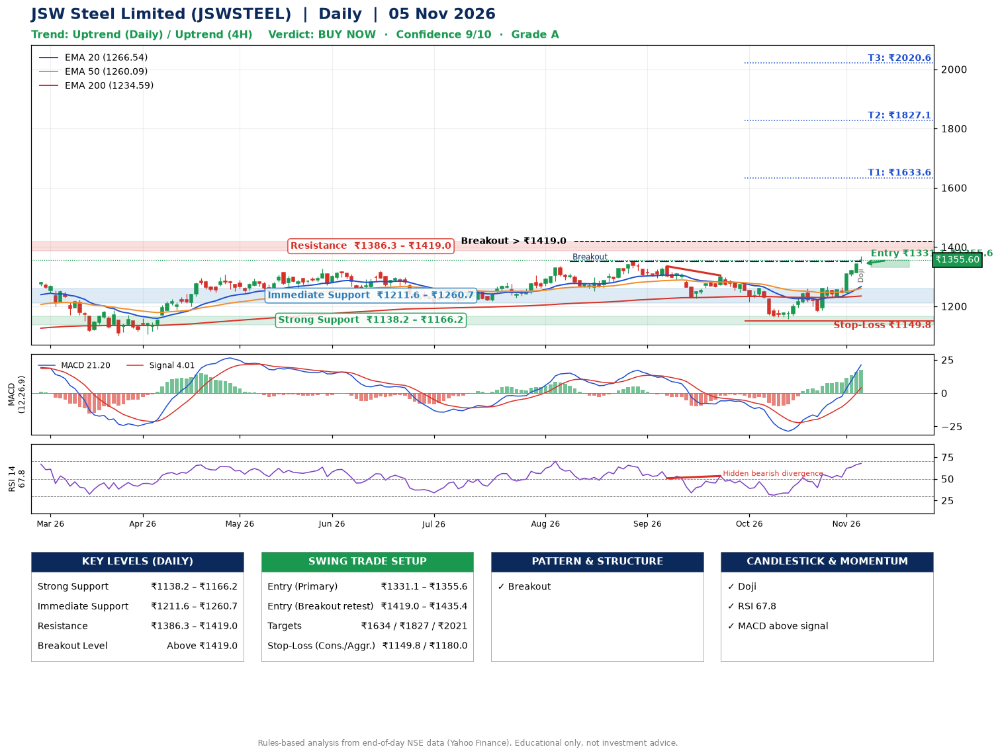

📌 **JSW Steel Limited (JSWSTEEL) – Multi-Timeframe Technical Analysis (Daily + 4H Combined)**
_Data up to 05 Nov 2026 · Close ₹1355.60_

**📍 Daily Timeframe Trend**
- Trend: **Uptrend** (price above rising EMAs)
- Recent swing highs: ₹1351.0, ₹1335.0, ₹1304.0 · swing lows: ₹1250.4, ₹1227.0, ₹1158.0
- EMAs: EMA20 ₹1266.5, EMA50 ₹1260.1, EMA200 ₹1234.6; bullish stack (EMA20 > EMA50 > EMA200); price above EMA20, EMA50, EMA200
- MACD 21.20 above signal 4.01 (above zero); histogram rising
- RSI(14) 67.8; Hidden bearish divergence

**📍 4-Hour Timeframe Trend**
- Structure: **Uptrend** (higher highs and higher lows)
- Pullback/support area: recent 4H swing lows ₹1163.3, ₹1182.0; EMA20 ₹1288.4
- EMA20/50: bullish stack (EMA20 > EMA50); price above EMA20, EMA50
- MACD 33.10 above signal 23.32 (above zero); histogram falling
- RSI(14) 76.9; no divergence

**📍 Pattern Detection (Both Timeframes)**
- Daily: **Breakout** – closed above the 60-session high ₹1351.0 on strong volume
- 4H: **Double Bottom** – bottoms near ₹1163.3/₹1182.0, neckline ₹1260.9, confirmed (closed above neckline)

**📍 Candlestick Patterns (last 3 daily candles)**
- **Doji** – 05 Nov: indecision; wait for the next candle to confirm direction

**📍 Price Action Key Levels (Daily Structure)**

| Zone | Price Level (₹) | Context |
|------|-----------------|---------|
| Strong Support | ₹1138.2 – ₹1166.2 | Cluster of earlier swing lows (demand) |
| Immediate Support | ₹1211.6 – ₹1260.7 | Nearest swing-low / wick area |
| Resistance | ₹1386.3 – ₹1419.0 | Nearest swing-high supply |
| Breakout Level | Above ₹1419.0 | Swing continuation trigger (52-week high ₹1370.0) |

**📍 Swing Trade Setup**

🟢 **Entry Zone**
- Primary: ₹1331.1 – ₹1355.6 (daily support / EMA20 area; enter on a bullish 4H candle)
- Alternate: ₹1419.0 – ₹1435.4 (breakout retest)

🎯 **Profit Targets**
- T1: ₹1633.6
- T2: ₹1827.1
- T3: ₹2020.6

🛑 **Stop-Loss**
- Conservative: below daily swing low (₹1149.8)
- Aggressive: below 4H structure (₹1180.0)
- Risk per share ≈ ₹193.5; reward:risk to T1 ≈ 1.5

**📌 Strategy Notes**
- Higher timeframe: daily trend is uptrend; only take longs while price holds above ₹1138.2.
- Entry timing: wait for a bullish 4H candle (engulfing/hammer) inside ₹1331.1 – ₹1355.6 rather than buying mid-range.
- EMA stacking: bullish stack (EMA20 > EMA50 > EMA200); price above EMA20, EMA50, EMA200.
- Breakout rule: a daily close above ₹1419.0 with volume above its 20-day average (≈2,216,463) opens T2/T3.
- Momentum: RSI 68 – elevated, prefer dips; Hidden bearish divergence.
- Exit discipline: move the stop to entry once T1 is hit; book partial profits at each target.

**STEP 2 — Marked Up Chart**

**✅ Trade Validation Checklist**
- Trend + momentum aligned: Yes · Price at entry zone: Yes
- Stop defined (₹1149.8) · Reward:risk ≥ 1.5 to T1: No

## 📌 Final Verdict

Recommendation: **🟢 BUY NOW**

Confidence: **9/10**

Trade Quality: **A**

Reason:
• Daily uptrend (price above rising EMAs)
• EMAs stacked bullishly

Next Action:
• Buy now within the entry zone, with the stop-loss in place

_Rules-based analysis from end-of-day data. Educational only, not investment advice. Never place orders without your own confirmation._