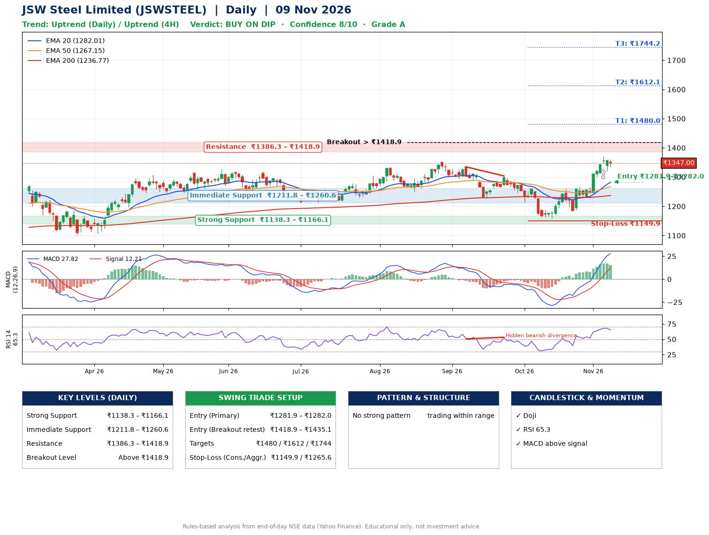

📌 **JSW Steel Limited (JSWSTEEL) – Multi-Timeframe Technical Analysis (Daily + 4H Combined)**
_Data up to 09 Nov 2026 · Close ₹1347.00_

**📍 Daily Timeframe Trend**
- Trend: **Uptrend** (price above rising EMAs)
- Recent swing highs: ₹1351.0, ₹1335.0, ₹1304.0 · swing lows: ₹1250.4, ₹1227.0, ₹1158.0
- EMAs: EMA20 ₹1282.0, EMA50 ₹1267.2, EMA200 ₹1236.8; bullish stack (EMA20 > EMA50 > EMA200); price above EMA20, EMA50, EMA200
- MACD 27.82 above signal 12.21 (above zero); histogram falling
- RSI(14) 65.3; Hidden bearish divergence

**📍 4-Hour Timeframe Trend**
- Structure: **Uptrend** (higher highs and higher lows)
- Pullback/support area: recent 4H swing lows ₹1182.0, ₹1321.7; EMA20 ₹1308.8
- EMA20/50: bullish stack (EMA20 > EMA50); price above EMA20, EMA50
- MACD 33.00 above signal 29.47 (above zero); histogram falling
- RSI(14) 70.4; no divergence

**📍 Pattern Detection (Both Timeframes)**
- No strong pattern detected. Trading within range.

**📍 Candlestick Patterns (last 3 daily candles)**
- **Doji** – 05 Nov: indecision; wait for the next candle to confirm direction

**📍 Price Action Key Levels (Daily Structure)**

| Zone | Price Level (₹) | Context |
|------|-----------------|---------|
| Strong Support | ₹1138.3 – ₹1166.1 | Cluster of earlier swing lows (demand) |
| Immediate Support | ₹1211.8 – ₹1260.6 | Nearest swing-low / wick area |
| Resistance | ₹1386.3 – ₹1418.9 | Nearest swing-high supply |
| Breakout Level | Above ₹1418.9 | Swing continuation trigger (52-week high ₹1370.0) |

**📍 Swing Trade Setup**

🟢 **Entry Zone**
- Primary: ₹1281.9 – ₹1282.0 (daily support / EMA20 area; enter on a bullish 4H candle)
- Alternate: ₹1418.9 – ₹1435.1 (breakout retest)

🎯 **Profit Targets**
- T1: ₹1480.0
- T2: ₹1612.1
- T3: ₹1744.2

🛑 **Stop-Loss**
- Conservative: below daily swing low (₹1149.9)
- Aggressive: below 4H structure (₹1265.6)
- Risk per share ≈ ₹132.1; reward:risk to T1 ≈ 1.5

**📌 Strategy Notes**
- Higher timeframe: daily trend is uptrend; only take longs while price holds above ₹1138.3.
- Entry timing: wait for a bullish 4H candle (engulfing/hammer) inside ₹1281.9 – ₹1282.0 rather than buying mid-range.
- EMA stacking: bullish stack (EMA20 > EMA50 > EMA200); price above EMA20, EMA50, EMA200.
- Breakout rule: a daily close above ₹1418.9 with volume above its 20-day average (≈2,236,071) opens T2/T3.
- Momentum: RSI 65 – elevated, prefer dips; Hidden bearish divergence.
- Exit discipline: move the stop to entry once T1 is hit; book partial profits at each target.

**STEP 2 — Marked Up Chart**

**✅ Trade Validation Checklist**
- Trend + momentum aligned: Yes · Price at entry zone: No
- Stop defined (₹1149.9) · Reward:risk ≥ 1.5 to T1: No

## 📌 Final Verdict

Recommendation: **🟡 BUY ON DIP**

Confidence: **8/10**

Trade Quality: **A**

Reason:
• Daily uptrend (price above rising EMAs)
• EMAs stacked bullishly

Next Action:
• Wait for a pullback to ₹1281.9–₹1282.0

_Rules-based analysis from end-of-day data. Educational only, not investment advice. Never place orders without your own confirmation._