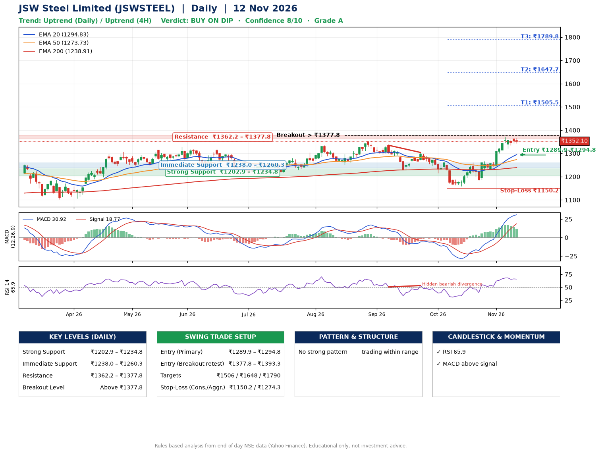

📌 **JSW Steel Limited (JSWSTEEL) – Multi-Timeframe Technical Analysis (Daily + 4H Combined)**
_Data up to 12 Nov 2026 · Close ₹1352.10_

**📍 Daily Timeframe Trend**
- Trend: **Uptrend** (price above rising EMAs)
- Recent swing highs: ₹1351.0, ₹1335.0, ₹1304.0 · swing lows: ₹1250.4, ₹1227.0, ₹1158.0
- EMAs: EMA20 ₹1294.8, EMA50 ₹1273.7, EMA200 ₹1238.9; bullish stack (EMA20 > EMA50 > EMA200); price above EMA20, EMA50, EMA200
- MACD 30.92 above signal 18.77 (above zero); histogram falling
- RSI(14) 65.9; Hidden bearish divergence

**📍 4-Hour Timeframe Trend**
- Structure: **Uptrend** (higher highs and higher lows)
- Pullback/support area: recent 4H swing lows ₹1182.0, ₹1321.7; EMA20 ₹1323.7
- EMA20/50: bullish stack (EMA20 > EMA50); price above EMA20, EMA50
- MACD 29.55 below signal 30.30 (above zero), fresh bearish crossover; histogram falling
- RSI(14) 69.6; no divergence

**📍 Pattern Detection (Both Timeframes)**
- No strong pattern detected. Trading within range.

**📍 Candlestick Patterns (last 3 daily candles)**
- No notable candlestick signal in the last 3 sessions.

**📍 Price Action Key Levels (Daily Structure)**

| Zone | Price Level (₹) | Context |
|------|-----------------|---------|
| Strong Support | ₹1202.9 – ₹1234.8 | Cluster of earlier swing lows (demand) |
| Immediate Support | ₹1238.0 – ₹1260.3 | Nearest swing-low / wick area |
| Resistance | ₹1362.2 – ₹1377.8 | Nearest swing-high supply |
| Breakout Level | Above ₹1377.8 | Swing continuation trigger (52-week high ₹1370.0) |

**📍 Swing Trade Setup**

🟢 **Entry Zone**
- Primary: ₹1289.9 – ₹1294.8 (daily support / EMA20 area; enter on a bullish 4H candle)
- Alternate: ₹1377.8 – ₹1393.3 (breakout retest)

🎯 **Profit Targets**
- T1: ₹1505.5
- T2: ₹1647.7
- T3: ₹1789.8

🛑 **Stop-Loss**
- Conservative: below daily swing low (₹1150.2)
- Aggressive: below 4H structure (₹1274.3)
- Risk per share ≈ ₹142.1; reward:risk to T1 ≈ 1.5
- Time to T1: about 44 trading days (it rose this much within 60 trading days 11% of the time in the last 2 years)
- Time to T2: it never rose this much within 60 trading days in the price history

**📌 Strategy Notes**
- Higher timeframe: daily trend is uptrend; only take longs while price holds above ₹1202.9.
- Entry timing: wait for a bullish 4H candle (engulfing/hammer) inside ₹1289.9 – ₹1294.8 rather than buying mid-range.
- EMA stacking: bullish stack (EMA20 > EMA50 > EMA200); price above EMA20, EMA50, EMA200.
- Breakout rule: a daily close above ₹1377.8 with volume above its 20-day average (≈2,354,916) opens T2/T3.
- Momentum: RSI 66 – elevated, prefer dips; Hidden bearish divergence.
- Exit discipline: move the stop to entry once T1 is hit; book partial profits at each target.

**STEP 2 — Marked Up Chart**

**✅ Trade Validation Checklist**
- Trend + momentum aligned: Yes · Price at entry zone: No
- Stop defined (₹1150.2) · Reward:risk ≥ 1.5 to T1: No

## 📌 Final Verdict

Recommendation: **🟡 BUY ON DIP**

Confidence: **8/10**

Trade Quality: **A**

Reason:
• Daily uptrend (price above rising EMAs)
• EMAs stacked bullishly

Next Action:
• Wait for a pullback to ₹1289.9–₹1294.8

_Rules-based analysis from end-of-day data. Educational only, not investment advice. Never place orders without your own confirmation._