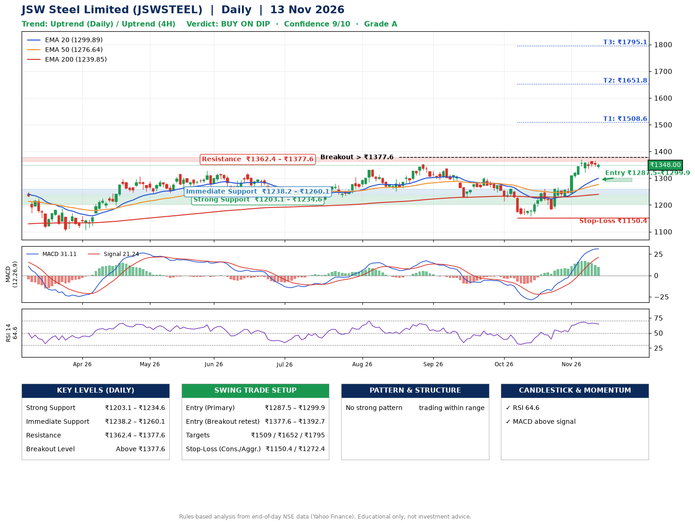

📌 **JSW Steel Limited (JSWSTEEL) – Multi-Timeframe Technical Analysis (Daily + 4H Combined)**
_Data up to 13 Nov 2026 · Close ₹1348.00_

**📍 Daily Timeframe Trend**
- Trend: **Uptrend** (price above rising EMAs)
- Recent swing highs: ₹1335.0, ₹1304.0, ₹1370.0 · swing lows: ₹1250.4, ₹1227.0, ₹1158.0
- EMAs: EMA20 ₹1299.9, EMA50 ₹1276.6, EMA200 ₹1239.8; bullish stack (EMA20 > EMA50 > EMA200); price above EMA20, EMA50, EMA200
- MACD 31.11 above signal 21.24 (above zero); histogram falling
- RSI(14) 64.6; no divergence on the last two swings

**📍 4-Hour Timeframe Trend**
- Structure: **Uptrend** (price above rising EMAs)
- Pullback/support area: recent 4H swing lows ₹1182.0, ₹1321.7; EMA20 ₹1328.3
- EMA20/50: bullish stack (EMA20 > EMA50); price above EMA20, EMA50
- MACD 26.38 below signal 29.16 (above zero), fresh bearish crossover; histogram falling
- RSI(14) 66.9; no divergence

**📍 Pattern Detection (Both Timeframes)**
- No strong pattern detected. Trading within range.

**📍 Candlestick Patterns (last 3 daily candles)**
- No notable candlestick signal in the last 3 sessions.

**📍 Price Action Key Levels (Daily Structure)**

| Zone | Price Level (₹) | Context |
|------|-----------------|---------|
| Strong Support | ₹1203.1 – ₹1234.6 | Cluster of earlier swing lows (demand) |
| Immediate Support | ₹1238.2 – ₹1260.1 | Nearest swing-low / wick area |
| Resistance | ₹1362.4 – ₹1377.6 | Nearest swing-high supply |
| Breakout Level | Above ₹1377.6 | Swing continuation trigger (52-week high ₹1370.0) |

**📍 Swing Trade Setup**

🟢 **Entry Zone**
- Primary: ₹1287.5 – ₹1299.9 (daily support / EMA20 area; enter on a bullish 4H candle)
- Alternate: ₹1377.6 – ₹1392.7 (breakout retest)

🎯 **Profit Targets**
- T1: ₹1508.6
- T2: ₹1651.8
- T3: ₹1795.1

🛑 **Stop-Loss**
- Conservative: below daily swing low (₹1150.4)
- Aggressive: below 4H structure (₹1272.4)
- Risk per share ≈ ₹143.3; reward:risk to T1 ≈ 1.5
- Time to T1: about 44 trading days (it rose this much within 60 trading days 11% of the time in the last 2 years)
- Time to T2: it never rose this much within 60 trading days in the price history

**📌 Strategy Notes**
- Higher timeframe: daily trend is uptrend; only take longs while price holds above ₹1203.1.
- Entry timing: wait for a bullish 4H candle (engulfing/hammer) inside ₹1287.5 – ₹1299.9 rather than buying mid-range.
- EMA stacking: bullish stack (EMA20 > EMA50 > EMA200); price above EMA20, EMA50, EMA200.
- Breakout rule: a daily close above ₹1377.6 with volume above its 20-day average (≈2,288,026) opens T2/T3.
- Momentum: RSI 65 – room to run; no divergence on the last two swings.
- Exit discipline: move the stop to entry once T1 is hit; book partial profits at each target.

**STEP 2 — Marked Up Chart**

**✅ Trade Validation Checklist**
- Trend + momentum aligned: Yes · Price at entry zone: No
- Stop defined (₹1150.4) · Reward:risk ≥ 1.5 to T1: Yes

## 📌 Final Verdict

Recommendation: **🟡 BUY ON DIP**

Confidence: **9/10**

Trade Quality: **A**

Reason:
• Daily uptrend (price above rising EMAs)
• EMAs stacked bullishly

Next Action:
• Wait for a pullback to ₹1287.5–₹1299.9

_Rules-based analysis from end-of-day data. Educational only, not investment advice. Never place orders without your own confirmation._