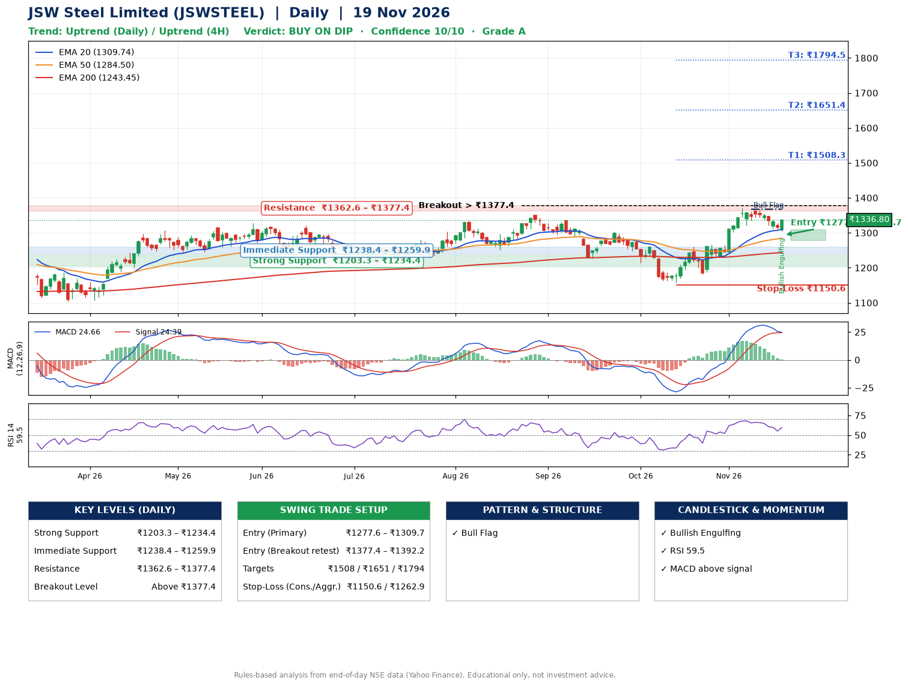

📌 **JSW Steel Limited (JSWSTEEL) – Multi-Timeframe Technical Analysis (Daily + 4H Combined)**
_Data up to 19 Nov 2026 · Close ₹1336.80_

**📍 Daily Timeframe Trend**
- Trend: **Uptrend** (price above rising EMAs)
- Recent swing highs: ₹1335.0, ₹1304.0, ₹1370.0 · swing lows: ₹1250.4, ₹1227.0, ₹1158.0
- EMAs: EMA20 ₹1309.7, EMA50 ₹1284.5, EMA200 ₹1243.5; bullish stack (EMA20 > EMA50 > EMA200); price above EMA20, EMA50, EMA200
- MACD 24.66 above signal 24.39 (above zero); histogram falling
- RSI(14) 59.5; no divergence on the last two swings

**📍 4-Hour Timeframe Trend**
- Structure: **Uptrend** (price above rising EMAs)
- Pullback/support area: recent 4H swing lows ₹1182.0, ₹1321.7; EMA20 ₹1327.3
- EMA20/50: bullish stack (EMA20 > EMA50); price above EMA20, EMA50
- MACD 9.32 below signal 15.79 (above zero); histogram rising
- RSI(14) 58.0; no divergence

**📍 Pattern Detection (Both Timeframes)**
- Daily: **Bull Flag** – 15% pole then a tight 5% flag; trigger above ₹1366.7

**📍 Candlestick Patterns (last 3 daily candles)**
- **Bullish Engulfing** – 19 Nov: buyers fully reversed the prior red candle

**📍 Price Action Key Levels (Daily Structure)**

| Zone | Price Level (₹) | Context |
|------|-----------------|---------|
| Strong Support | ₹1203.3 – ₹1234.4 | Cluster of earlier swing lows (demand) |
| Immediate Support | ₹1238.4 – ₹1259.9 | Nearest swing-low / wick area |
| Resistance | ₹1362.6 – ₹1377.4 | Nearest swing-high supply |
| Breakout Level | Above ₹1377.4 | Swing continuation trigger (52-week high ₹1370.0) |

**📍 Swing Trade Setup**

🟢 **Entry Zone**
- Primary: ₹1277.6 – ₹1309.7 (daily support / EMA20 area; enter on a bullish 4H candle)
- Alternate: ₹1377.4 – ₹1392.2 (breakout retest)

🎯 **Profit Targets**
- T1: ₹1508.3
- T2: ₹1651.4
- T3: ₹1794.5

🛑 **Stop-Loss**
- Conservative: below daily swing low (₹1150.6)
- Aggressive: below 4H structure (₹1262.9)
- Risk per share ≈ ₹143.1; reward:risk to T1 ≈ 1.5
- Time to T1: about 44 trading days (it rose this much within 60 trading days 11% of the time in the last 2 years)
- Time to T2: it never rose this much within 60 trading days in the price history

**📌 Strategy Notes**
- Higher timeframe: daily trend is uptrend; only take longs while price holds above ₹1203.3.
- Entry timing: wait for a bullish 4H candle (engulfing/hammer) inside ₹1277.6 – ₹1309.7 rather than buying mid-range.
- EMA stacking: bullish stack (EMA20 > EMA50 > EMA200); price above EMA20, EMA50, EMA200.
- Breakout rule: a daily close above ₹1377.4 with volume above its 20-day average (≈2,188,459) opens T2/T3.
- Momentum: RSI 60 – room to run; no divergence on the last two swings.
- Exit discipline: move the stop to entry once T1 is hit; book partial profits at each target.

**STEP 2 — Marked Up Chart**

**✅ Trade Validation Checklist**
- Trend + momentum aligned: Yes · Price at entry zone: No
- Stop defined (₹1150.6) · Reward:risk ≥ 1.5 to T1: No

## 📌 Final Verdict

Recommendation: **🟡 BUY ON DIP**

Confidence: **10/10**

Trade Quality: **A**

Reason:
• Daily uptrend (price above rising EMAs)
• EMAs stacked bullishly

Next Action:
• Wait for a pullback to ₹1277.6–₹1309.7, or a breakout above ₹1377.4

_Rules-based analysis from end-of-day data. Educational only, not investment advice. Never place orders without your own confirmation._