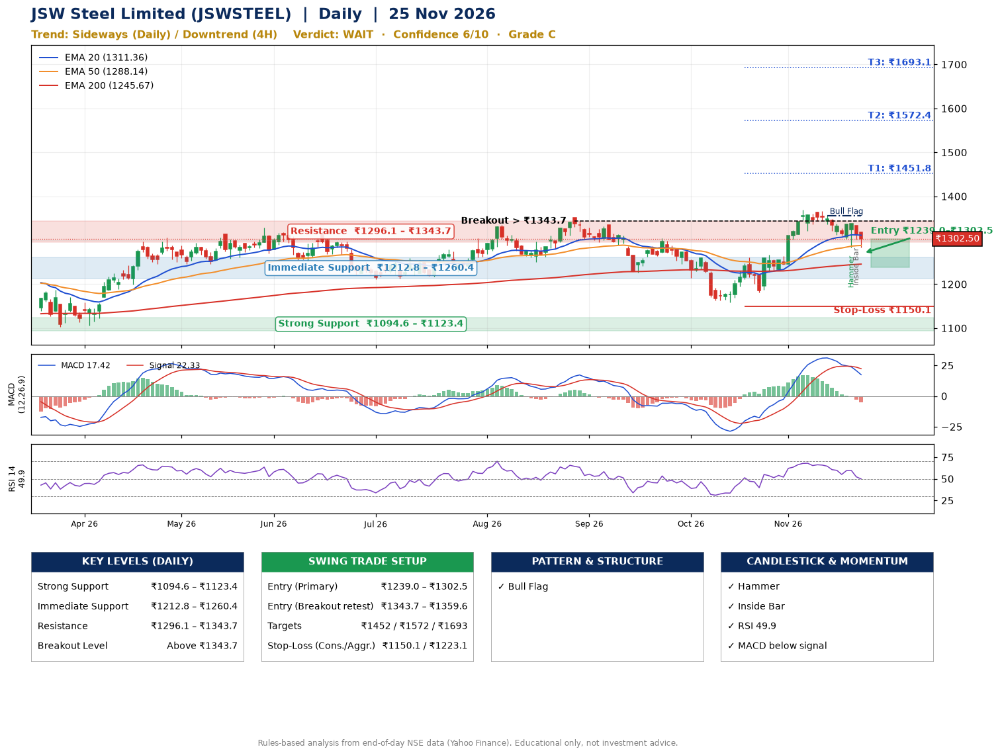

📌 **JSW Steel Limited (JSWSTEEL) – Multi-Timeframe Technical Analysis (Daily + 4H Combined)**
_Data up to 25 Nov 2026 · Close ₹1302.50_

**📍 Daily Timeframe Trend**
- Trend: **Sideways** (mixed swing structure)
- Recent swing highs: ₹1335.0, ₹1304.0, ₹1370.0 · swing lows: ₹1250.4, ₹1227.0, ₹1158.0
- EMAs: EMA20 ₹1311.4, EMA50 ₹1288.1, EMA200 ₹1245.7; bullish stack (EMA20 > EMA50 > EMA200); price above EMA50, EMA200
- MACD 17.42 below signal 22.33 (above zero), fresh bearish crossover; histogram falling
- RSI(14) 49.9; no divergence on the last two swings

**📍 4-Hour Timeframe Trend**
- Structure: **Downtrend** (lower highs and lower lows)
- Pullback/support area: recent 4H swing lows ₹1321.7, ₹1286.1; EMA20 ₹1318.7
- EMA20/50: bullish stack (EMA20 > EMA50); price below all EMAs
- MACD -1.05 below signal 6.09 (below zero); histogram rising
- RSI(14) 45.6; no divergence

**📍 Pattern Detection (Both Timeframes)**
- Daily: **Bull Flag** – 15% pole then a tight 5% flag; trigger above ₹1355.4
- 4H: **Double Top** – tops near ₹1365.9/₹1337.0, neckline ₹1286.1, forming
- 4H: **Double Bottom** – bottoms near ₹1321.7/₹1286.1, neckline ₹1365.9, forming
- 4H: **Symmetrical Triangle** – converging swing highs and lows over the last ~60 sessions

**📍 Candlestick Patterns (last 3 daily candles)**
- **Hammer** – 20 Nov: long lower wick shows dip-buying near ₹1284.1
- **Inside Bar** – 23 Nov: compression inside the prior range ₹1284.1–₹1337.0

**📍 Price Action Key Levels (Daily Structure)**

| Zone | Price Level (₹) | Context |
|------|-----------------|---------|
| Strong Support | ₹1094.6 – ₹1123.4 | Cluster of earlier swing lows (demand) |
| Immediate Support | ₹1212.8 – ₹1260.4 | Nearest swing-low / wick area |
| Resistance | ₹1296.1 – ₹1343.7 | Nearest swing-high supply |
| Breakout Level | Above ₹1343.7 | Swing continuation trigger (52-week high ₹1370.0) |

**📍 Swing Trade Setup**

🟢 **Entry Zone**
- Primary: ₹1239.0 – ₹1302.5 (daily support / EMA20 area; enter on a bullish 4H candle)
- Alternate: ₹1343.7 – ₹1359.6 (breakout retest)

🎯 **Profit Targets**
- T1: ₹1451.8
- T2: ₹1572.4
- T3: ₹1693.1

🛑 **Stop-Loss**
- Conservative: below daily swing low (₹1150.1)
- Aggressive: below 4H structure (₹1223.1)
- Risk per share ≈ ₹120.7; reward:risk to T1 ≈ 1.5
- Time to T1: about 42 trading days (it rose this much within 60 trading days 18% of the time in the last 2 years)
- Time to T2: it never rose this much within 60 trading days in the price history

**📌 Strategy Notes**
- Higher timeframe: daily trend is sideways; only take longs while price holds above ₹1094.6.
- Entry timing: wait for a bullish 4H candle (engulfing/hammer) inside ₹1239.0 – ₹1302.5 rather than buying mid-range.
- EMA stacking: bullish stack (EMA20 > EMA50 > EMA200); price above EMA50, EMA200.
- Breakout rule: a daily close above ₹1343.7 with volume above its 20-day average (≈2,196,590) opens T2/T3.
- Momentum: RSI 50 – room to run; no divergence on the last two swings.
- Exit discipline: move the stop to entry once T1 is hit; book partial profits at each target.

**STEP 2 — Marked Up Chart**

**✅ Trade Validation Checklist**
- Trend + momentum aligned: No · Price at entry zone: Yes
- Stop defined (₹1150.1) · Reward:risk ≥ 1.5 to T1: Yes

## 📌 Final Verdict

Recommendation: **🟠 WAIT**

Confidence: **6/10**

Trade Quality: **C**

Reason:
• EMAs stacked bullishly
• Bull Flag: 15% pole then a tight 5% flag; trigger above ₹1355.4

Next Action:
• Wait for a breakout above ₹1343.7

_Rules-based analysis from end-of-day data. Educational only, not investment advice. Never place orders without your own confirmation._