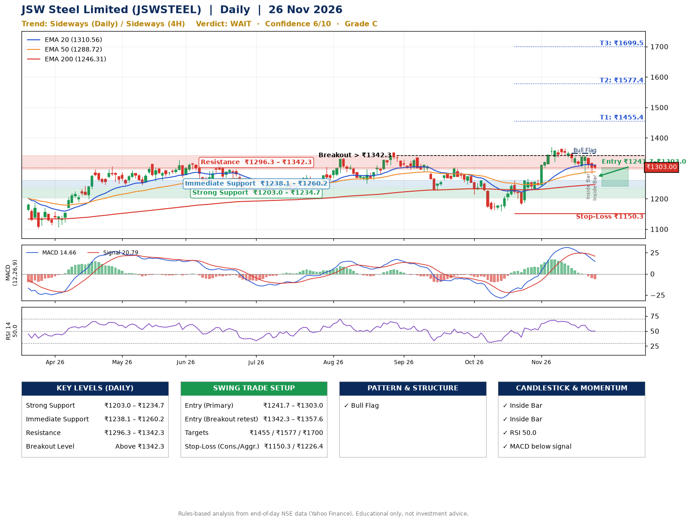

📌 **JSW Steel Limited (JSWSTEEL) – Multi-Timeframe Technical Analysis (Daily + 4H Combined)**
_Data up to 26 Nov 2026 · Close ₹1303.00_

**📍 Daily Timeframe Trend**
- Trend: **Sideways** (mixed swing structure)
- Recent swing highs: ₹1335.0, ₹1304.0, ₹1370.0 · swing lows: ₹1250.4, ₹1227.0, ₹1158.0
- EMAs: EMA20 ₹1310.6, EMA50 ₹1288.7, EMA200 ₹1246.3; bullish stack (EMA20 > EMA50 > EMA200); price above EMA50, EMA200
- MACD 14.66 below signal 20.79 (above zero), fresh bearish crossover; histogram falling
- RSI(14) 50.0; no divergence on the last two swings

**📍 4-Hour Timeframe Trend**
- Structure: **Sideways** (mixed swing structure)
- Pullback/support area: recent 4H swing lows ₹1286.1, ₹1283.6; EMA20 ₹1316.0
- EMA20/50: bullish stack (EMA20 > EMA50); price above EMA50
- MACD -2.59 below signal 3.09 (below zero); histogram rising
- RSI(14) 45.9; no divergence

**📍 Pattern Detection (Both Timeframes)**
- Daily: **Bull Flag** – 15% pole then a tight 5% flag; trigger above ₹1348.8
- 4H: **Double Top** – tops near ₹1365.9/₹1337.0, neckline ₹1286.1, forming

**📍 Candlestick Patterns (last 3 daily candles)**
- **Inside Bar** – 23 Nov: compression inside the prior range ₹1284.1–₹1337.0
- **Inside Bar** – 26 Nov: compression inside the prior range ₹1283.5–₹1318.9

**📍 Price Action Key Levels (Daily Structure)**

| Zone | Price Level (₹) | Context |
|------|-----------------|---------|
| Strong Support | ₹1203.0 – ₹1234.7 | Cluster of earlier swing lows (demand) |
| Immediate Support | ₹1238.1 – ₹1260.2 | Nearest swing-low / wick area |
| Resistance | ₹1296.3 – ₹1342.3 | Nearest swing-high supply |
| Breakout Level | Above ₹1342.3 | Swing continuation trigger (52-week high ₹1370.0) |

**📍 Swing Trade Setup**

🟢 **Entry Zone**
- Primary: ₹1241.7 – ₹1303.0 (daily support / EMA20 area; enter on a bullish 4H candle)
- Alternate: ₹1342.3 – ₹1357.6 (breakout retest)

🎯 **Profit Targets**
- T1: ₹1455.4
- T2: ₹1577.4
- T3: ₹1699.5

🛑 **Stop-Loss**
- Conservative: below daily swing low (₹1150.3)
- Aggressive: below 4H structure (₹1226.4)
- Risk per share ≈ ₹122.0; reward:risk to T1 ≈ 1.5
- Time to T1: about 41 trading days (it rose this much within 60 trading days 17% of the time in the last 2 years)
- Time to T2: it never rose this much within 60 trading days in the price history

**📌 Strategy Notes**
- Higher timeframe: daily trend is sideways; only take longs while price holds above ₹1203.0.
- Entry timing: wait for a bullish 4H candle (engulfing/hammer) inside ₹1241.7 – ₹1303.0 rather than buying mid-range.
- EMA stacking: bullish stack (EMA20 > EMA50 > EMA200); price above EMA50, EMA200.
- Breakout rule: a daily close above ₹1342.3 with volume above its 20-day average (≈2,178,550) opens T2/T3.
- Momentum: RSI 50 – room to run; no divergence on the last two swings.
- Exit discipline: move the stop to entry once T1 is hit; book partial profits at each target.

**STEP 2 — Marked Up Chart**

**✅ Trade Validation Checklist**
- Trend + momentum aligned: No · Price at entry zone: Yes
- Stop defined (₹1150.3) · Reward:risk ≥ 1.5 to T1: No

## 📌 Final Verdict

Recommendation: **🟠 WAIT**

Confidence: **6/10**

Trade Quality: **C**

Reason:
• EMAs stacked bullishly
• Bull Flag: 15% pole then a tight 5% flag; trigger above ₹1348.8

Next Action:
• Wait for a breakout above ₹1342.3

_Rules-based analysis from end-of-day data. Educational only, not investment advice. Never place orders without your own confirmation._